# AD secondaire - second contrôleur de domaine DC02

| | |
| --- | --- |
| **Chantier** | 7 sur 9 |
| **Objectif** | Ajouter un second contrôleur de domaine `DC02` pour que l'annuaire et le DNS restent disponibles si `DC01` tombe |
| **Prérequis** | [Serveur DC01](../Serveur/Serveur.md) et [Active Directory](../Active%20Directory/Active-Directory.md) en place |
| **Résultat** | `DC02` contrôleur de domaine de `redone.local`, avec DNS et catalogue global, qui réplique l'annuaire de `DC01` |
| **Suite** | GLPI (à venir) |

## 1. Valeurs retenues

| Paramètre | Valeur |
| --- | --- |
| Nom de la VM (Proxmox) | `DC02-REDONE`, VMID 602 |
| Nom de l'hôte (Windows) | `DC02` |
| Système | Windows Server 2022 Standard Evaluation (expérience de bureau) |
| Processeur, mémoire, disque | 2 sockets × 2 cœurs (4 vCPU), 4096 Mio, 64 Gio sur `Raid5-VMs` (bus IDE) |
| Réseau | pont `vmbr2`, **VLAN 600**, modèle Intel E1000, pare-feu Proxmox activé |
| Adresse IP | 10.2.81.3/24 |
| Passerelle | 10.2.81.1 |
| DNS | préféré 10.2.81.2 (`DC01`), auxiliaire 10.2.81.3 (lui-même) |

La VM est créée comme `DC01` : seuls le nom, le VMID et l'adresse changent.

## 2. Créer la machine virtuelle

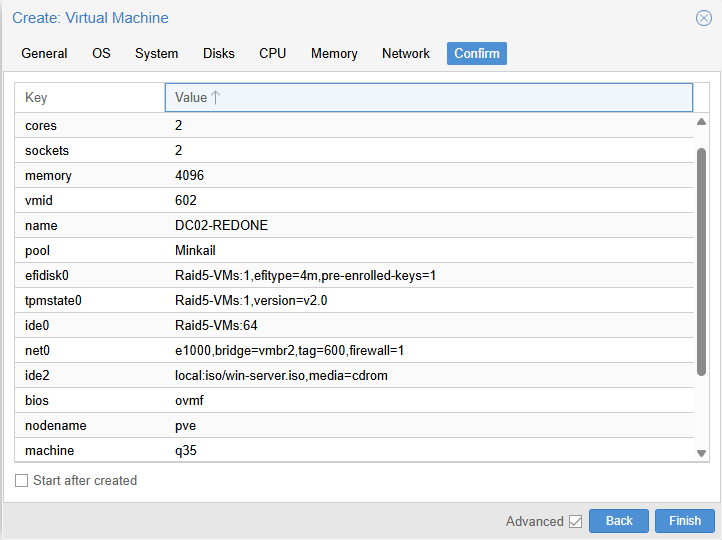

Les paramètres sont ceux de `DC01` : UEFI (OVMF) avec disque EFI, TPM 2.0, chipset q35, disque IDE de 64 Gio, ISO `win-server.iso` et carte `e1000` avec **`tag=600`**.

## 3. Installer Windows Server 2022

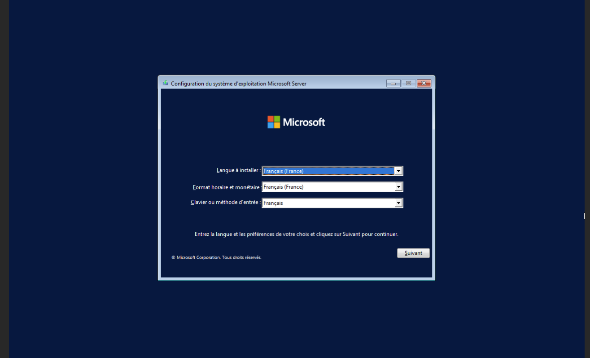

Édition **Windows Server 2022 Standard Evaluation (expérience de bureau)**, comme `DC01`.

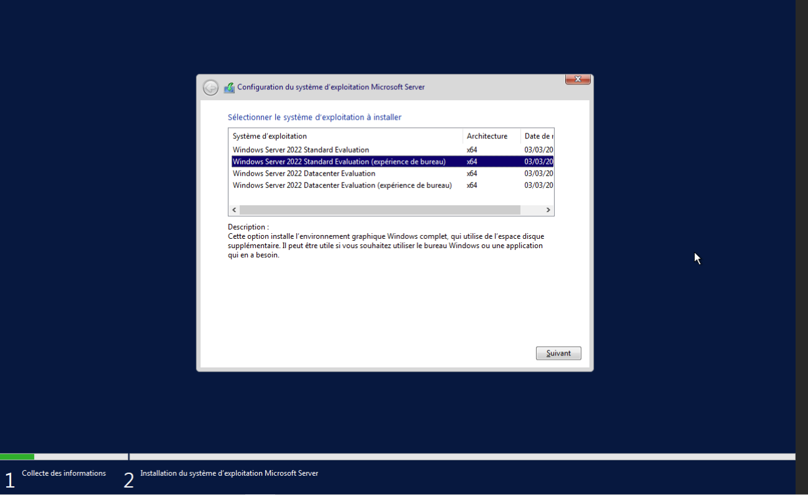

Le disque de 64 Go apparaît en espace non alloué : l'installateur crée les partitions.

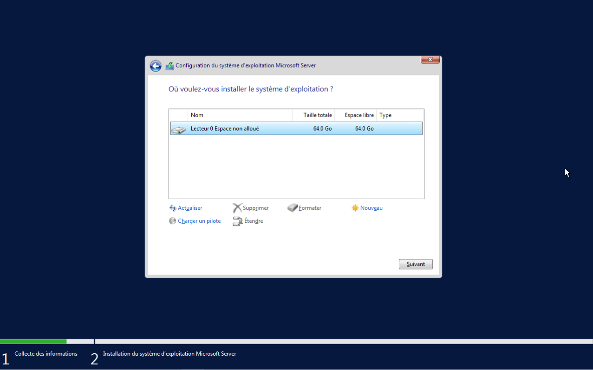

## 4. Renommer le serveur

Je renomme le serveur **`DC02`** avant la promotion, puis je redémarre. Le nom est ensuite inscrit dans l'annuaire et le DNS.

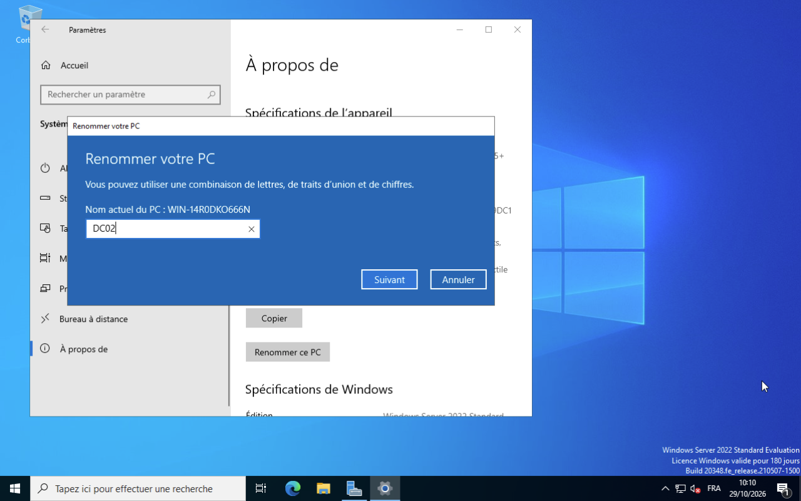

## 5. Réseau et tests

IP fixe `10.2.81.3`, passerelle `10.2.81.1`. Le **DNS préféré est `DC01` (`10.2.81.2`)** : c'est lui qui connaît le domaine `redone.local`, et `DC02` en a besoin pour le trouver au moment de la promotion. L'adresse de `DC02` lui-même est en auxiliaire.

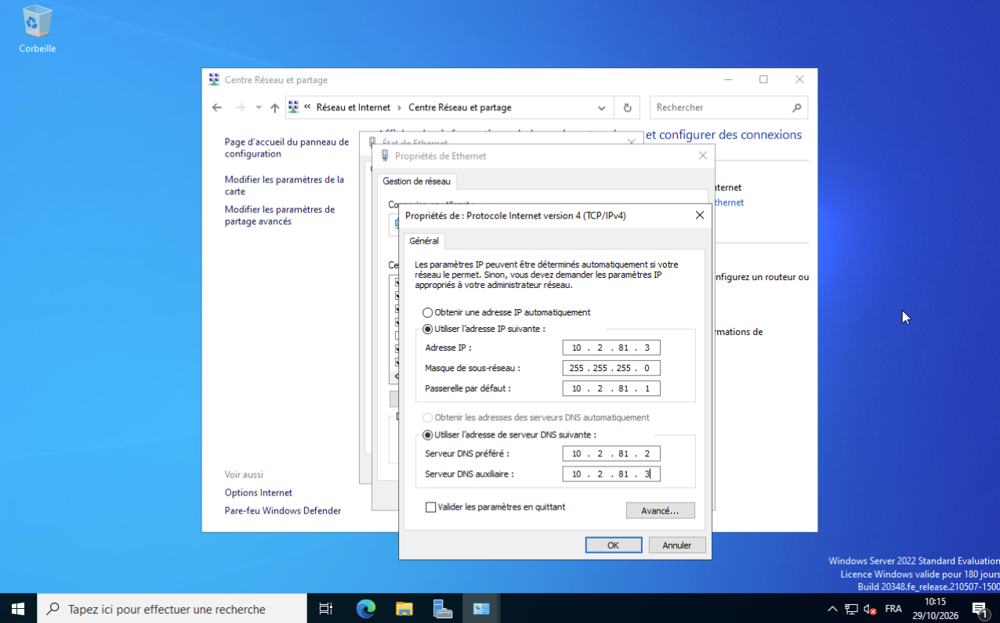

Deux tests avant d'aller plus loin :

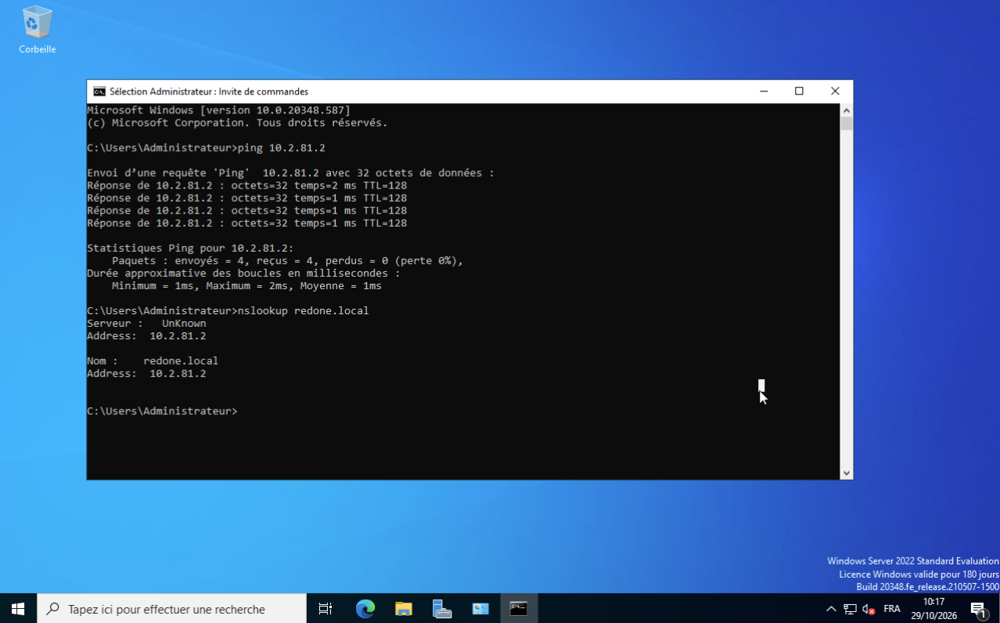

| Test | Résultat |
| --- | --- |
| `ping 10.2.81.2` | 4 réponses, 1 à 2 ms, 0 % de perte : `DC01` est joignable |
| `nslookup redone.local` | Réponse `10.2.81.2` : le DNS de `DC01` résout le domaine |

## 6. Installer le rôle AD DS

Dans le Gestionnaire de serveur, *Ajouter des rôles et des fonctionnalités*, je coche **Services AD DS**.

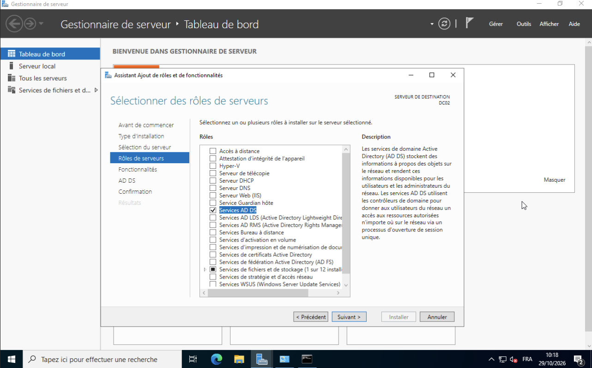

L'installation réussit. Le lien *Promouvoir ce serveur en contrôleur de domaine* lance l'étape suivante.

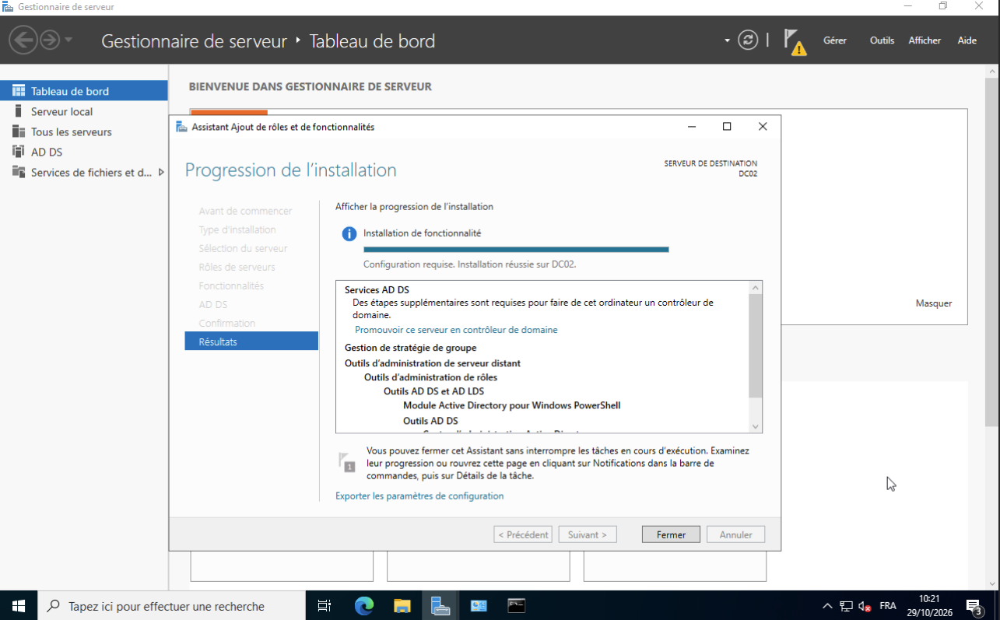

## 7. Promouvoir DC02

Choix de l'opération : **Ajouter un contrôleur de domaine à un domaine existant**, domaine `redone.local`. Je ne crée ni nouveau domaine ni nouvelle forêt : `DC02` rejoint celui de `DC01`.

**Un piège rencontré.** L'assistant propose par défaut le compte local `DC02\Administrateur`. Il refuse d'avancer avec le message « Vous devez fournir le nom d'un compte d'utilisateur ».

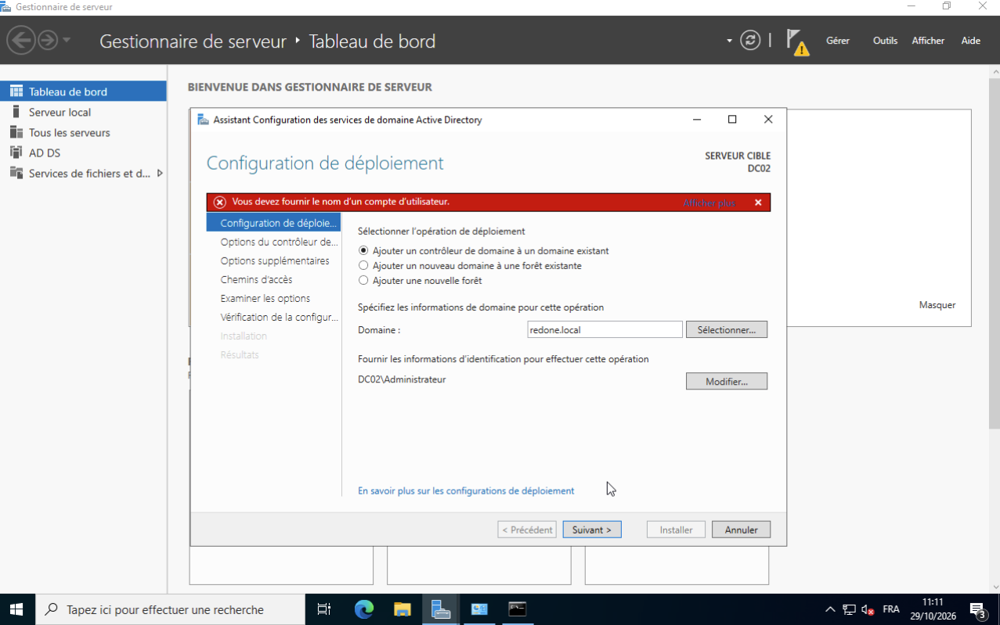

Il faut cliquer sur *Modifier...* et fournir un compte **du domaine**, `REDONE\Administrateur` : seul un administrateur du domaine peut ajouter un contrôleur.

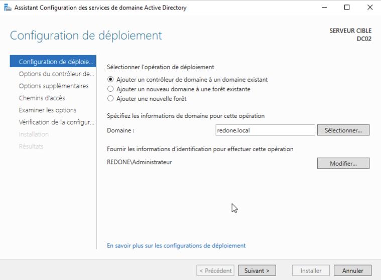

Options du contrôleur de domaine :

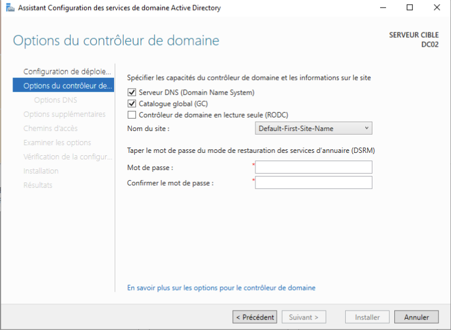

| Option | Choix | Pourquoi |
| --- | --- | --- |
| Serveur DNS | coché | `DC02` répond lui aussi aux requêtes DNS : le DNS survit à une panne de `DC01` |
| Catalogue global | coché | `DC02` peut authentifier les utilisateurs sans `DC01` |
| RODC | décoché | Contrôleur complet, pas en lecture seule |
| Site | `Default-First-Site-Name` | Un seul site dans ce laboratoire |
| Mot de passe DSRM | défini | Mode de restauration des services d'annuaire (jamais dans une capture ni dans le dépôt) |

Réplication à partir de **n'importe quel contrôleur de domaine** (il n'y a que `DC01`), chemins d'accès par défaut. Après la vérification de la configuration, l'installation lance un redémarrage automatique.

## 8. Vérifier

Après le redémarrage, l'écran de connexion de `DC02` propose `REDONE\Administrateur` : le serveur est dans le domaine.

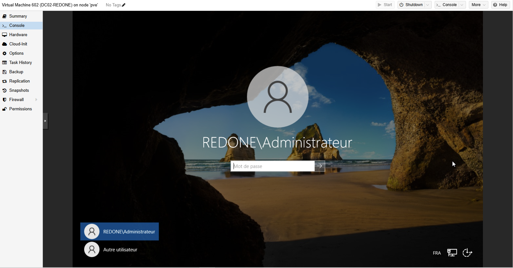

**La preuve de la réplication.** Je n'ai créé aucun compte sur `DC02`. Pourtant *Utilisateurs et ordinateurs Active Directory* y affiche les OU de l'entreprise et les comptes de l'OU `Accueil` : l'annuaire de `DC01` a bien été répliqué.

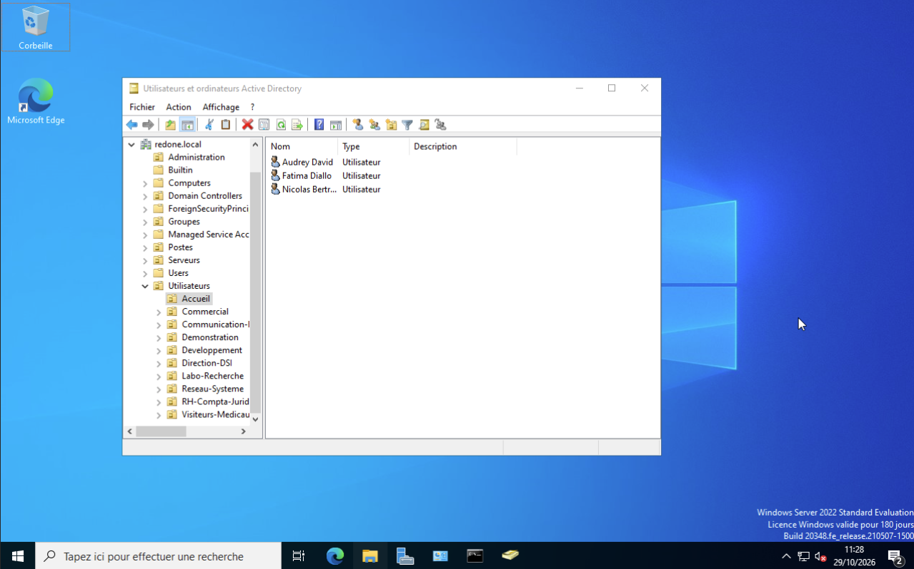

**Les DNS de DC01.** Sur `DC01`, le DNS auxiliaire est `10.2.81.3` : si son DNS préféré (lui-même) ne répond plus, il interroge `DC02`.

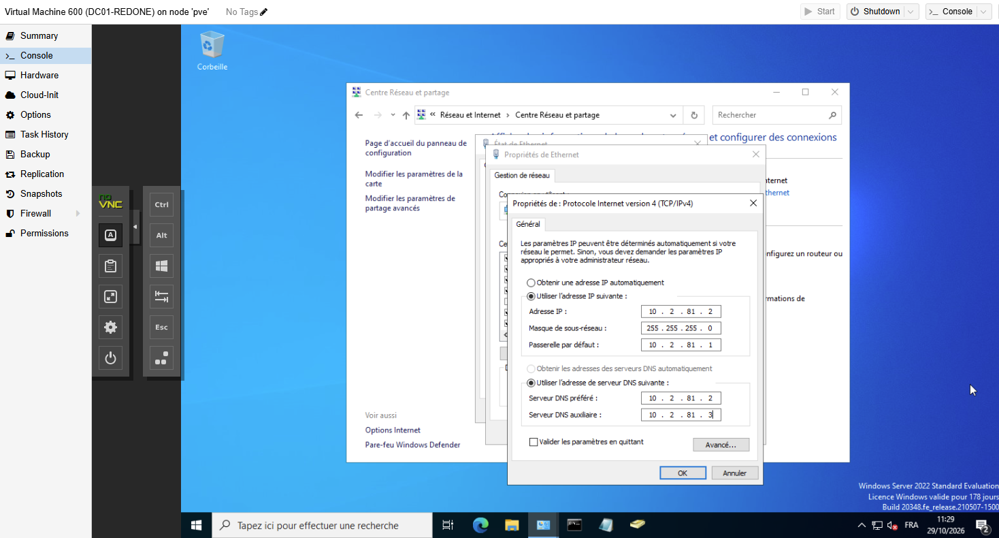

## 9. Questions pour l'oral

- **Pourquoi deux contrôleurs de domaine ?** Disponibilité : si `DC01` tombe, `DC02` continue d'authentifier les utilisateurs et de répondre au DNS. Les deux contrôleurs se répartissent aussi la charge.
- **Que réplique `DC02` ?** L'annuaire Active Directory (comptes, groupes, OU), la zone DNS intégrée à l'annuaire et le dossier SYSVOL.
- **Pourquoi le DNS de `DC02` pointe-t-il d'abord vers `DC01` ?** Avant la promotion, `DC02` ne connaît pas le domaine : seul le DNS de `DC01` le lui indique.
- **Pourquoi l'erreur « Vous devez fournir le nom d'un compte d'utilisateur » ?** L'assistant propose un compte local. Il faut un compte du domaine disposant des droits d'administrateur.
- **À quoi sert le catalogue global ?** Il contient une copie partielle de tous les objets de la forêt. Il est nécessaire à l'ouverture de session : sans lui, personne ne se connecte.
- **Qu'est-ce que le mot de passe DSRM ?** Le mot de passe du mode de restauration des services d'annuaire, utilisé pour réparer ou restaurer l'annuaire, hors domaine.
- **Où sont les rôles FSMO ?** Sur `DC01`, premier contrôleur de la forêt. `DC02` peut les prendre en cas de panne définitive de `DC01`.

Suite : GLPI (à venir).
