# Active Directory et DNS - domaine redone.local

| | |
| --- | --- |
| **Chantier** | 2 sur 9 |
| **Objectif** | Transformer `DC01` en premier contrôleur du domaine `redone.local`, avec le DNS |
| **Prérequis** | [Serveur DC01](../Serveur/Serveur.md) : serveur nommé, IP fixe, réseau fonctionnel |
| **Résultat** | Domaine opérationnel, ouverture de session `REDONE\Administrateur`, DNS qui résout le domaine |
| **Suite** | [Structure d'OU](Structure-OU.md) |

## 1. Valeurs retenues

| Paramètre | Valeur |
| --- | --- |
| Domaine (forêt et domaine racine) | `redone.local` |
| Nom NetBIOS | `REDONE` |
| Contrôleur de domaine | `DC01` (`DC01.redone.local`), 10.2.81.2 |
| Niveau fonctionnel | Windows Server 2016 (forêt et domaine) |
| Rôles du contrôleur | Serveur DNS et catalogue global |
| Type de déploiement | Nouvelle forêt |

## 2. Installer le rôle AD DS

Dans le Gestionnaire de serveur, *Gérer > Ajouter des rôles et fonctionnalités*, j'ai sélectionné le rôle **Services AD DS**. L'assistant propose d'ajouter les fonctionnalités requises : gestion de stratégie de groupe, outils d'administration (module Active Directory pour PowerShell, centre d'administration Active Directory).

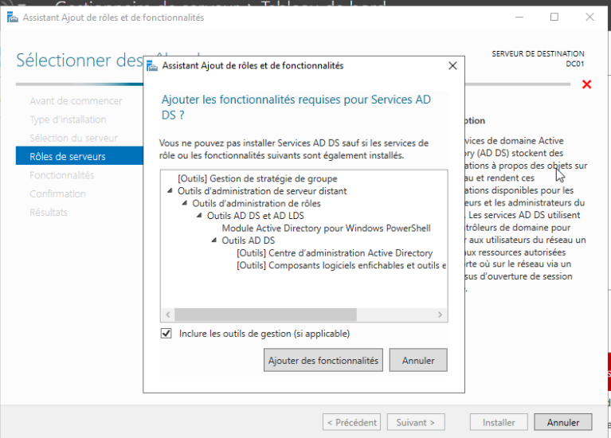

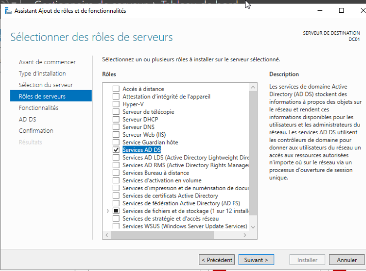

Le rôle **Serveur DNS** n'est pas coché ici : il est installé pendant la promotion, grâce à la case « Serveur DNS » de l'assistant.

L'installation se termine avec le message « Installation réussie sur DC01 » et le lien **Promouvoir ce serveur en contrôleur de domaine**.

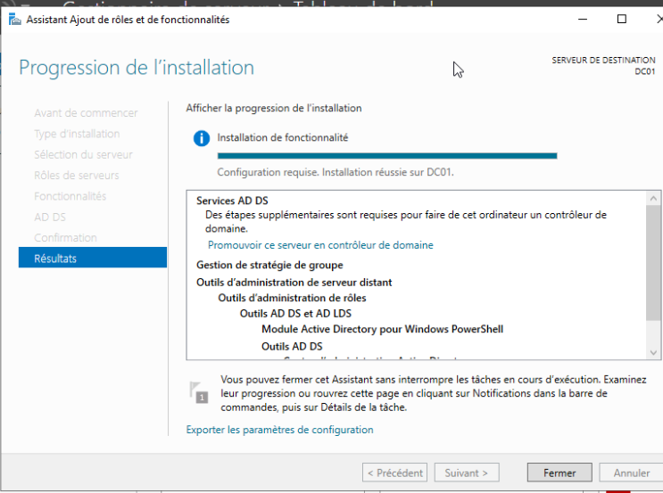

## 3. Promouvoir le serveur en contrôleur de domaine

| Écran de l'assistant | Choix |
| --- | --- |
| Configuration de déploiement | **Ajouter une nouvelle forêt**, domaine racine `redone.local` |
| Options du contrôleur de domaine | Niveau fonctionnel Windows Server 2016, **Serveur DNS** et **Catalogue global** cochés, contrôleur en lecture seule (RODC) non coché, mot de passe DSRM défini |
| Options supplémentaires | Nom NetBIOS `REDONE` |
| Options DNS, chemins d'accès, examen, installation | Valeurs par défaut (écrans non capturés, le serveur redémarre à la fin) |

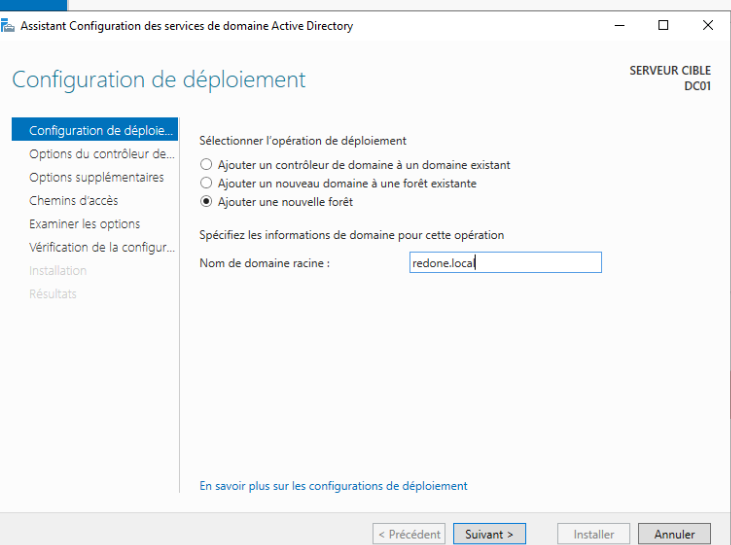

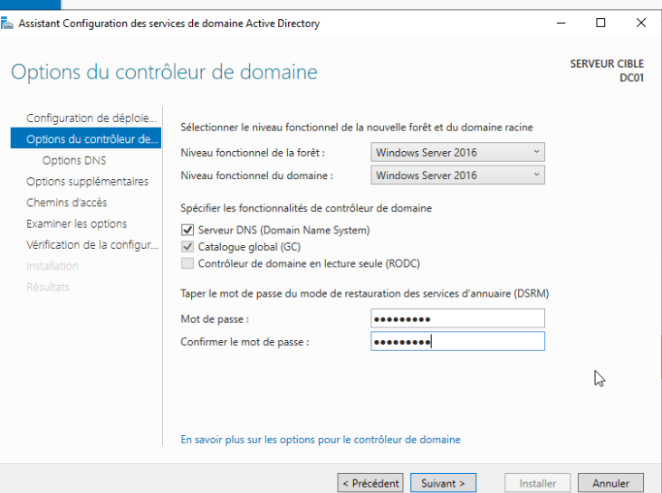

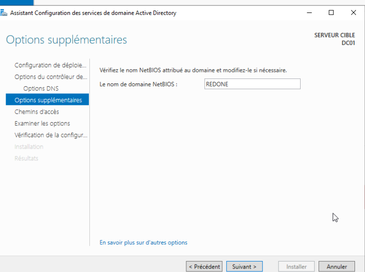

- **Nouvelle forêt** : c'est le premier domaine de l'entreprise, il n'y a pas de domaine existant à rejoindre.
- **Niveau fonctionnel 2016** : c'est le niveau proposé par défaut, le plus élevé disponible sur Windows Server 2022.
- **Catalogue global** : obligatoire sur le premier contrôleur de la forêt.
- **Pas de RODC** : un contrôleur en lecture seule sert aux sites distants, ce qui n'est pas le cas ici.
- **Mot de passe DSRM** : il protège le mode de restauration des services d'annuaire. Je le conserve dans un gestionnaire de mots de passe et je ne le publie jamais.

## 4. Vérifier le domaine

Après le redémarrage, l'écran de connexion propose le compte de domaine **`REDONE\Administrateur`** : le domaine existe.

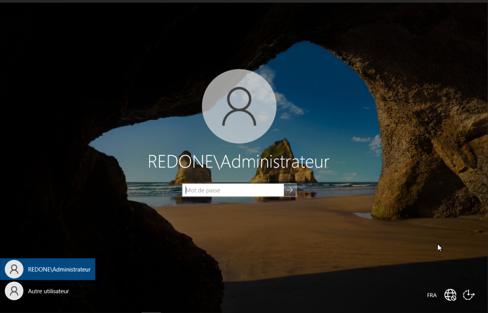

Le Gestionnaire de serveur affiche le nom `DC01`, le domaine `redone.local` et l'adresse 10.2.81.2.

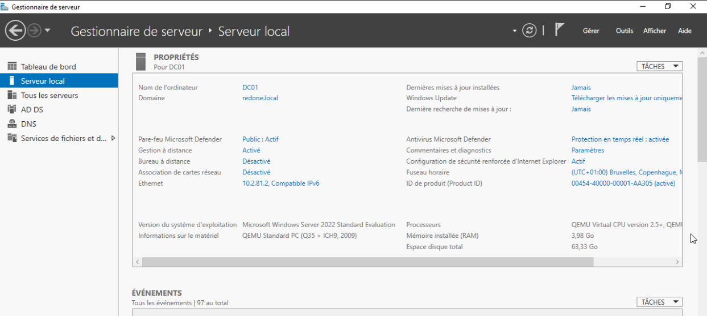

La commande `Get-ADDomainController` confirme le rôle du serveur :

```powershell
Get-ADDomainController
```

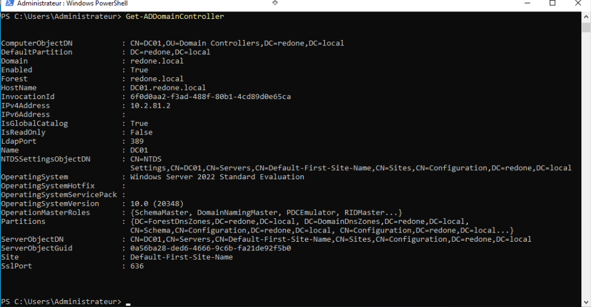

| Champ | Valeur | Signification |
| --- | --- | --- |
| `HostName` | `DC01.redone.local` | Nom complet du contrôleur |
| `Domain` et `Forest` | `redone.local` | Domaine et forêt |
| `IPv4Address` | 10.2.81.2 | Adresse du contrôleur |
| `IsGlobalCatalog` | True | Il porte le catalogue global |
| `IsReadOnly` | False | Contrôleur en lecture et écriture |
| `LdapPort` et `SslPort` | 389 et 636 | LDAP et LDAPS |
| `OperationMasterRoles` | `SchemaMaster`, `DomainNamingMaster`, `PDCEmulator`, `RIDMaster`... | Rôles FSMO, tous portés par le premier contrôleur (la capture tronque la liste) |
| `Site` | `Default-First-Site-Name` | Site Active Directory par défaut |

## 5. Vérifier la résolution DNS

```powershell
nslookup redone.local
```

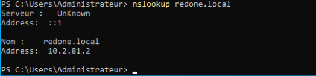

`redone.local` se résout en `10.2.81.2`. À ce stade, la ligne « Serveur : UnKnown » est normale : `nslookup` cherche le nom du serveur DNS par une requête inverse, et la zone de recherche inversée n'existe pas encore. Je la crée à la [section 7](#7-zone-de-recherche-inversée).

## 6. Configurer le DNS

Dans le Gestionnaire DNS, propriétés de `DC01`, onglet **Redirecteurs**, j'ai ajouté `8.8.8.8`. Le serveur résout ainsi lui-même les noms d'Internet pour le compte des clients, au lieu de les envoyer vers un DNS externe qui ne connaît pas `redone.local`.

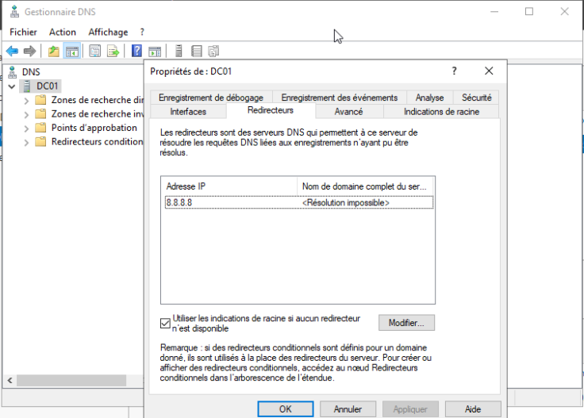

Le message « Résolution impossible » dans la colonne du nom complet vient de la même absence de zone inverse, corrigée à la [section 7](#7-zone-de-recherche-inversée).

## 7. Zone de recherche inversée

Une zone directe traduit un nom en adresse IP ; une zone **inversée** fait l'inverse, de l'adresse vers le nom. Sans elle, `nslookup` affiche « UnKnown » pour le serveur DNS, et les journaux de plusieurs services (messagerie, supervision, partages) montrent des adresses au lieu de noms. Je la crée dans le Gestionnaire DNS de `DC01`.

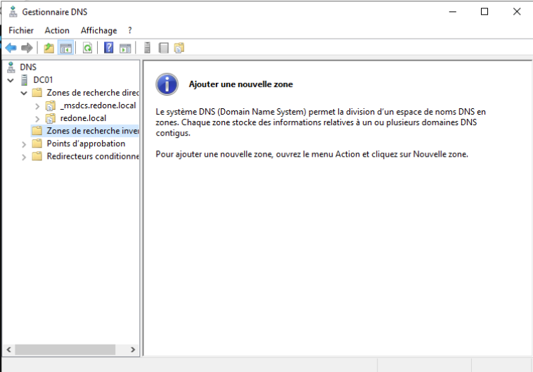

Clic droit sur *Zones de recherche inversée*, puis *Nouvelle zone*. Je choisis une **zone principale enregistrée dans Active Directory** : elle est ainsi répliquée sur tous les contrôleurs de domaine, `DC02` compris.

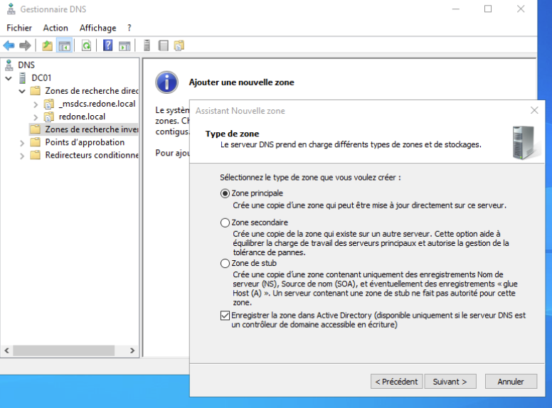

Je saisis l'**ID réseau** `10.2.81`, la partie commune de mon réseau `10.2.81.0/24`. L'assistant en déduit le nom de la zone, `81.2.10.in-addr.arpa` : les octets sont écrits à l'envers, c'est le principe de la zone inversée.

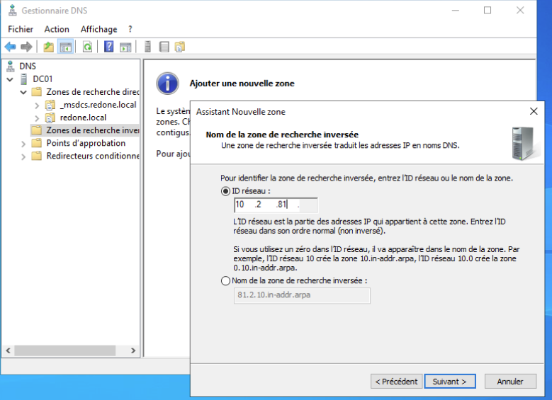

La zone apparaît comme *Serveur principal intégré à Active Directory*.

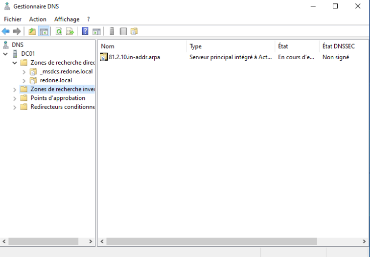

**Les enregistrements pointeurs (PTR).** La zone ne contient au départ que ses enregistrements SOA et NS. J'ajoute un pointeur par contrôleur : clic droit sur la zone, *Nouveau pointeur (PTR)*.

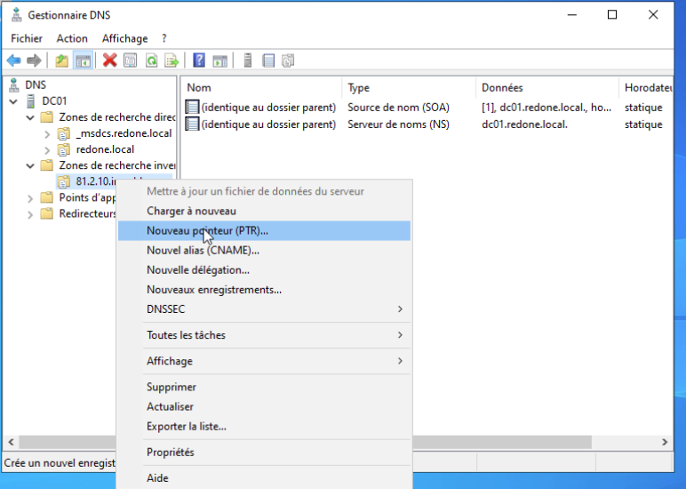

| Adresse | Nom |
| --- | --- |
| `10.2.81.2` | `dc01.redone.local` |
| `10.2.81.3` | `DC02.redone.local` |

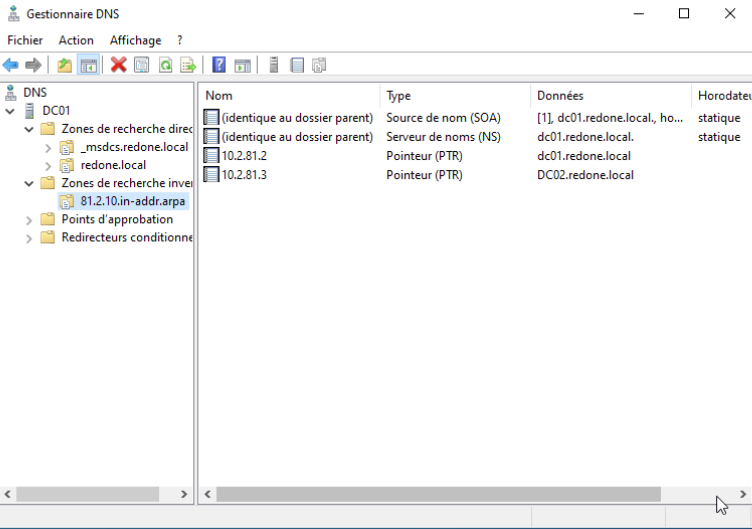

Les serveurs que j'ajouterai ensuite avec une IP fixe (TrueNAS, GLPI) auront leur pointeur de la même façon.

## 8. Sauvegarde

Je prends un **snapshot Proxmox** nommé `apres-chantier2`, sans la RAM : domaine créé, DNS opérationnel.

## 9. Questions pour l'oral

- **Quelle différence entre une forêt, un domaine et un contrôleur de domaine ?** Une forêt regroupe des domaines qui partagent un schéma et une configuration, un domaine est une limite d'administration, et un contrôleur de domaine est un serveur qui porte l'annuaire et authentifie.
- **À quoi sert le catalogue global ?** Il contient une copie partielle de tous les objets de la forêt, ce qui permet de les rechercher et d'ouvrir une session.
- **Pourquoi les enregistrements SRV du DNS sont-ils indispensables ?** Les clients s'en servent pour trouver les contrôleurs de domaine et les services de l'annuaire.
- **Pourquoi un redirecteur plutôt que 8.8.8.8 en DNS auxiliaire ?** Un DNS externe ne connaît pas `redone.local` : si un client l'interroge pour le domaine, il reçoit des erreurs. Le redirecteur laisse le serveur du domaine répondre seul.
- **À quoi sert la zone de recherche inversée ?** Elle traduit une adresse IP en nom. Sans elle, `nslookup` ne trouve pas le nom du serveur DNS et les journaux n'affichent que des adresses.
- **Pourquoi `81.2.10.in-addr.arpa` pour le réseau `10.2.81.0/24` ?** Les octets de l'adresse sont écrits à l'envers, car le DNS lit les noms de la racine vers la feuille.
- **Que sont les rôles FSMO ?** Cinq rôles à instance unique (maître de schéma, maître des noms de domaine, émulateur PDC, maître RID, maître d'infrastructure), tous portés ici par `DC01`.
- **À quoi sert le mot de passe DSRM ?** À ouvrir le mode de restauration des services d'annuaire pour réparer ou restaurer l'annuaire.

Suite : [Structure d'OU](Structure-OU.md).
