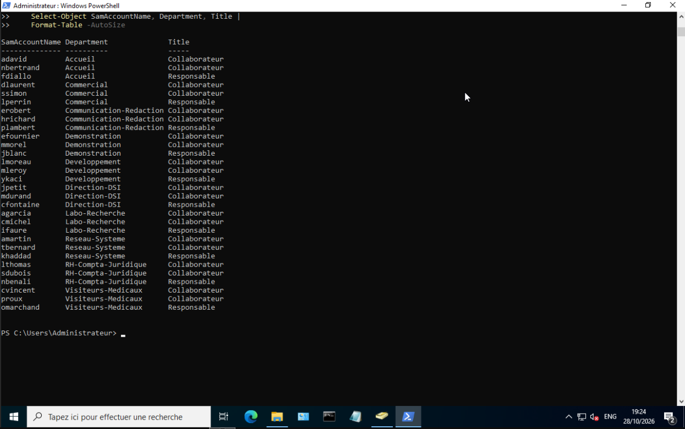
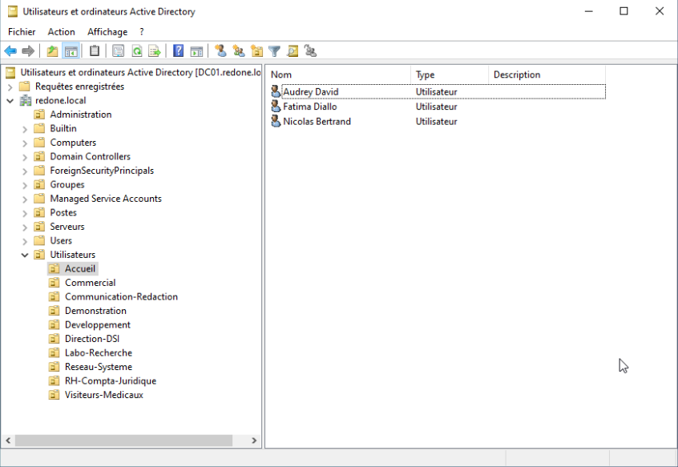
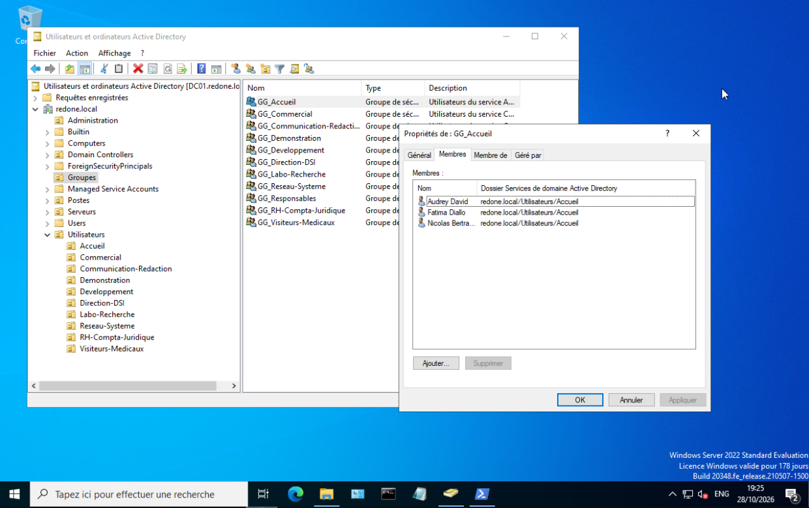

# Groupes et comptes utilisateurs

| | |
| --- | --- |
| **Chantier** | 4 sur 9 |
| **Objectif** | Créer un groupe de sécurité par service et 3 comptes par service (1 responsable et 2 collaborateurs) |
| **Prérequis** | [Structure d'OU](Structure-OU.md) : les OU `Utilisateurs`, `Groupes` et les 10 OU de services existent |
| **Résultat** | 11 groupes et 30 comptes, rangés dans les bonnes OU |
| **Script** | [Creer-Utilisateurs.ps1](Creer-Utilisateurs.ps1) |
| **Suite** | Poste client Windows 11 (à venir) |

## 1. Principe

**Un groupe par service.** Chaque service a un groupe de sécurité global `GG_<service>` dans l'OU `Groupes` (par exemple `GG_Accueil`). Les droits d'accès (partages TrueNAS, GLPI) seront donnés aux groupes et non aux comptes : quand une personne change de service, je la déplace de groupe sans toucher aux permissions. Un groupe supplémentaire, `GG_Responsables`, réunit les 10 responsables.

**Trois comptes par service.** Le premier est le responsable, les deux autres des collaborateurs. Trois comptes suffisent pour tester un accès, un refus et un changement de groupe. Les noms sont fictifs.

| Service (OU) | Responsable | Collaborateurs |
| --- | --- | --- |
| `Reseau-Systeme` | Karim Haddad (`khaddad`) | Alex Martin (`amartin`), Thomas Bernard (`tbernard`) |
| `Direction-DSI` | Claire Fontaine (`cfontaine`) | Julie Petit (`jpetit`), Marc Durand (`mdurand`) |
| `RH-Compta-Juridique` | Nadia Benali (`nbenali`) | Sophie Dubois (`sdubois`), Lucas Thomas (`lthomas`) |
| `Communication-Redaction` | Pierre Lambert (`plambert`) | Emma Robert (`erobert`), Hugo Richard (`hrichard`) |
| `Developpement` | Yanis Kaci (`ykaci`) | Manon Leroy (`mleroy`), Louis Moreau (`lmoreau`) |
| `Commercial` | Laura Perrin (`lperrin`) | Sarah Simon (`ssimon`), David Laurent (`dlaurent`) |
| `Labo-Recherche` | Isabelle Faure (`ifaure`) | Chloe Michel (`cmichel`), Antoine Garcia (`agarcia`) |
| `Accueil` | Fatima Diallo (`fdiallo`) | Audrey David (`adavid`), Nicolas Bertrand (`nbertrand`) |
| `Visiteurs-Medicaux` | Olivier Marchand (`omarchand`) | Paul Roux (`proux`), Camille Vincent (`cvincent`) |
| `Demonstration` | Julien Blanc (`jblanc`) | Elodie Fournier (`efournier`), Maxime Morel (`mmorel`) |

**Conventions**
- **Identifiant** : première lettre du prénom + nom, en minuscules (`amartin`).
- **Adresse de messagerie** : `identifiant@redone.com`, comme dans le contexte de RedOne.
- **Attributs** : `Department` = le service, `Title` = `Responsable` ou `Collaborateur`.
- **Mot de passe de laboratoire** : nom de famille + `123!` (par exemple `Martin123!`). Il n'expire pas et les comptes n'ont pas à le changer. Ce choix ne vaut que pour ce laboratoire et ses comptes fictifs.

## 2. Le script

Le script [Creer-Utilisateurs.ps1](Creer-Utilisateurs.ps1) contient les données (services et comptes) et crée tout :

1. Il vérifie que les OU de `Creer-OU.ps1` existent, sinon il s'arrête avec un message clair.
2. Il crée le groupe `GG_Responsables`.
3. Pour chaque service, il crée le groupe `GG_<service>`, puis les 3 comptes dans l'OU du service.
4. Il ajoute chaque compte à son groupe de service, et les responsables à `GG_Responsables`.
5. Il affiche la liste des comptes obtenus.

Il peut être relancé sans risque : il ne crée que ce qui manque et ne supprime jamais rien. En cas d'erreur sur un compte, il l'affiche en rouge et continue avec les suivants.

**Un détail technique :** Windows refuse un mot de passe qui contient une partie du nom complet de la personne (l'attribut `DisplayName`). Le script crée donc le compte **sans** `DisplayName`, avec son mot de passe, puis ajoute le `DisplayName` juste après. Sans cette précaution, `Martin123!` serait refusé pour Alex Martin.

## 3. Exécution

J'ai copié le script sur `DC01` avec le presse-papiers de la console noVNC et je l'ai exécuté en PowerShell administrateur,.

À la fin, le script affiche le tableau des comptes de l'OU `Utilisateurs`, triés par service : 30 comptes, un `Responsable` et deux `Collaborateur` par service.

## 4. Vérification

**Les comptes.** Dans *Utilisateurs et ordinateurs Active Directory*, l'OU `Accueil` contient bien ses 3 comptes : Fatima Diallo (responsable), Audrey David et Nicolas Bertrand.

**Les groupes.** L'OU `Groupes` contient les 11 groupes : un `GG_<service>` par service et `GG_Responsables`. Les propriétés de `GG_Accueil` (onglet *Membres*) montrent ses 3 membres, tous situés dans `redone.local/Utilisateurs/Accueil`.

## 5. Questions pour l'oral

- **Pourquoi donner les droits à un groupe plutôt qu'aux comptes ?** Quand une personne arrive, part ou change de service, je modifie son appartenance aux groupes sans retoucher les permissions de chaque ressource.
- **Que signifie `GG_` ?** Un groupe de sécurité de portée **globale** : il contient des comptes du domaine et peut recevoir des droits dans tout le domaine.
- **Pourquoi le `DisplayName` est-il ajouté après la création ?** Parce que la complexité du mot de passe est vérifiée contre le nom complet : avec le nom dans le mot de passe, la création échouerait.
- **Pourquoi ce mot de passe ne serait-il pas acceptable en production ?** Il se déduit du nom, il est identique pour tous les homonymes et il n'expire jamais. En production, chaque compte a un mot de passe initial aléatoire à changer à la première connexion.
- **À quoi sert `GG_Responsables` ?** À donner à tous les responsables un droit commun, par exemple l'accès à un dossier de pilotage, sans l'ouvrir à leurs collaborateurs.

Suite : poste client Windows 11 (à venir).
