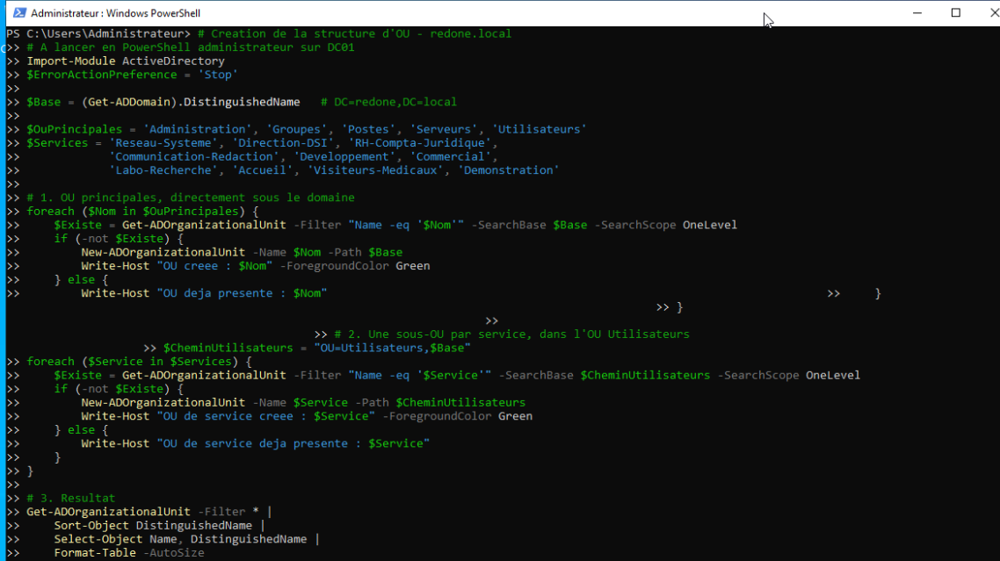
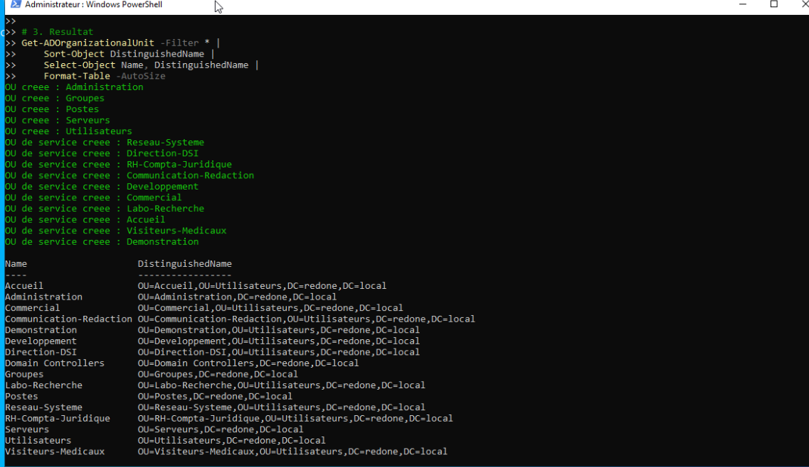
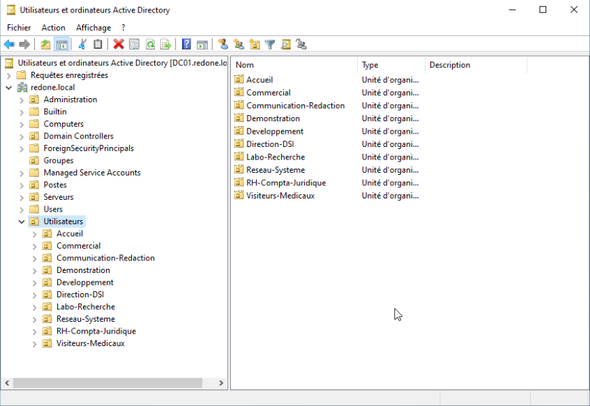

# Structure d'OU - organisation de l'annuaire

| | |
| --- | --- |
| **Chantier** | 3 sur 9 |
| **Objectif** | Organiser l'annuaire `redone.local` en unités d'organisation (OU), avec un script reproductible |
| **Prérequis** | [Active Directory et DNS](Active-Directory.md) |
| **Résultat** | 5 OU principales et 10 OU de services |
| **Script** | [Creer-OU.ps1](Creer-OU.ps1) |
| **Suite** | Groupes de sécurité et comptes utilisateurs (à venir) |

## 1. Structure choisie

Sous `redone.local` :

| OU | Contenu |
| --- | --- |
| `Utilisateurs` | Les comptes des personnes, rangés dans une sous-OU par service |
| `Groupes` | Les groupes de sécurité |
| `Postes` | Les ordinateurs clients |
| `Serveurs` | Les serveurs membres du domaine |
| `Administration` | Les comptes à privilèges, séparés des comptes de tous les jours |

Les 10 services, dans `Utilisateurs` :

| OU de service | Service de RedOne |
| --- | --- |
| `Reseau-Systeme` | Réseau & Système |
| `Direction-DSI` | Direction / DSI |
| `RH-Compta-Juridique` | RH / Compta / Juridique / Secrétariat administratif |
| `Communication-Redaction` | Communication / Rédaction |
| `Developpement` | Développement |
| `Commercial` | Commercial |
| `Labo-Recherche` | Labo-Recherche |
| `Accueil` | Accueil |
| `Visiteurs-Medicaux` | Visiteurs médicaux (commerciaux de terrain) |
| `Demonstration` | Démonstration |

**Pourquoi cette organisation :**
- Une **stratégie de groupe (GPO) s'applique à une OU** : avec `Utilisateurs` d'un côté, `Postes` et `Serveurs` de l'autre, je cible les comptes sans toucher aux machines, et inversement.
- Une OU par service permet des règles propres à chaque service et la délégation d'une OU à un responsable.
- Chaque OU racine ne contient **qu'un seul type d'objet** : l'annuaire reste lisible, y compris avec des centaines de comptes.
- Les groupes sont à part dans `Groupes`, parce qu'une OU sert à **administrer** et un groupe à **donner des droits**.

**Ce que je n'ai pas créé :**
- **Pas d'OU « Sortie »** : c'est une zone réseau (le lien vers Internet), sans utilisateur ni ordinateur à ranger.
- **Pas d'OU pour le VLAN « Visiteurs »** : ce sont des invités du Wi-Fi, sans compte dans l'annuaire. L'OU `Visiteurs-Medicaux` concerne les commerciaux de terrain, une autre population.
- `DC01` reste dans l'OU par défaut `Domain Controllers`.

Les noms n'ont ni accent, ni espace, ni caractère spécial (`/`, `&`), qui posent problème dans les noms de groupes et les scripts.

## 2. Le script

Le script [Creer-OU.ps1](Creer-OU.ps1) crée la structure :

1. Il lit le nom du domaine avec `Get-ADDomain`, donc il n'y a rien à modifier dedans.
2. Il crée les 5 OU principales sous le domaine, uniquement si elles n'existent pas.
3. Il crée une sous-OU par service dans `Utilisateurs`, avec le même test.
4. Il affiche la liste des OU obtenues.

Il peut être relancé sans risque et **ne supprime jamais rien**. Avec `$ErrorActionPreference = 'Stop'`, il s'arrête à la première erreur au lieu de continuer sur un état incohérent.

## 3. Exécution

J'ai utilisé **Windows PowerShell 5.1**, lancé en administrateur sur `DC01`, version livrée avec Windows Server 2022 et dont le module Active Directory est intégré. J'ai collé le script dans la console grâce au presse-papiers de la console noVNC.

Les lignes `>>` sont l'invite de continuation de PowerShell pour un bloc saisi sur plusieurs lignes ; le décalage de quelques lignes vient du collage et n'affecte pas l'exécution.

Le résultat montre les 15 OU créées, puis la liste complète de l'annuaire :

## 4. Vérification dans la console graphique

Dans *Utilisateurs et ordinateurs Active Directory*, les OU principales apparaissent sous `redone.local`, et `Utilisateurs` contient les 10 OU de services.

`Builtin`, `Computers`, `Users`, `Domain Controllers`, `Managed Service Accounts` et `ForeignSecurityPrincipals` sont des conteneurs et OU créés par défaut avec le domaine.

## 5. Questions pour l'oral

- **Quelle différence entre une OU et un groupe de sécurité ?** Une OU sert à organiser et à administrer (GPO, délégation), un groupe sert à attribuer des droits d'accès.
- **Pourquoi un script plutôt que la console pour 15 OU ?** C'est reproductible, plus rapide, sans oubli, et la structure se recrée à l'identique.
- **Comment le script évite-t-il de créer une OU en double ?** Il teste d'abord son existence avec `Get-ADOrganizationalUnit` et ne crée que ce qui manque.
- **Pourquoi les OU sont-elles protégées contre la suppression accidentelle ?** Par défaut, une OU créée par PowerShell est protégée : il faut décocher l'option dans l'onglet *Objet* pour la supprimer.
- **Pourquoi `DC01` reste-t-il dans `Domain Controllers` ?** C'est l'emplacement attendu, sur lequel s'applique la stratégie par défaut des contrôleurs de domaine.

Suite : groupes de sécurité et comptes utilisateurs (à venir).
