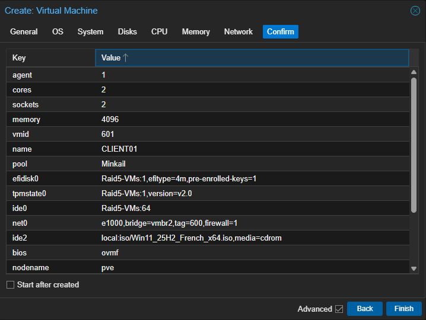
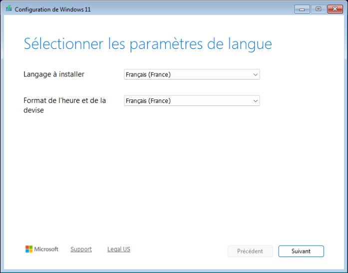
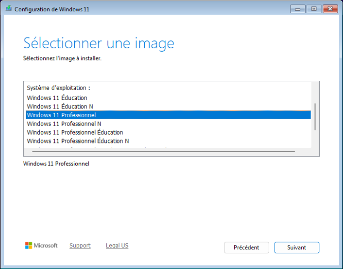
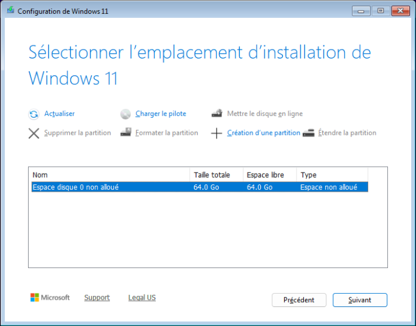
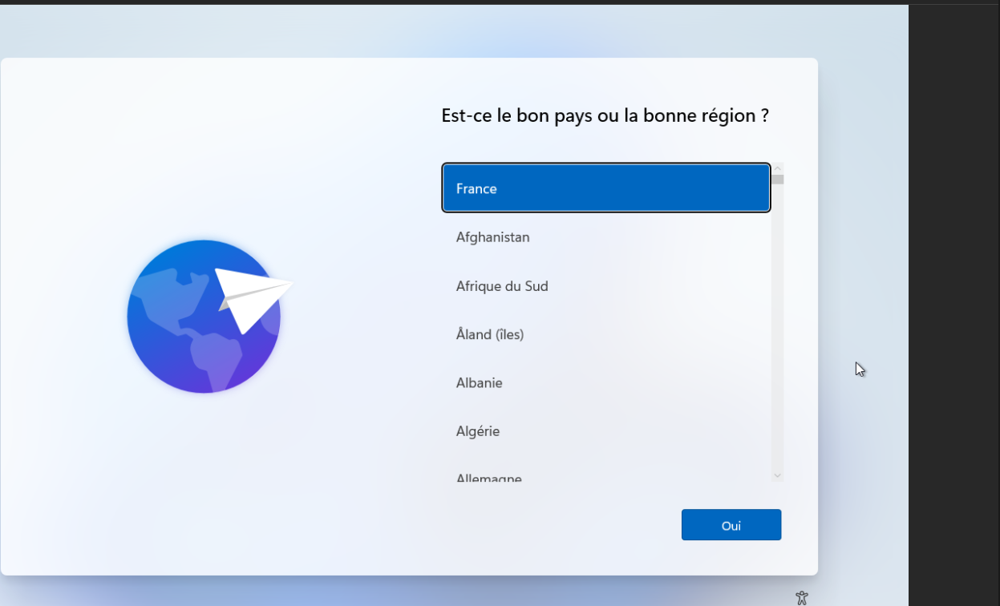
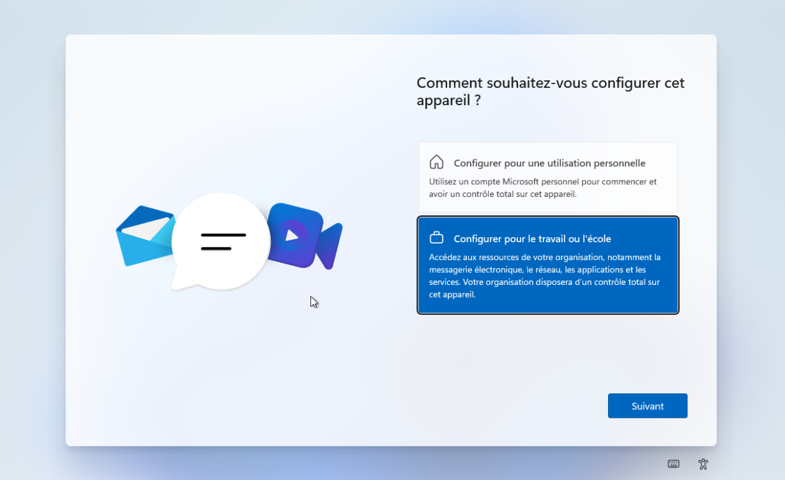
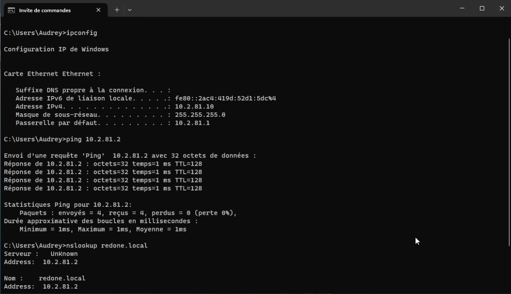
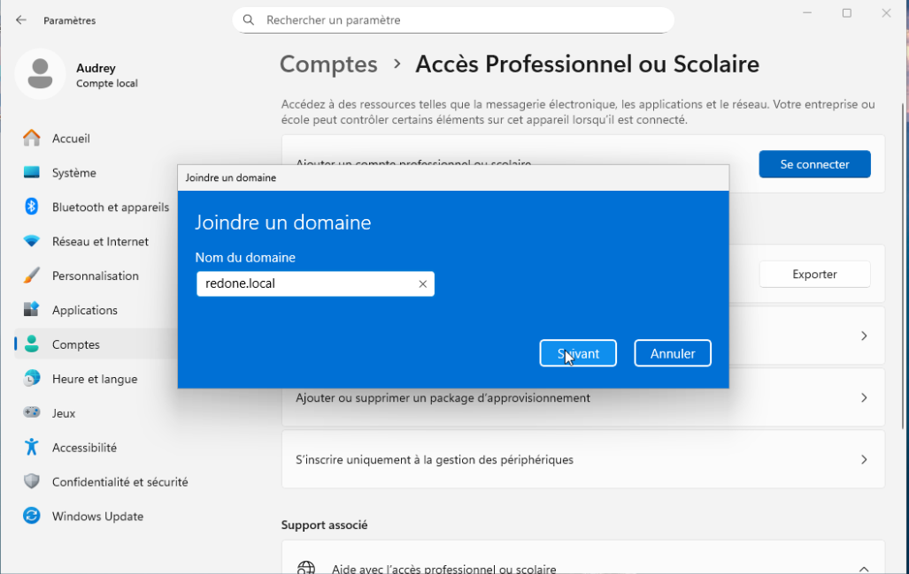
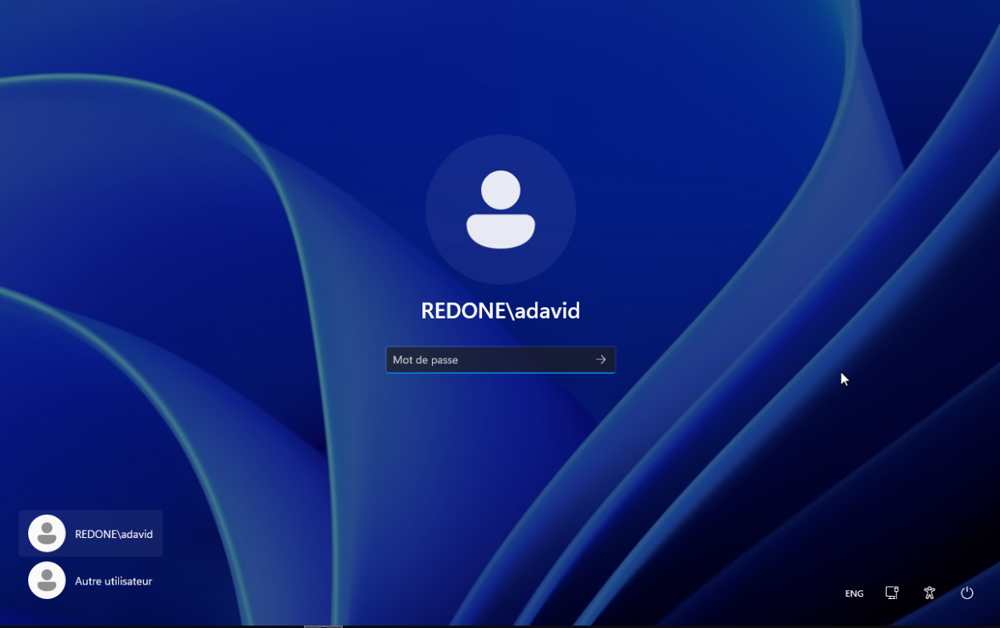

# Poste client Windows 11 - installation, réseau et jonction au domaine

| | |
| --- | --- |
| **Chantier** | 5 sur 9 |
| **Objectif** | Disposer d'un poste Windows 11 `CLIENT01` dans le VLAN 600, joint au domaine `redone.local` |
| **Prérequis** | [Groupes et comptes](../Active%20Directory/Groupes-Comptes.md) : les comptes du domaine existent |
| **Résultat** | Poste joint au domaine, écran de connexion proposant les comptes `REDONE\...` |
| **Suite** | AD secondaire (à venir) |

## 1. Valeurs retenues

| Paramètre | Valeur |
| --- | --- |
| Nom de la VM (Proxmox) | `CLIENT01`, VMID 601 |
| Système | Windows 11 Professionnel, 25H2, français |
| Processeur | 2 sockets × 2 cœurs (4 vCPU) |
| Mémoire | 4096 Mio |
| Disque | 64 Gio sur `Raid5-VMs`, bus IDE |
| Réseau | pont `vmbr2`, **VLAN 600**, modèle Intel E1000, pare-feu Proxmox activé |
| Adresse IP | 10.2.81.10/24 (fixe) |
| Passerelle | 10.2.81.1 |
| DNS | 10.2.81.2 (`DC01`) |

Pas de DHCP dans ce laboratoire : l'adresse est donc fixe.

## 2. Créer la machine virtuelle

L'écran de confirmation de Proxmox récapitule les choix.

| Paramètre | Valeur | Pourquoi |
| --- | --- | --- |
| `bios`, `efidisk0` | OVMF (UEFI) avec disque EFI et clés pré-enregistrées | Windows 11 exige l'UEFI |
| `tpmstate0` | version 2.0 | Windows 11 exige un TPM 2.0 |
| `ide2` | `Win11_25H2_French_x64.iso` | ISO d'installation |
| `net0` | `e1000`, pont `vmbr2`, **`tag=600`** | Carte reconnue nativement, VM placée dans le VLAN 600 |
| `agent` | 1 | Agent invité activé |

## 3. Installer Windows 11

Langue et format de l'heure en français (France).

Édition **Windows 11 Professionnel** : c'est l'édition qui peut rejoindre un domaine Active Directory (l'édition Famille ne le peut pas).

Le disque de 64 Go apparaît en espace non alloué : l'installateur crée lui-même les partitions.

## 4. Configuration initiale

Pays : France.

J'ai choisi **Configurer pour le travail ou l'école**, l'usage prévu pour un poste d'entreprise, puis créé un compte local (`Audrey`) pour finir l'installation. Ce compte local sert seulement à administrer le poste avant la jonction.

## 5. Réseau et tests avant la jonction

J'ai configuré l'IPv4 de la carte avec l'adresse fixe `10.2.81.10`, la passerelle `10.2.81.1` et le DNS `10.2.81.2`. Le DNS est celui de `DC01` et d'aucun autre serveur : lui seul connaît les enregistrements du domaine.

Trois tests depuis une invite de commandes :

| Test | Résultat |
| --- | --- |
| `ipconfig` | IPv4 10.2.81.10, masque 255.255.255.0, passerelle 10.2.81.1 |
| `ping 10.2.81.2` | 4 réponses, 1 ms, 0 % de perte : `DC01` est joignable |
| `nslookup redone.local` | Réponse `10.2.81.2` : le DNS de `DC01` résout le domaine |

Le `Serveur : UnKnown` affiché par `nslookup` est normal : il n'existe pas de zone de recherche inversée, donc l'adresse du serveur DNS n'a pas de nom. La résolution de `redone.local` fonctionne.

## 6. Joindre le domaine

*Paramètres > Comptes > Accès professionnel ou scolaire > Se connecter > Joindre cet appareil à un domaine Active Directory local*, puis le nom du domaine : `redone.local`.

Windows demande ensuite un compte autorisé à joindre des machines au domaine (l'administrateur du domaine), puis redémarre.

## 7. Écran de connexion

Après le redémarrage, l'écran de connexion propose un compte du domaine, `REDONE\adavid`, ainsi que l'option *Autre utilisateur*. Le préfixe `REDONE\` montre que le poste authentifie auprès du domaine et non plus en local.

> **Capture à ajouter :** une session ouverte avec un compte du domaine (`whoami` dans une invite de commandes doit afficher `redone\adavid`), et le message de réussite de la jonction.

## 8. Questions pour l'oral

- **Pourquoi une IP fixe sur le client ?** Il n'y a pas de DHCP dans ce laboratoire ; le client doit connaître son adresse, sa passerelle et son DNS.
- **Pourquoi le DNS du client est-il `DC01` et pas `8.8.8.8` ?** Le client retrouve le contrôleur de domaine grâce aux enregistrements DNS du domaine, que seul `DC01` possède.
- **Pourquoi Windows 11 Professionnel ?** L'édition Famille ne peut pas joindre un domaine.
- **Pourquoi un TPM et l'UEFI ?** Ce sont des prérequis de Windows 11.
- **Que change la jonction au domaine ?** Les comptes et les mots de passe sont vérifiés par `DC01` : n'importe quel utilisateur du domaine peut ouvrir une session sur le poste.
- **Pourquoi `Serveur : UnKnown` dans `nslookup` ?** Faute de zone inversée, l'adresse du serveur DNS n'a pas de nom associé.

Suite : AD secondaire (à venir).
