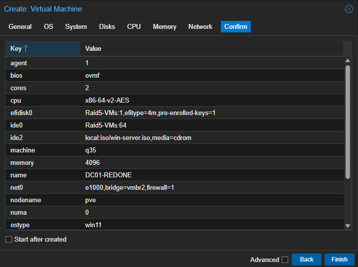
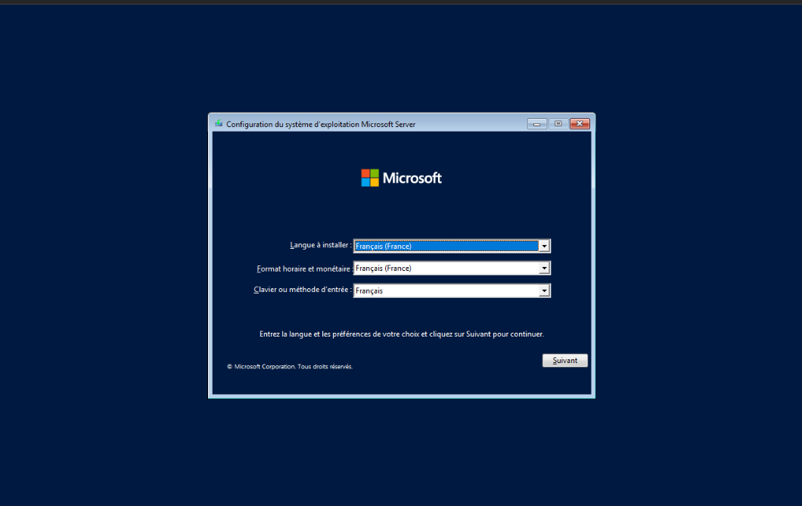
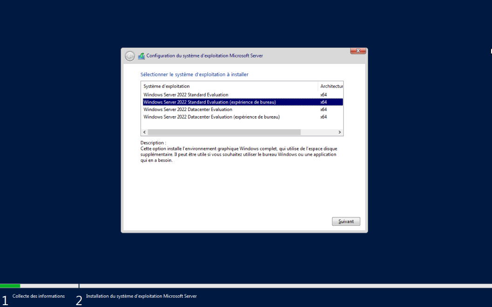
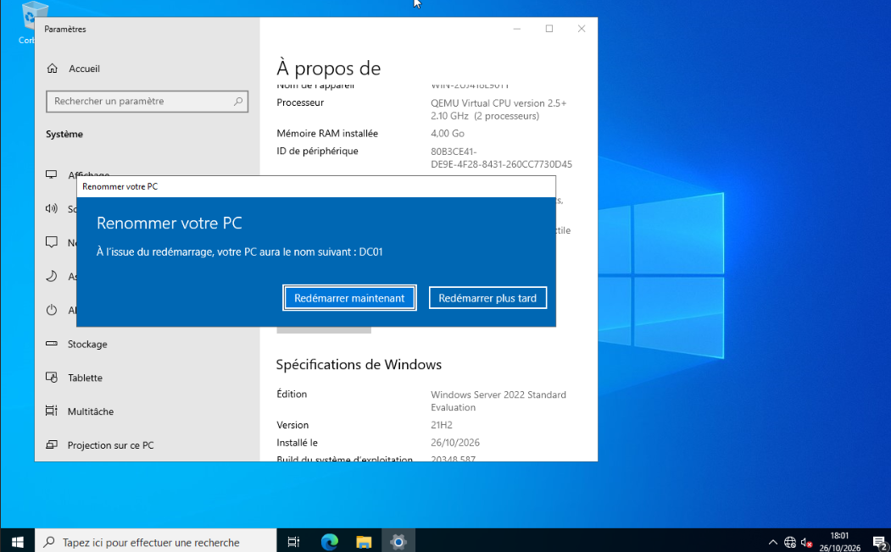
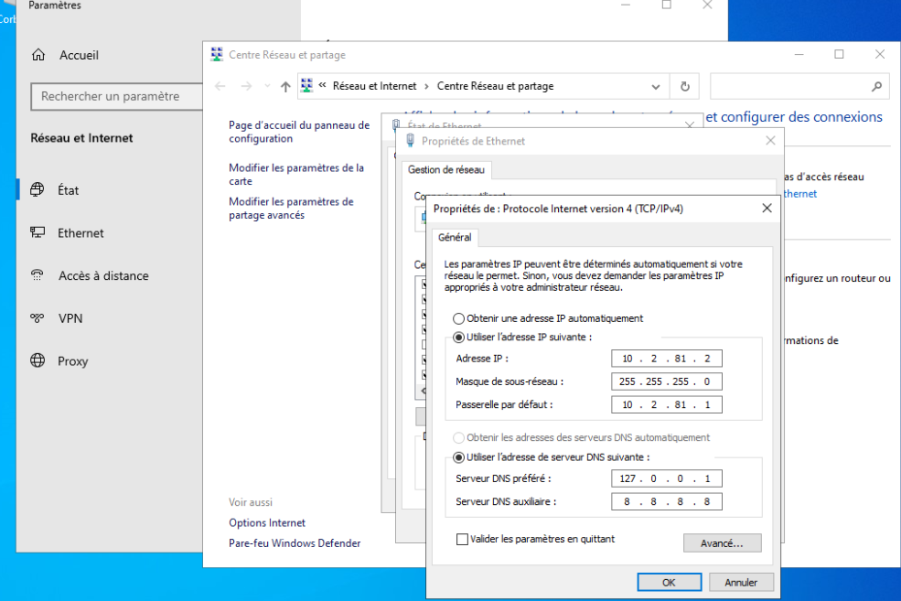
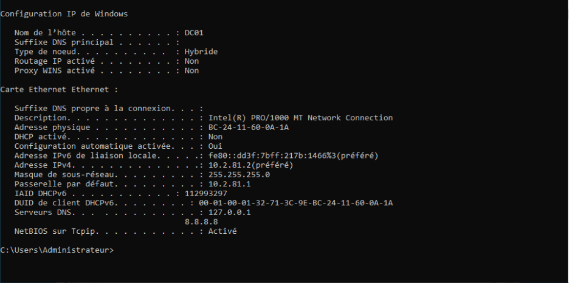
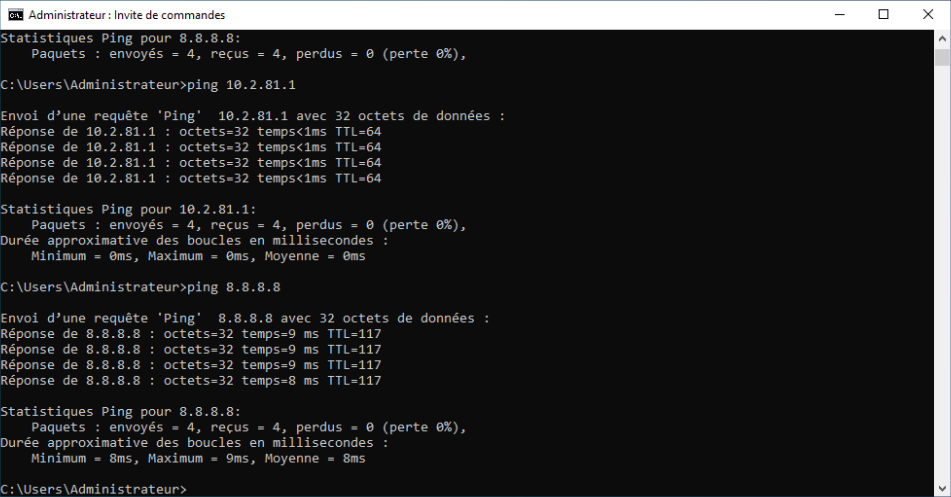

# Serveur DC01 - VM, installation et réseau

| | |
| --- | --- |
| **Chantier** | 1 sur 9 |
| **Objectif** | Disposer d'un serveur Windows Server 2022 nommé `DC01`, avec une IP fixe, relié au VLAN 600 |
| **Résultat** | Serveur joignant la passerelle et Internet, prêt à devenir contrôleur de domaine |
| **Suite** | [Active Directory et DNS](../Active%20Directory/Active-Directory.md) |

## 1. Valeurs retenues

| Paramètre | Valeur |
| --- | --- |
| Hyperviseur | Proxmox VE 9, nœud `pve` |
| Nom de la VM (Proxmox) | `DC01-REDONE` |
| Nom de l'hôte (Windows) | `DC01` |
| Système | Windows Server 2022 Standard Evaluation (expérience de bureau) |
| Processeur | 2 sockets × 2 cœurs (4 vCPU), type `x86-64-v2-AES` |
| Mémoire | 4096 Mio |
| Disque | 64 Gio sur `Raid5-VMs`, bus IDE |
| Réseau | pont `vmbr2`, **VLAN 600**, modèle Intel E1000, pare-feu Proxmox activé |
| Adresse IP | 10.2.81.2/24 |
| Passerelle | 10.2.81.1 |
| DNS | 127.0.0.1 (le serveur lui-même) |

Ces valeurs respectent mes plages réservées : réseaux 10.2.81.0/24 à 10.2.100.0/24, VLAN 600 à 699, VMID 600 à 699.

## 2. Créer la machine virtuelle

J'ai créé la VM avec l'assistant *Create VM* de Proxmox. L'écran de confirmation récapitule les choix.

| Paramètre | Valeur | Pourquoi |
| --- | --- | --- |
| `bios` et `efidisk0` | OVMF (UEFI) avec un disque EFI | Démarrage UEFI, adapté à Windows Server 2022 |
| `machine` | q35 | Chipset récent |
| Processeur | 2 sockets, 2 cœurs | 4 vCPU, confortable pour un contrôleur de domaine de laboratoire |
| `memory` | 4096 Mio | Suffisant pour AD DS et DNS |
| `ide0` | 64 Gio | Disque IDE : Windows le reconnaît sans pilote supplémentaire pendant l'installation |
| `ide2` | `win-server.iso` | ISO d'installation de Windows Server |
| `net0` | `e1000`, pont `vmbr2`, pare-feu activé | Carte Intel reconnue nativement par Windows |
| `ostype` | win11 | Profil de pilotes adapté aux Windows récents |

## 3. Placer la VM dans le VLAN 600

Dans Proxmox, *Hardware > Network Device (net0)*, j'ai défini le **VLAN Tag à 600** sur le pont `vmbr2`.

Le pont `vmbr2` gère les VLAN : Proxmox ajoute l'étiquette 802.1Q aux trames de la VM, qui arrivent ainsi dans le VLAN 600, celui de ma plage. La VM n'a rien à configurer côté système.

## 4. Installer Windows Server 2022

J'ai démarré sur l'ISO et gardé la langue, le format horaire et le clavier en français.

J'ai choisi l'édition **Windows Server 2022 Standard Evaluation (expérience de bureau)** : elle installe l'interface graphique, plus simple pour s'entraîner et documenter. C'est une version d'évaluation de 180 jours.

## 5. Renommer le serveur

J'ai renommé le serveur **`DC01`** (*Paramètres > Système > À propos > Renommer ce PC*), puis redémarré.

Je renomme le serveur **avant** de le promouvoir en contrôleur de domaine : son nom est ensuite inscrit dans l'annuaire et le DNS, et le changer devient délicat.

## 6. Configurer l'adresse IP fixe

J'ai configuré IPv4 sur la carte Ethernet (*Centre Réseau et partage > Propriétés de la carte > IPv4*).

| Paramètre | Valeur |
| --- | --- |
| Adresse IP | 10.2.81.2 |
| Masque | 255.255.255.0 |
| Passerelle par défaut | 10.2.81.1 |
| DNS préféré | 127.0.0.1 |
| DNS auxiliaire | 8.8.8.8 (provisoire, remplacé ensuite par un redirecteur DNS) |

- Un contrôleur de domaine a besoin d'une **IP fixe** : tous les clients s'appuient sur son adresse.
- L'adresse .1 est celle de la passerelle (le pfSense) : mon serveur prend la première adresse libre, .2.
- Le **DNS préféré est le serveur lui-même** : il héberge la zone du domaine et ses enregistrements, indispensables à l'annuaire.
- `8.8.8.8` ne sert qu'avant la création du domaine. Ensuite, c'est le DNS du serveur qui transmet les requêtes externes (voir [Active Directory](../Active%20Directory/Active-Directory.md#6-configurer-le-dns)).

## 7. Vérifier

`ipconfig /all` confirme le nom `DC01`, l'adresse, le masque, la passerelle, le DNS et l'absence de DHCP.

Les tests ping montrent que la passerelle et Internet répondent.

| Test | Résultat |
| --- | --- |
| `ping 10.2.81.1` (passerelle) | 4 réponses, temps < 1 ms, TTL 64 |
| `ping 8.8.8.8` (Internet) | 4 réponses, 8 à 9 ms, TTL 117 |

Le premier test prouve que le VLAN 600 est bien relié au pfSense, le second que le routage vers Internet fonctionne.

## 8. Sauvegarde

Je prends un **snapshot Proxmox** nommé `apres-chantier1`, sans la RAM, pour revenir à cet état : Windows installé, serveur nommé `DC01`, réseau fonctionnel.

## 9. Questions pour l'oral

- **Pourquoi une IP fixe pour un contrôleur de domaine ?** Les clients et les autres serveurs le trouvent par son adresse, et son DNS doit rester joignable en permanence.
- **Pourquoi le DNS préféré est-il le serveur lui-même ?** Il héberge la zone du domaine et ses enregistrements SRV, dont l'annuaire a besoin pour fonctionner.
- **À quoi sert le tag VLAN 600 ?** Proxmox ajoute l'étiquette 802.1Q aux trames de la VM, ce qui les place dans le VLAN 600. Sans tag, la VM n'atteint pas la passerelle du VLAN.
- **Pourquoi renommer avant la promotion ?** Le nom est inscrit dans l'annuaire et le DNS : le changer après est risqué.
- **Pourquoi .2 et pas .0 ou .1 ?** .0 est l'adresse du réseau, .255 le broadcast et .1 la passerelle.
- **Quelle différence entre un snapshot et une sauvegarde ?** Le snapshot est stocké avec la VM : si la VM est supprimée, il disparaît avec elle.

Suite : [Active Directory et DNS](../Active%20Directory/Active-Directory.md).
