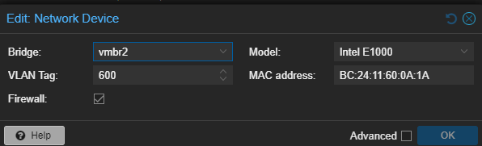

# Serveur DC01 - Création de la VM, installation et réseau

Je présente ici la création de la machine virtuelle du premier contrôleur de domaine de RedOne, l'installation de Windows Server 2022 et la configuration réseau, avec mes captures.

## 1. Valeurs retenues

| Paramètre | Valeur |
| --- | --- |
| Hyperviseur | Proxmox VE 9, nœud `pve` |
| Nom de la VM (Proxmox) | `DC01-REDONE` |
| Nom de l'hôte (Windows) | `DC01` |
| Système | Windows Server 2022 Standard Evaluation (expérience de bureau) |
| Processeur | 2 cœurs, type `x86-64-v2-AES` |
| Mémoire | 4096 Mio |
| Disque | 64 Gio sur le stockage `Raid5-VMs` |
| Réseau | pont `vmbr2`, **VLAN 600**, modèle Intel E1000, pare-feu Proxmox activé |
| Adresse IP | 10.2.81.2/24 |
| Passerelle | 10.2.81.1 |
| DNS | 127.0.0.1 (lui-même), puis 10.2.81.2 uniquement après la création du domaine |

Ces valeurs respectent les plages qui me sont réservées : réseaux 10.2.81.0/24 à 10.2.100.0/24, VLAN 600 à 699 et VMID 600 à 699.

## 2. Créer la machine virtuelle

J'ai créé la VM avec l'assistant *Create VM* de Proxmox. La capture ci-dessous est l'écran de confirmation, qui récapitule tous les onglets.

| Paramètre | Valeur | Pourquoi |
| --- | --- | --- |
| `bios` / `efidisk0` | OVMF (UEFI) avec un disque EFI | Démarrage UEFI, recommandé pour Windows Server 2022 |
| `machine` | q35 | Chipset récent, adapté à Windows moderne |
| `cores` / `memory` | 2 cœurs, 4096 Mio | Suffisant pour un contrôleur de domaine de laboratoire |
| `ide0` | 64 Gio sur `Raid5-VMs` | Disque en IDE : Windows le reconnaît sans pilote supplémentaire pendant l'installation |
| `ide2` | `win-server.iso` | ISO d'installation de Windows Server |
| `net0` | `e1000`, pont `vmbr2`, pare-feu activé | Carte Intel reconnue nativement par Windows |
| `ostype` | win11 | Profil de pilotes adapté aux Windows récents |

> **Point d'attention :** cet écran ne montre pas de **VLAN Tag**. Je l'avais laissé vide à la création, ce qui m'a causé un problème réseau détaillé au paragraphe 6.

## 3. Installer Windows Server 2022

Au démarrage sur l'ISO, j'ai gardé la langue, le format horaire et le clavier en français.

J'ai choisi l'édition **Windows Server 2022 Standard Evaluation (expérience de bureau)**. Elle installe l'interface graphique, plus simple pour s'entraîner et documenter avec des captures.

C'est une version d'évaluation, utilisable 180 jours.

## 4. Renommer le serveur

J'ai renommé le serveur **`DC01`** (Paramètres > Système > À propos > Renommer ce PC) puis redémarré.

Je renomme le serveur **avant** de le promouvoir en contrôleur de domaine, car changer le nom d'un contrôleur de domaine ensuite est délicat : le nom est enregistré dans l'annuaire et dans le DNS.

## 5. Configurer l'adresse IP fixe

J'ai configuré le protocole IPv4 de la carte Ethernet (Centre Réseau et partage > Propriétés de la carte > IPv4).

| Paramètre | Valeur |
| --- | --- |
| Adresse IP | 10.2.81.2 |
| Masque | 255.255.255.0 |
| Passerelle par défaut | 10.2.81.1 |
| DNS préféré | 127.0.0.1 |
| DNS auxiliaire | 8.8.8.8 (provisoire) |

**Pourquoi ces choix :**
- Un contrôleur de domaine a besoin d'une **IP fixe**, car tous les clients s'appuient sur son adresse.
- L'adresse .1 du réseau est celle de la passerelle (le pfSense). Mon serveur prend donc la première adresse libre, .2.
- Le **DNS préféré est le serveur lui-même** : le rôle DNS sera installé sur ce serveur, et l'annuaire repose sur ses enregistrements.
- Le DNS auxiliaire `8.8.8.8` ne sert que tant que le domaine n'existe pas. Après la création du domaine, je le retire de la carte et je le configure comme **redirecteur** dans le DNS du serveur.

Je vérifie la configuration avec `ipconfig /all` : nom d'hôte `DC01`, IP 10.2.81.2, masque, passerelle et DNS corrects, DHCP désactivé.

## 6. Problème rencontré : le VLAN Tag était vide

Après avoir configuré l'adresse, mes tests ping échouaient avec le message `Réponse de 10.2.81.2 : Impossible de joindre l'hôte de destination`. La réponse venait de **ma propre adresse** : le serveur n'avait pas trouvé la passerelle sur le réseau.

**Cause :** la carte réseau de la VM n'avait pas de **VLAN Tag** dans Proxmox. Les trames partaient donc sans étiquette 802.1Q et n'arrivaient jamais dans le VLAN 600, où se trouve l'interface 10.2.81.1 du pfSense.

**Correction :** dans Proxmox, *Hardware > Network Device (net0)*, j'ai renseigné **VLAN Tag = 600** (pont `vmbr2`, Intel E1000, pare-feu activé). Le changement s'applique à chaud, sans redémarrage.

## 7. Tests réseau

Après la correction, la passerelle et Internet répondent :

| Test | Résultat |
| --- | --- |
| `ping 10.2.81.1` (passerelle) | 4 réponses de 10.2.81.1, temps < 1 ms, TTL 64 |
| `ping 8.8.8.8` (Internet) | 4 réponses de 8.8.8.8, 8 à 9 ms, TTL 117 |

Le premier test prouve que le VLAN 600 est bien relié au pfSense. Le second prouve que le routage vers Internet fonctionne.

## 8. Sauvegarde

Je prends un **snapshot Proxmox** nommé `apres-chantier1`, sans la RAM, pour pouvoir revenir à ce point : Windows installé, serveur nommé `DC01`, réseau fonctionnel.

## 9. Points à justifier à l'oral

- **Pourquoi une IP fixe pour un contrôleur de domaine ?** Les clients et les autres serveurs le trouvent par son adresse, et son DNS doit rester joignable en permanence.
- **Pourquoi le DNS préféré pointe-t-il sur le serveur lui-même ?** Il héberge la zone du domaine et ses enregistrements SRV, indispensables à l'annuaire.
- **À quoi sert le tag VLAN 600 sur la carte de la VM ?** Proxmox ajoute l'étiquette 802.1Q aux trames de la VM : le pont `vmbr2`, configuré avec la gestion des VLAN, les envoie sur le bon VLAN. Sans tag, la VM n'atteint pas la passerelle.
- **Pourquoi renommer le serveur avant la promotion ?** Le nom est inscrit dans l'annuaire et le DNS : le changer après est risqué.
- **Pourquoi .2 et pas .0 ou .1 ?** .0 est l'adresse du réseau, .255 le broadcast, et .1 est réservée à la passerelle.

Suite : [Active Directory et DNS](../Active%20Directory/Active-Directory.md).
