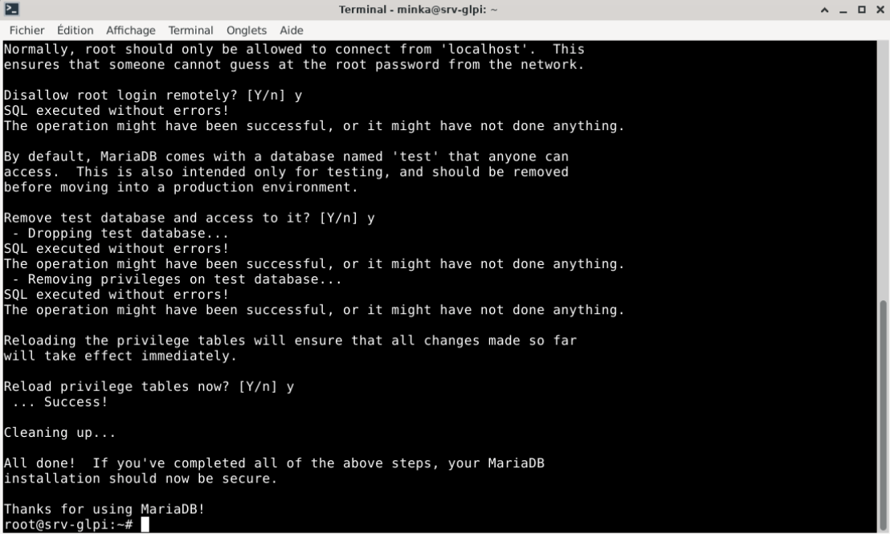
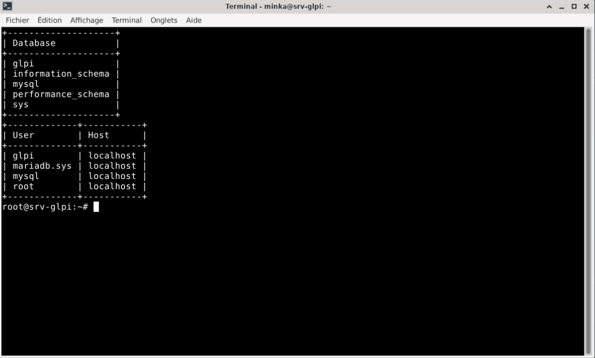
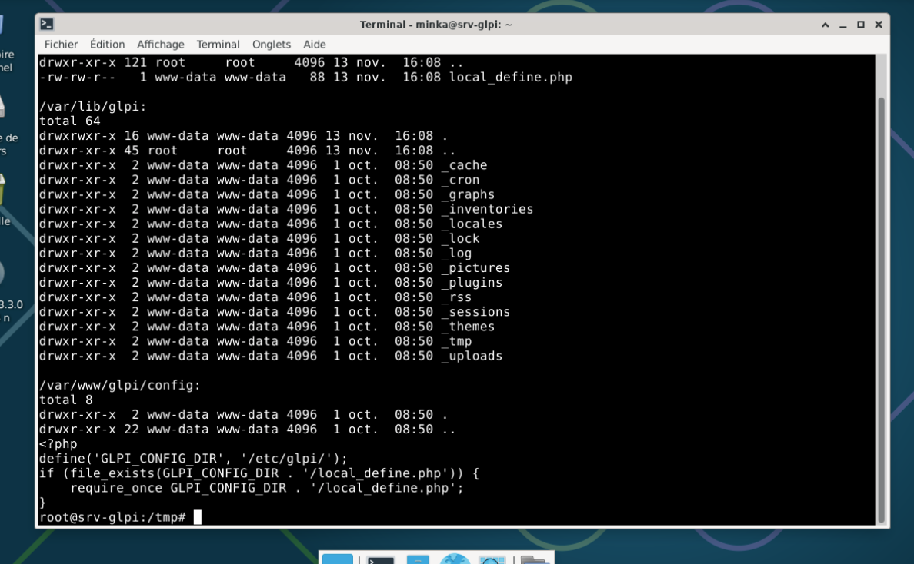
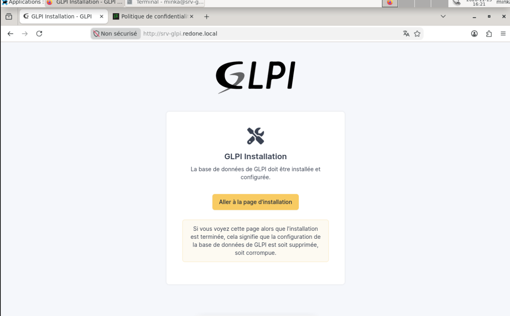
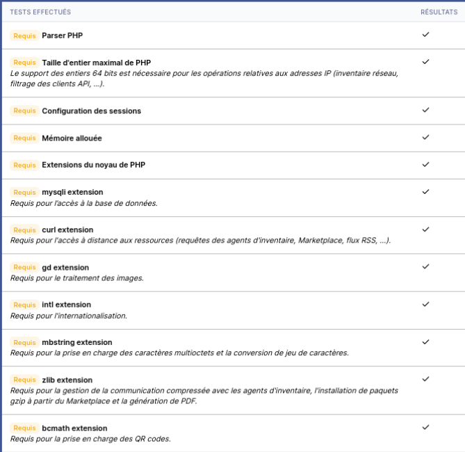
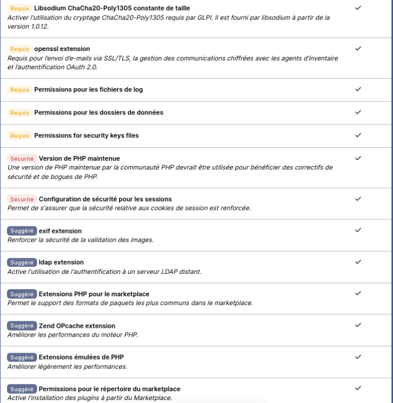
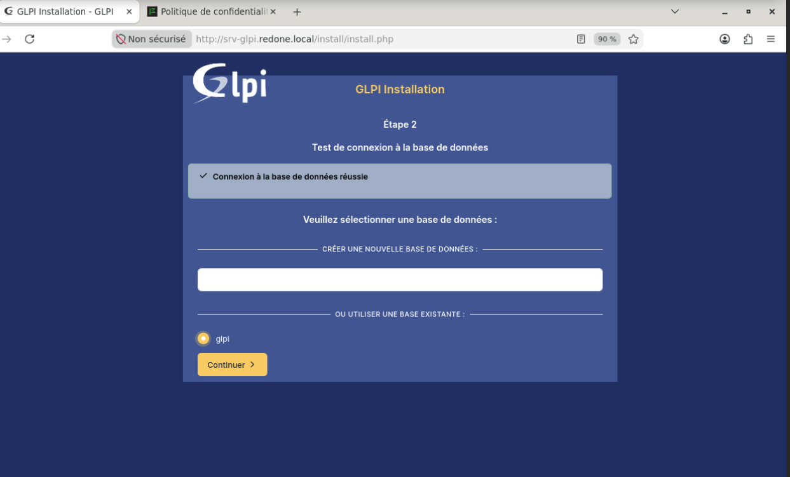
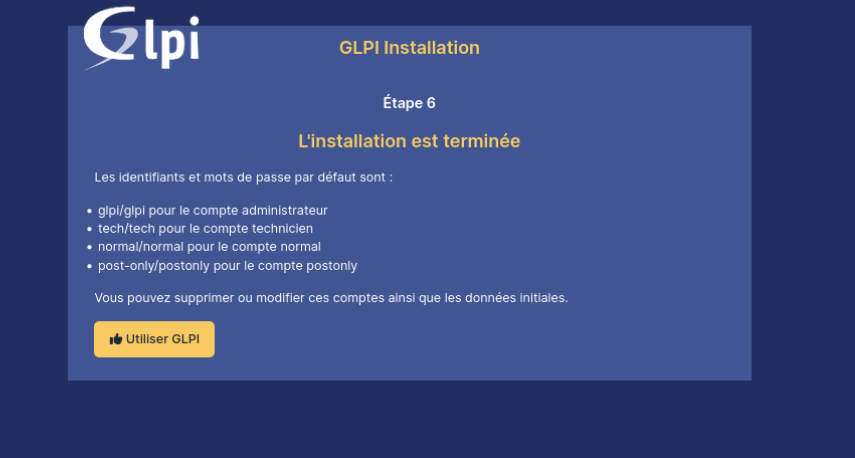
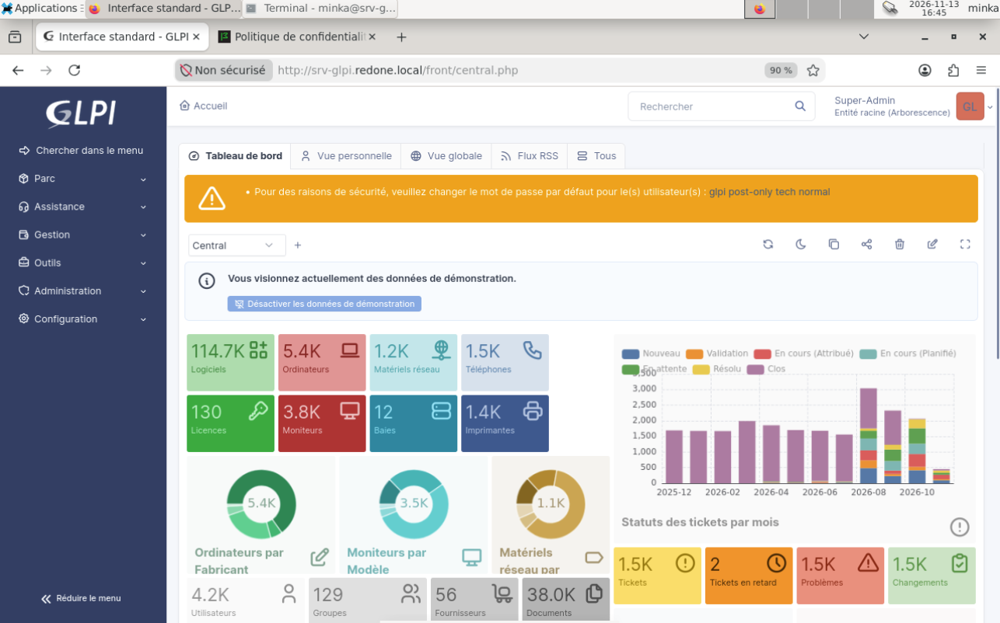

# GLPI - gestion du parc et des tickets

| | |
| --- | --- |
| **Atelier** | AP 1, chantier 2 |
| **Objectif** | Déployer GLPI pour gérer le parc et les tickets d'incident, avec une authentification des utilisateurs par leur compte de domaine |
| **Prérequis** | [Active Directory et DNS](../../Infrastructure/Active-Directory/Active-Directory.md), [comptes et groupes](../../Infrastructure/Active-Directory/Groupes-Comptes.md) |
| **État** | **En cours** : GLPI 11 installé et accessible (étapes 1 à 7) |

## Plan

| # | Étape | État |
| --- | --- | --- |
| 1 | Créer la VM `SRV-GLPI` | Réalisé |
| 2 | Installer Debian | Réalisé |
| 3 | Réseau, nom et DNS | Réalisé |
| 4 | Pile LAMP : Apache, MariaDB, PHP | Réalisé |
| 5 | Sécuriser MariaDB, créer la base `glpi` | Réalisé |
| 6 | Déployer GLPI, configurer Apache | Réalisé |
| 7 | Installation web, comptes par défaut | Réalisé |
| 8 | Liaison à l'Active Directory (LDAP) | À faire |
| 9 | Tests : connexion de domaine, ticket, inventaire | À faire |

## 1. Valeurs retenues

| Paramètre | Valeur |
| --- | --- |
| Nom de la VM (Proxmox) | `SRV-GLPI`, VMID 605, pool `Minkail` |
| Système | Debian 13.3, bureau Xfce |
| Processeur, mémoire | 2 sockets × 2 cœurs (4 vCPU), 4 Gio |
| Disque | 32 Gio sur `Raid5-VMs` (`discard`, `iothread`) |
| Affichage | VirtIO-GPU, presse-papiers VNC |
| Réseau | pont `vmbr2`, **VLAN 600**, VirtIO |
| Nom | `srv-glpi.redone.local` |
| Adresse IP | 10.2.81.6/24 (fixe), passerelle 10.2.81.1 |
| DNS | 10.2.81.2 (`DC01`), puis 10.2.81.3 (`DC02`) |
| Pile | Apache 2.4, MariaDB 11.8, PHP 8.4 |
| GLPI | 11.0.11 |
| Adresse web | `http://srv-glpi.redone.local` |

## 2. Créer la machine virtuelle

Une VM dédiée : **un serveur, un rôle**. GLPI n'est installé ni sur un contrôleur de domaine (machine la plus sensible du réseau) ni sur un poste utilisateur.


La carte graphique **VirtIO-GPU** et le presse-papiers **VNC** permettent le copier-coller depuis la console Proxmox.

## 3. Installer Debian

Installation graphique, nom `srv-glpi`, domaine `redone.local`. Logiciels : **bureau Xfce**, **serveur SSH** et utilitaires usuels.


Le bureau léger Xfce sert uniquement à administrer le serveur depuis la console Proxmox du laboratoire, avec le copier-coller. En production, le serveur serait sans interface graphique et administré en SSH.


## 4. Réseau, nom et DNS

Avec un bureau, le réseau est géré par NetworkManager. Passage en adresse fixe :

```
CON=$(nmcli -t -f NAME,DEVICE con show --active | grep ens18 | cut -d: -f1)
nmcli con mod "$CON" ipv4.method manual ipv4.addresses 10.2.81.6/24 ipv4.gateway 10.2.81.1 ipv4.dns "10.2.81.2 10.2.81.3" ipv4.dns-search redone.local
nmcli con up "$CON"
sed -i 's/^127.0.1.1.*/10.2.81.6\tsrv-glpi.redone.local srv-glpi/' /etc/hosts
```

Vérification : nom complet `srv-glpi.redone.local`, adresse `10.2.81.6/24` sans `dynamic`, passerelle `10.2.81.1`, DNS des deux contrôleurs, `DC01` et Internet joignables.


Sur `DC01`, enregistrement **A** `srv-glpi` → `10.2.81.6`, avec son pointeur **PTR** dans la zone inversée.


Test depuis `DC01` : le nom donne l'adresse et l'adresse donne le nom. (`Serveur : UnKnown` est normal : `DC01` s'interroge par son adresse IPv6 locale `::1`, qui n'a pas de nom inverse.)


## 5. Pile LAMP

GLPI est une application web : il lui faut un serveur web, PHP et une base de données.

```
apt install -y apache2 mariadb-server libapache2-mod-php php php-mysql php-mbstring php-curl php-gd php-xml php-intl php-ldap php-apcu php-zip php-bz2 php-bcmath
```

| Extension PHP | Rôle |
| --- | --- |
| `mysql` | Connexion à la base MariaDB |
| `ldap` | Authentification sur l'Active Directory |
| `intl`, `mbstring` | Langues et caractères accentués |
| `gd` | Images et graphiques |
| `curl` | Échanges avec l'extérieur (vérification de version, agents) |
| `apcu` | Cache en mémoire, pour les performances |
| `xml`, `zip`, `bz2`, `bcmath` | Imports, archives, calculs |

**PHP 8.4.27** (GLPI 11 demande au minimum PHP 8.2), **Apache** et **MariaDB 11.8.6** sont actifs et lancés au démarrage.


## 6. Sécuriser MariaDB et créer la base

```
mariadb-secure-installation
```

Suppression des utilisateurs anonymes, de la base `test` et de l'accès root à distance. Le compte root de MariaDB reste sans mot de passe : il n'est accessible qu'au root du système, par le socket local.



Une base et un utilisateur dédiés, dont les droits se limitent à cette base (**moindre privilège**) :

```
mariadb -e "CREATE DATABASE glpi CHARACTER SET utf8mb4 COLLATE utf8mb4_unicode_ci;"
mariadb -e "CREATE USER 'glpi'@'localhost' IDENTIFIED BY '<mot_de_passe>';"
mariadb -e "GRANT ALL PRIVILEGES ON glpi.* TO 'glpi'@'localhost';"
mariadb-tzinfo-to-sql /usr/share/zoneinfo | mariadb mysql
mariadb -e "GRANT SELECT ON mysql.time_zone_name TO 'glpi'@'localhost'; FLUSH PRIVILEGES;"
```

`utf8mb4` gère tous les caractères (accents, emojis). Les fuseaux horaires sont chargés pour que GLPI affiche les bonnes heures. L'utilisateur `glpi` n'est autorisé que depuis `localhost` : la base n'est pas joignable depuis le réseau.



## 7. Déployer GLPI

```
cd /tmp
wget https://github.com/glpi-project/glpi/releases/download/11.0.11/glpi-11.0.11.tgz
tar -xzf glpi-11.0.11.tgz -C /var/www/
```

**Configuration, données et journaux sont sortis du dossier web**, pour qu'aucun ne soit téléchargeable par une adresse web :

| Dossier | Contenu |
| --- | --- |
| `/var/www/glpi` | Code de l'application |
| `/etc/glpi` | Configuration, dont la connexion à la base |
| `/var/lib/glpi` | Documents, sessions, cache |
| `/var/log/glpi` | Journaux |

```
mkdir -p /etc/glpi /var/lib/glpi /var/log/glpi
mv /var/www/glpi/files/* /var/lib/glpi/
cat > /var/www/glpi/inc/downstream.php <<'EOF'
<?php
define('GLPI_CONFIG_DIR', '/etc/glpi/');
if (file_exists(GLPI_CONFIG_DIR . '/local_define.php')) {
    require_once GLPI_CONFIG_DIR . '/local_define.php';
}
EOF
cat > /etc/glpi/local_define.php <<'EOF'
<?php
define('GLPI_VAR_DIR', '/var/lib/glpi');
define('GLPI_LOG_DIR', '/var/log/glpi');
EOF
chown -R www-data:www-data /var/www/glpi /etc/glpi /var/lib/glpi /var/log/glpi
```

`downstream.php` indique à GLPI où trouver sa configuration ; `local_define.php` où ranger ses données et journaux. Le compte `www-data` (Apache) en est propriétaire. Le dossier `config` de GLPI 11 est livré vide : il n'y a rien à y déplacer.



**Site Apache** : la racine publiée est **`/var/www/glpi/public`**, le reste du code n'est pas accessible depuis le navigateur.

```
cat > /etc/apache2/sites-available/glpi.conf <<'EOF'
<VirtualHost *:80>
    ServerName srv-glpi.redone.local
    DocumentRoot /var/www/glpi/public
    <Directory /var/www/glpi/public>
        Require all granted
        RewriteEngine On
        RewriteCond %{HTTP:Authorization} ^(.+)$
        RewriteRule .* - [E=HTTP_AUTHORIZATION:%{HTTP:Authorization}]
        RewriteCond %{REQUEST_FILENAME} !-f
        RewriteRule ^(.*)$ index.php [QSA,L]
    </Directory>
</VirtualHost>
EOF
a2enmod rewrite
a2dissite 000-default
a2ensite glpi
sed -i 's/^session.cookie_httponly =.*/session.cookie_httponly = On/' /etc/php/8.4/apache2/php.ini
systemctl restart apache2
```

| Élément | Rôle |
| --- | --- |
| `ServerName` | Le site répond au nom `srv-glpi.redone.local` |
| `DocumentRoot .../public` | Seul le dossier public est servi |
| `RewriteRule ... index.php` | Toutes les adresses passent par le point d'entrée unique de GLPI 11 |
| `a2dissite 000-default` | Désactive la page par défaut d'Apache |
| `session.cookie_httponly` | Le cookie de session n'est pas lisible par du JavaScript (protection contre le vol de session) |

## 8. Installation web

Depuis Firefox, `http://srv-glpi.redone.local` affiche l'assistant : DNS, Apache et PHP fonctionnent ensemble.



**Vérification des prérequis** : tous les tests sont validés, obligatoires, de sécurité et suggérés. On y retrouve la **configuration de sécurité des sessions** (`cookie_httponly`) et l'**extension `ldap`**, nécessaire à la liaison avec l'Active Directory.





**Connexion à la base** : serveur `localhost`, utilisateur `glpi`. La connexion réussit et la base `glpi` créée à l'étape 6 est sélectionnée.



L'installation se termine en listant les **quatre comptes par défaut** (`glpi`, `tech`, `normal`, `post-only`), dont les mots de passe sont connus de tous.



Connexion avec le compte `glpi` : le tableau de bord s'affiche. GLPI signale lui-même que les mots de passe par défaut doivent être changés.



## Questions pour l'oral

- **Pourquoi une VM dédiée ?** Un serveur, un rôle : une faille dans GLPI n'expose ni l'annuaire ni un poste utilisateur.
- **Pourquoi un enregistrement DNS ?** Les utilisateurs ouvrent `http://srv-glpi.redone.local` au lieu d'une adresse IP ; si l'adresse change, seul le DNS est à modifier.
- **Pourquoi un compte de service LDAP en lecture seule plutôt qu'un administrateur du domaine ?** Si son mot de passe fuite, l'attaquant peut seulement lire l'annuaire.
- **Pourquoi LDAPS est-il préférable à LDAP ?** LDAP circule en clair sur le port 389 ; LDAPS chiffre les échanges sur le port 636.
- **Pourquoi sortir la configuration du dossier web ?** Le fichier de connexion à la base contient un mot de passe : hors du dossier publié, il ne peut pas être téléchargé.
- **Pourquoi un utilisateur SQL dédié ?** Moindre privilège : s'il est compromis, seule la base `glpi` est exposée.
- **Pourquoi « Non sécurisé » dans le navigateur ?** Le site est en HTTP : les échanges, mots de passe compris, circulent en clair. En production, on activerait HTTPS avec un certificat.
- **Quelle différence entre inventaire du parc et gestion des tickets ?** Le parc recense ce que l'entreprise possède ; les tickets suivent les incidents et demandes des utilisateurs.

Les mots de passe de la base et du compte LDAP ne sont pas publiés dans ce dépôt.
