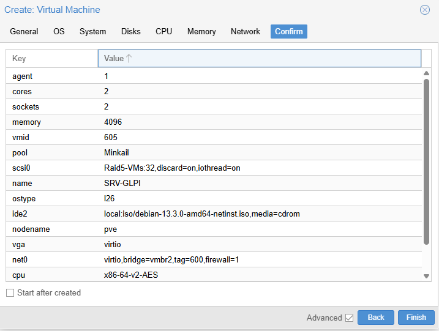
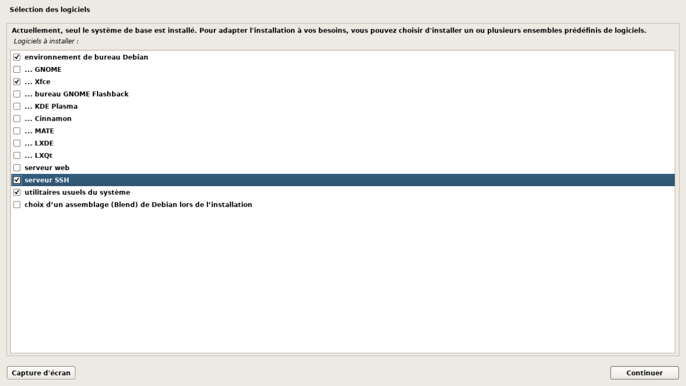
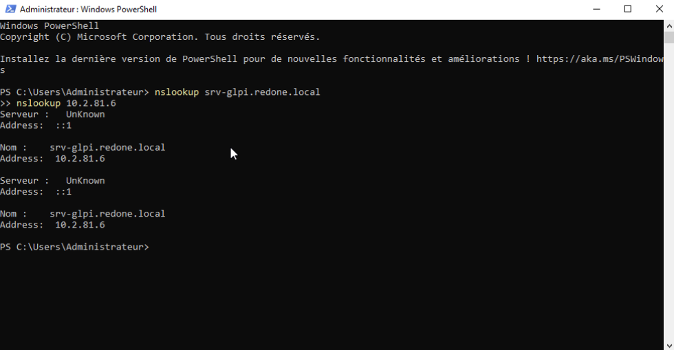
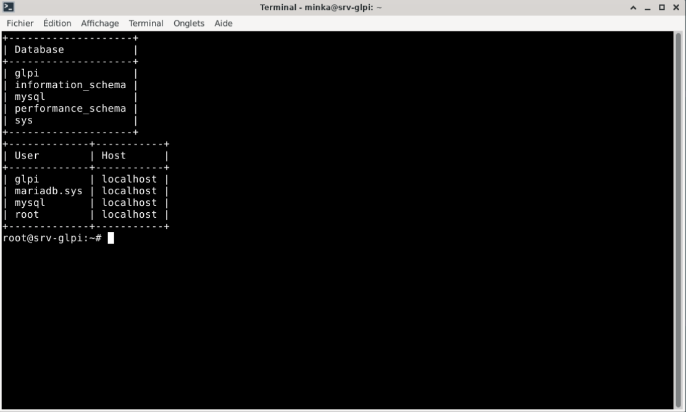
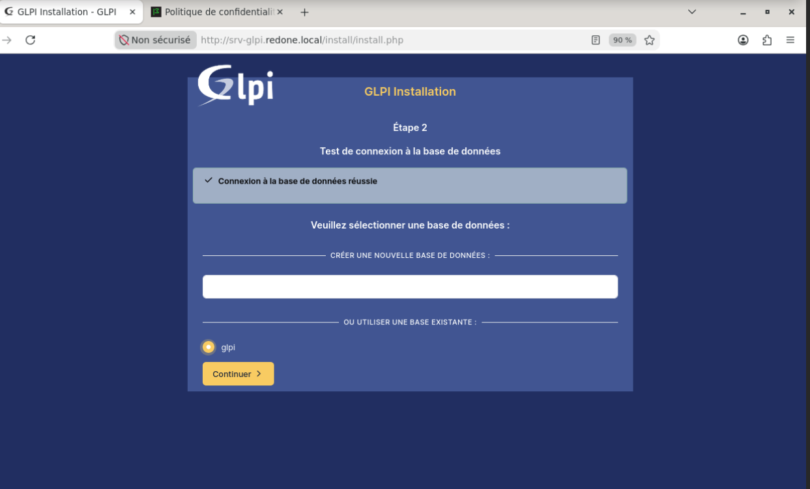
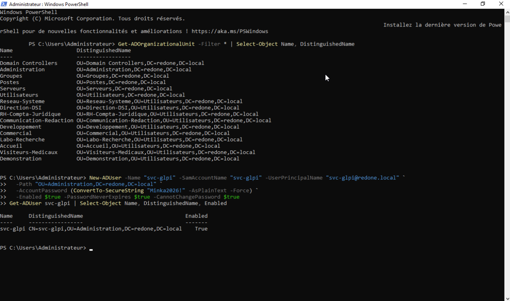
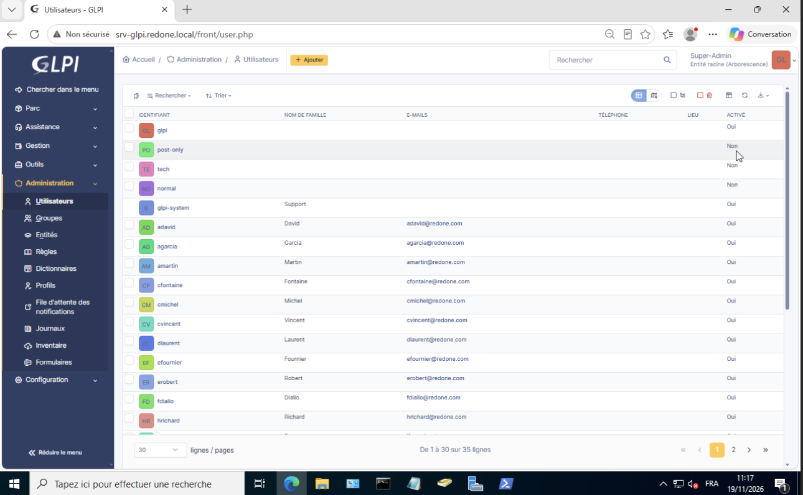
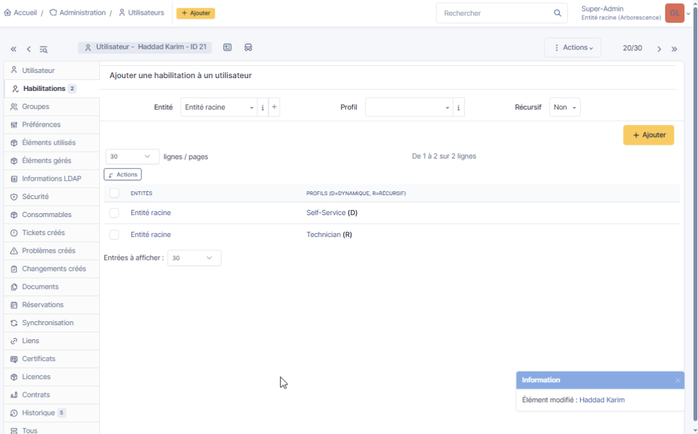
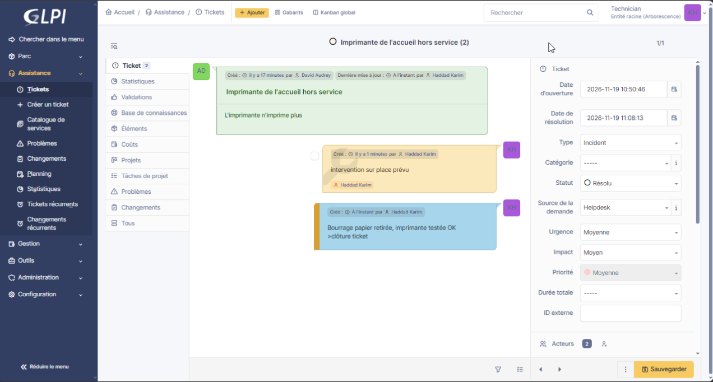
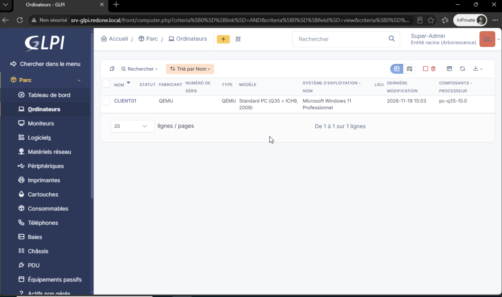

# GLPI - gestion du parc et des tickets

| | |
| --- | --- |
| **Atelier** | AP 1, chantier 2 |
| **Objectif** | Gérer le parc et les tickets d'incident, avec connexion des employés par leur compte de domaine |
| **Prérequis** | [Active Directory et DNS](../../Infrastructure/Active-Directory/Active-Directory.md), [comptes et groupes](../../Infrastructure/Active-Directory/Groupes-Comptes.md) |
| **Résultat** | GLPI 11 sur `http://srv-glpi.redone.local`, relié à l'annuaire, tickets traités, poste Windows inventorié automatiquement |

| Paramètre | Valeur |
| --- | --- |
| VM | `SRV-GLPI`, VMID 605, Debian 13.3 (bureau Xfce), 4 vCPU, 4 Gio, 32 Gio, VLAN 600 |
| Réseau | `srv-glpi.redone.local`, 10.2.81.6/24, passerelle 10.2.81.1, DNS 10.2.81.2 et 10.2.81.3 |
| Pile | Apache 2.4, MariaDB 11.8, PHP 8.4, GLPI 11.0.11 |
| Annuaire | `dc01.redone.local:389`, réplique `dc02.redone.local:389`, compte de service `svc-glpi` |
| Inventaire | GLPI Agent 1.21 sur `CLIENT01` |

## 1. Le serveur

Une VM dédiée : **un serveur, un rôle**. GLPI n'est installé ni sur un contrôleur de domaine ni sur un poste utilisateur.



Debian avec **serveur SSH** et un bureau léger **Xfce**, utilisé seulement pour administrer depuis la console Proxmox avec le copier-coller (affichage VirtIO-GPU, presse-papiers VNC). En production, le serveur serait sans interface graphique.



Adresse fixe avec NetworkManager :

```
CON=$(nmcli -t -f NAME,DEVICE con show --active | grep ens18 | cut -d: -f1)
nmcli con mod "$CON" ipv4.method manual ipv4.addresses 10.2.81.6/24 ipv4.gateway 10.2.81.1 ipv4.dns "10.2.81.2 10.2.81.3" ipv4.dns-search redone.local
nmcli con up "$CON"
sed -i 's/^127.0.1.1.*/10.2.81.6\tsrv-glpi.redone.local srv-glpi/' /etc/hosts
```


Sur `DC01`, enregistrement **A** `srv-glpi` → `10.2.81.6` avec son **PTR**. Depuis `DC01`, le nom donne l'adresse et l'adresse donne le nom.




## 2. Pile LAMP et base de données

```
apt install -y apache2 mariadb-server libapache2-mod-php php php-mysql php-mbstring php-curl php-gd php-xml php-intl php-ldap php-apcu php-zip php-bz2 php-bcmath
```

`php-mysql` relie PHP à la base, `php-ldap` permet l'authentification sur l'Active Directory. GLPI 11 demande PHP 8.2 au minimum : Debian 13 fournit la 8.4.


`mariadb-secure-installation` supprime les utilisateurs anonymes, la base de test et l'accès root à distance. Puis une base et un utilisateur dédiés, limités à cette base (**moindre privilège**) :

```
mariadb -e "CREATE DATABASE glpi CHARACTER SET utf8mb4 COLLATE utf8mb4_unicode_ci;"
mariadb -e "CREATE USER 'glpi'@'localhost' IDENTIFIED BY '<mot_de_passe>';"
mariadb -e "GRANT ALL PRIVILEGES ON glpi.* TO 'glpi'@'localhost';"
mariadb-tzinfo-to-sql /usr/share/zoneinfo | mariadb mysql
mariadb -e "GRANT SELECT ON mysql.time_zone_name TO 'glpi'@'localhost'; FLUSH PRIVILEGES;"
```



## 3. Déploiement de GLPI

```
cd /tmp
wget https://github.com/glpi-project/glpi/releases/download/11.0.11/glpi-11.0.11.tgz
tar -xzf glpi-11.0.11.tgz -C /var/www/
```

La configuration, les données et les journaux sont **sortis du dossier web** : ils ne peuvent pas être téléchargés par une adresse web.

| Dossier | Contenu |
| --- | --- |
| `/var/www/glpi` | Code de l'application |
| `/etc/glpi` | Configuration, dont la connexion à la base |
| `/var/lib/glpi` | Documents, sessions, cache |
| `/var/log/glpi` | Journaux |

```
mkdir -p /etc/glpi /var/lib/glpi /var/log/glpi
mv /var/www/glpi/files/* /var/lib/glpi/
cat > /var/www/glpi/inc/downstream.php <<'EOF'
<?php
define('GLPI_CONFIG_DIR', '/etc/glpi/');
if (file_exists(GLPI_CONFIG_DIR . '/local_define.php')) {
    require_once GLPI_CONFIG_DIR . '/local_define.php';
}
EOF
cat > /etc/glpi/local_define.php <<'EOF'
<?php
define('GLPI_VAR_DIR', '/var/lib/glpi');
define('GLPI_LOG_DIR', '/var/log/glpi');
EOF
chown -R www-data:www-data /var/www/glpi /etc/glpi /var/lib/glpi /var/log/glpi
```


Site Apache : seul le dossier **`public`** est publié.

```
cat > /etc/apache2/sites-available/glpi.conf <<'EOF'
<VirtualHost *:80>
    ServerName srv-glpi.redone.local
    DocumentRoot /var/www/glpi/public
    <Directory /var/www/glpi/public>
        Require all granted
        RewriteEngine On
        RewriteCond %{HTTP:Authorization} ^(.+)$
        RewriteRule .* - [E=HTTP_AUTHORIZATION:%{HTTP:Authorization}]
        RewriteCond %{REQUEST_FILENAME} !-f
        RewriteRule ^(.*)$ index.php [QSA,L]
    </Directory>
</VirtualHost>
EOF
a2enmod rewrite
a2dissite 000-default
a2ensite glpi
sed -i 's/^session.cookie_httponly =.*/session.cookie_httponly = On/' /etc/php/8.4/apache2/php.ini
systemctl restart apache2
```

`session.cookie_httponly` empêche un script de lire le cookie de session (protection contre le vol de session).

## 4. Installation web

Depuis `http://srv-glpi.redone.local`, l'assistant vérifie les prérequis : tous sont validés, dont la **sécurité des sessions** et l'**extension `ldap`**.


Connexion à la base avec l'utilisateur `glpi`, puis choix de la base `glpi`.



Après l'installation :

- données de démonstration désactivées ;
- mot de passe du compte **`glpi`** (Super-Admin) changé ;
- comptes **`tech`**, **`normal`** et **`post-only`** désactivés, les employés viendront de l'annuaire ;
- compte **`glpi-system`** conservé : compte technique interne qui signe les actions automatiques.


## 5. Liaison à l'Active Directory

Sur `DC01`, un **compte de service** en lecture seule, hors de l'OU importée :

```
New-ADUser -Name "svc-glpi" -SamAccountName "svc-glpi" -UserPrincipalName "svc-glpi@redone.local" `
  -Path "OU=Administration,DC=redone,DC=local" `
  -AccountPassword (ConvertTo-SecureString "<mot_de_passe>" -AsPlainText -Force) `
  -Enabled $true -PasswordNeverExpires $true -CannotChangePassword $true
```



Dans GLPI, *Configuration > Authentification > Annuaires LDAP* :

| Champ | Valeur | Pourquoi |
| --- | --- | --- |
| Serveur, port | `dc01.redone.local`, `389` | Contrôleur de domaine |
| Filtre | `(&(objectClass=user)(objectCategory=person)(!(userAccountControl:1.2.840.113556.1.4.803:=2)))` | Personnes seulement, comptes désactivés exclus |
| BaseDN | `OU=Utilisateurs,DC=redone,DC=local` | Seuls les employés, pas les comptes d'administration ni de service |
| DN du compte | `svc-glpi@redone.local` | Compte de service |
| Identifiant | `samaccountname` | Connexion avec l'identifiant Windows |
| Synchronisation | `objectguid` | Identifiant permanent, même si le compte est renommé |


Le test valide la connexion, l'authentification du compte de service et trouve **30 entrées**, les 30 employés.


**Réplique** `dc02.redone.local` : si `DC01` est arrêté, les connexions passent par `DC02`.


Une **règle d'affectation d'habilitations** donne à tout utilisateur venant de l'annuaire le profil **Self-Service** (créer et suivre ses tickets) sur l'entité racine.


Import des comptes (*Liaison annuaire LDAP*) : 30 employés, avec nom et adresse e-mail venus de l'annuaire.



`adavid` se connecte avec **son identifiant et son mot de passe Windows** (source *AD redone.local*) et arrive sur l'interface simplifiée. Aucun mot de passe d'employé n'est stocké dans GLPI. Le compte `glpi`, lui, se connecte sur la *Base interne GLPI* : il reste utilisable même si l'annuaire est indisponible.


## 6. Traitement d'un ticket

`khaddad` (responsable `Reseau-Systeme`) reçoit en plus le profil **Technician**.



1. **`adavid` déclare** l'incident « Imprimante de l'accueil hors service » : statut **Nouveau**.


2. **`khaddad` prend en charge** : il est technicien attribué, le ticket passe **En cours**.


3. **`khaddad` résout** : un suivi (« intervention sur place prévue »), puis une solution (« bourrage papier retiré, imprimante testée »). Le ticket passe **Résolu**. Le demandeur peut ensuite approuver la solution, ce qui le **clôt**.



## 7. Inventaire automatique

*Administration > Inventaire* : **Activer l'inventaire**.


**GLPI Agent 1.21** est installé sur `CLIENT01` (installation *Typical*), avec la cible `http://srv-glpi.redone.local/`. Il envoie un inventaire au démarrage puis toutes les 24 heures.


`CLIENT01` apparaît dans *Parc > Ordinateurs* **sans aucune saisie** : modèle (VM QEMU), Windows 11 Professionnel, processeur ; la fiche détaille composants et logiciels. Le premier inventaire a révélé que le nom Windows ne suivait pas le plan (`adavid`) : le poste a été renommé `CLIENT01`, et GLPI a mis à jour la même fiche, car il reconnaît la machine par son identifiant matériel.



## 8. Questions pour l'oral

- **Pourquoi une VM dédiée ?** Une faille dans GLPI n'expose ni l'annuaire ni un poste utilisateur.
- **Pourquoi sortir la configuration du dossier web ?** Le fichier de connexion à la base contient un mot de passe : hors du dossier publié, il ne peut pas être téléchargé.
- **Pourquoi un compte de service simple ?** S'il fuite, il permet seulement de lire l'annuaire. Un administrateur du domaine serait une faille majeure.
- **Pourquoi `objectguid` ?** Il ne change jamais, même si le compte est renommé ou déplacé.
- **Pourquoi Self-Service par défaut ?** Moindre privilège : les droits supplémentaires sont donnés au cas par cas, comme à `khaddad`.
- **Résolu ou Clos ?** Résolu : le technicien a apporté une solution. Clos : le demandeur l'a validée.
- **Pourquoi « Non sécurisé » ?** Le site est en HTTP, les mots de passe circulent en clair. En production : HTTPS avec un certificat, et LDAPS (port 636) vers l'annuaire.
- **Parc ou tickets ?** Le parc recense ce que l'entreprise possède ; les tickets suivent les incidents et demandes.
