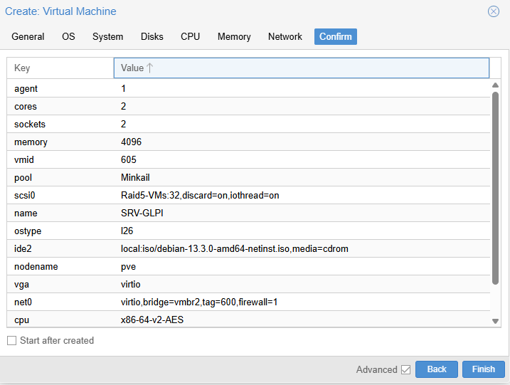
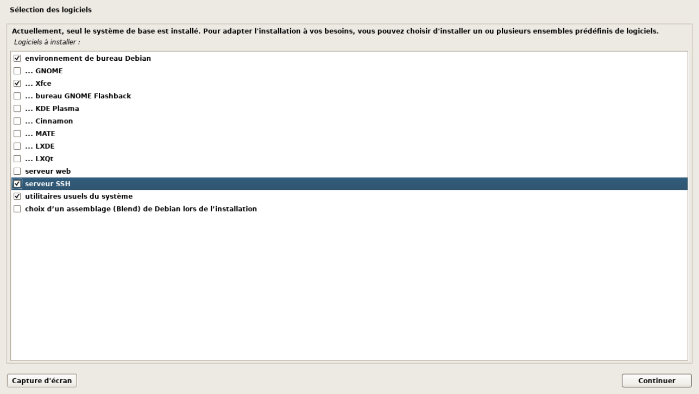
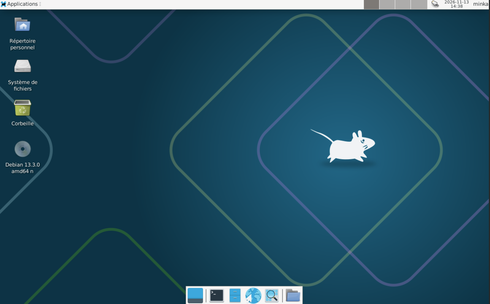
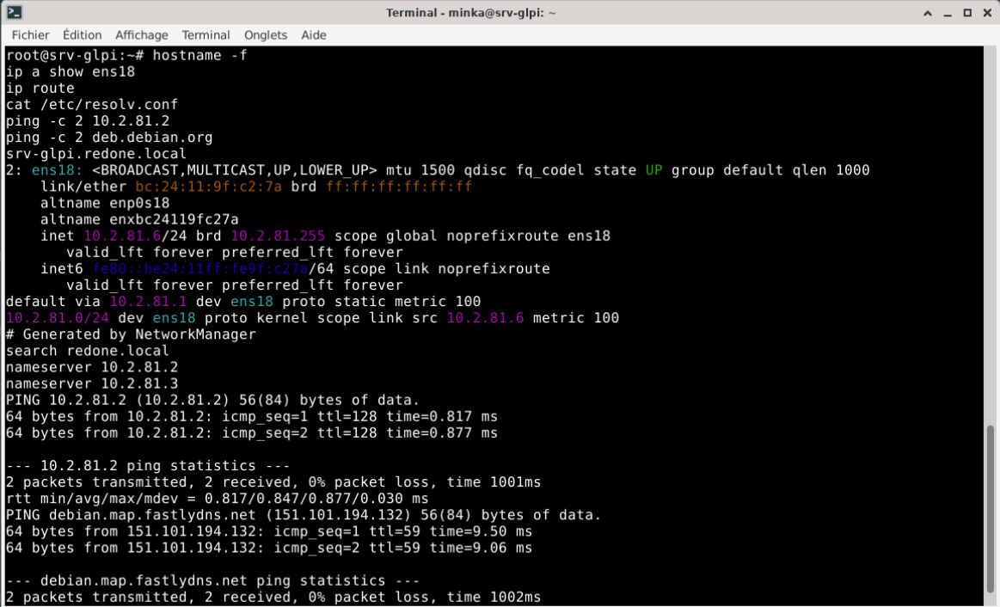
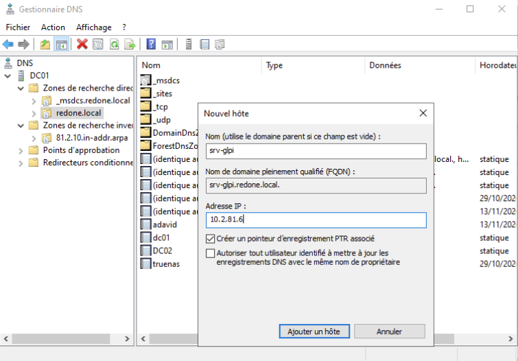
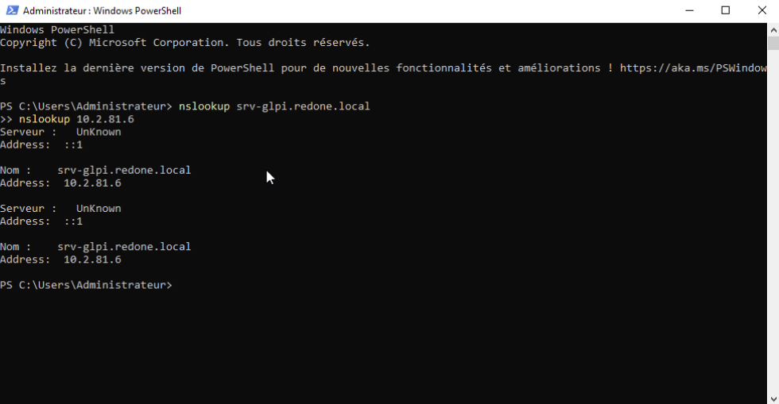
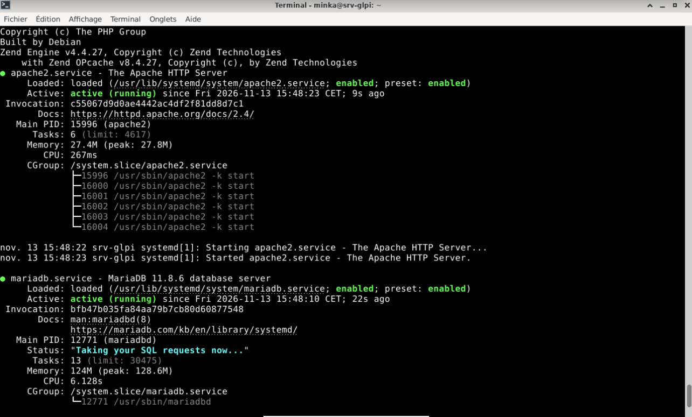

# GLPI - gestion du parc et des tickets

| | |
| --- | --- |
| **Atelier** | AP 1, chantier 2 |
| **Objectif** | Déployer GLPI pour gérer le parc et les tickets d'incident, avec une authentification des utilisateurs par leur compte de domaine |
| **Prérequis** | [Active Directory et DNS](../../Infrastructure/Active-Directory/Active-Directory.md), [comptes et groupes](../../Infrastructure/Active-Directory/Groupes-Comptes.md) |
| **État** | **En cours** : serveur et pile LAMP prêts (étapes 1 à 4) |

## Plan

| # | Étape | État |
| --- | --- | --- |
| 1 | Créer la VM `SRV-GLPI` | Réalisé |
| 2 | Installer Debian | Réalisé |
| 3 | Réseau, nom et DNS | Réalisé |
| 4 | Pile LAMP : Apache, MariaDB, PHP | Réalisé |
| 5 | Sécuriser MariaDB, créer la base `glpi` | À faire |
| 6 | Déployer GLPI, configurer Apache | À faire |
| 7 | Installation web, comptes par défaut | À faire |
| 8 | Liaison à l'Active Directory (LDAP) | À faire |
| 9 | Tests : connexion de domaine, ticket, inventaire | À faire |

## 1. Valeurs retenues

| Paramètre | Valeur |
| --- | --- |
| Nom de la VM (Proxmox) | `SRV-GLPI`, VMID 605, pool `Minkail` |
| Système | Debian 13.3, bureau Xfce |
| Processeur, mémoire | 2 sockets × 2 cœurs (4 vCPU), 4 Gio |
| Disque | 32 Gio sur `Raid5-VMs` (`discard`, `iothread`) |
| Affichage | VirtIO-GPU, presse-papiers VNC |
| Réseau | pont `vmbr2`, **VLAN 600**, VirtIO |
| Nom | `srv-glpi.redone.local` |
| Adresse IP | 10.2.81.6/24 (fixe), passerelle 10.2.81.1 |
| DNS | 10.2.81.2 (`DC01`), puis 10.2.81.3 (`DC02`) |
| Pile | Apache 2.4, MariaDB 11.8, PHP 8.4 |

## 2. Créer la machine virtuelle

Une VM dédiée : **un serveur, un rôle**. GLPI n'est installé ni sur un contrôleur de domaine (machine la plus sensible du réseau) ni sur un poste utilisateur.



La carte graphique **VirtIO-GPU** et le presse-papiers **VNC** permettent le copier-coller depuis la console Proxmox.

## 3. Installer Debian

Installation graphique, nom `srv-glpi`, domaine `redone.local`. Logiciels : **bureau Xfce**, **serveur SSH** et utilitaires usuels.



Le bureau léger Xfce sert uniquement à administrer le serveur depuis la console Proxmox du laboratoire, avec le copier-coller. En production, le serveur serait sans interface graphique et administré en SSH.



## 4. Réseau, nom et DNS

Avec un bureau, le réseau est géré par NetworkManager. Passage en adresse fixe :

```
CON=$(nmcli -t -f NAME,DEVICE con show --active | grep ens18 | cut -d: -f1)
nmcli con mod "$CON" ipv4.method manual ipv4.addresses 10.2.81.6/24 ipv4.gateway 10.2.81.1 ipv4.dns "10.2.81.2 10.2.81.3" ipv4.dns-search redone.local
nmcli con up "$CON"
sed -i 's/^127.0.1.1.*/10.2.81.6\tsrv-glpi.redone.local srv-glpi/' /etc/hosts
```

Vérification : nom complet `srv-glpi.redone.local`, adresse `10.2.81.6/24` sans `dynamic`, passerelle `10.2.81.1`, DNS des deux contrôleurs, `DC01` et Internet joignables.



Sur `DC01`, enregistrement **A** `srv-glpi` → `10.2.81.6`, avec son pointeur **PTR** dans la zone inversée.



Test depuis `DC01` : le nom donne l'adresse et l'adresse donne le nom. (`Serveur : UnKnown` est normal : `DC01` s'interroge par son adresse IPv6 locale `::1`, qui n'a pas de nom inverse.)



## 5. Pile LAMP

GLPI est une application web : il lui faut un serveur web, PHP et une base de données.

```
apt install -y apache2 mariadb-server libapache2-mod-php php php-mysql php-mbstring php-curl php-gd php-xml php-intl php-ldap php-apcu php-zip php-bz2 php-bcmath
```

| Extension PHP | Rôle |
| --- | --- |
| `mysql` | Connexion à la base MariaDB |
| `ldap` | Authentification sur l'Active Directory |
| `intl`, `mbstring` | Langues et caractères accentués |
| `gd` | Images et graphiques |
| `curl` | Échanges avec l'extérieur (vérification de version, agents) |
| `apcu` | Cache en mémoire, pour les performances |
| `xml`, `zip`, `bz2`, `bcmath` | Imports, archives, calculs |

**PHP 8.4.27** (GLPI 11 demande au minimum PHP 8.2), **Apache** et **MariaDB 11.8.6** sont actifs et lancés au démarrage.



## Questions pour l'oral

- **Pourquoi une VM dédiée ?** Un serveur, un rôle : une faille dans GLPI n'expose ni l'annuaire ni un poste utilisateur.
- **Pourquoi un enregistrement DNS ?** Les utilisateurs ouvrent `http://srv-glpi.redone.local` au lieu d'une adresse IP ; si l'adresse change, seul le DNS est à modifier.
- **Pourquoi un compte de service LDAP en lecture seule plutôt qu'un administrateur du domaine ?** Si son mot de passe fuite, l'attaquant peut seulement lire l'annuaire.
- **Pourquoi LDAPS est-il préférable à LDAP ?** LDAP circule en clair sur le port 389 ; LDAPS chiffre les échanges sur le port 636.
- **Quelle différence entre inventaire du parc et gestion des tickets ?** Le parc recense ce que l'entreprise possède ; les tickets suivent les incidents et demandes des utilisateurs.

Les mots de passe de la base et du compte LDAP ne sont pas publiés dans ce dépôt.
