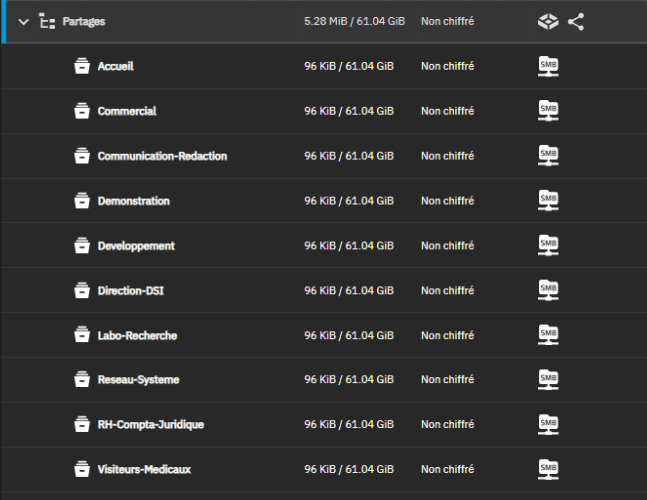
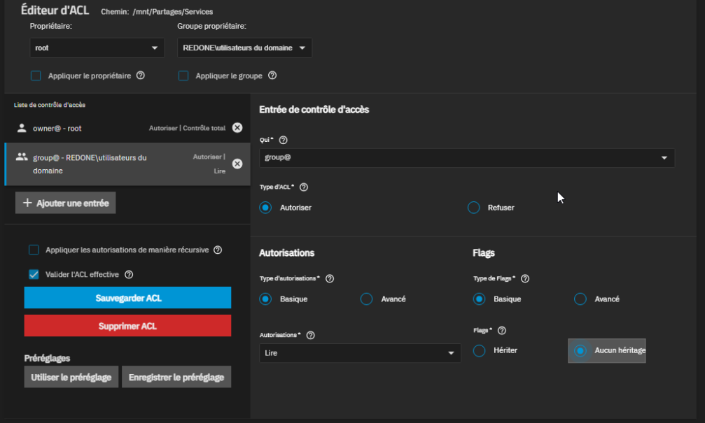
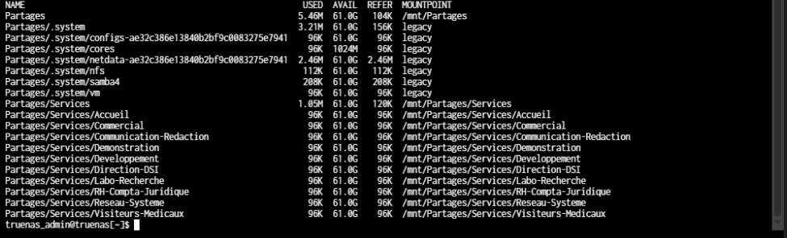
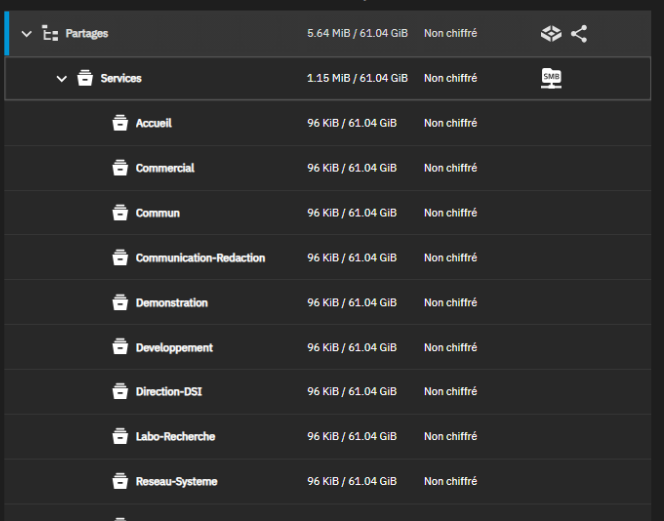
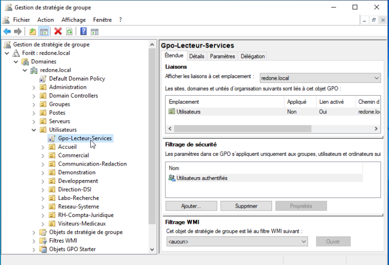
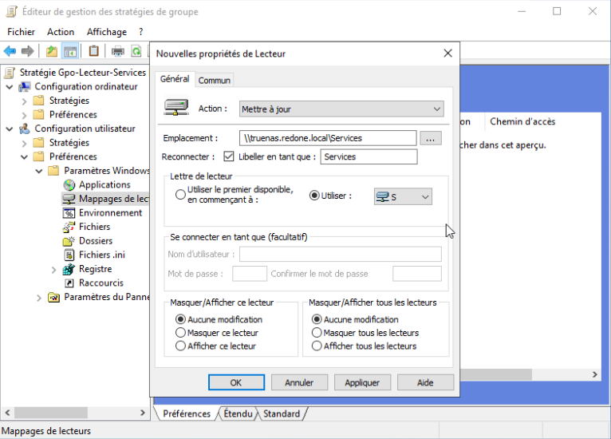
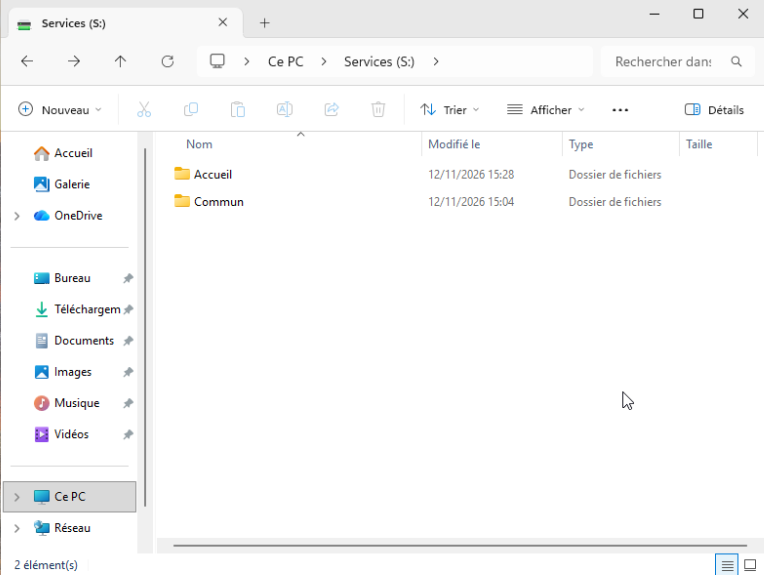
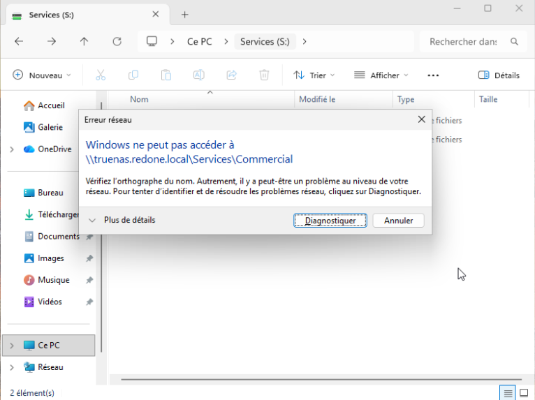

# Partages de services et lecteur réseau S: par GPO

| | |
| --- | --- |
| **Atelier** | AP 1, chantier 1 |
| **Objectif** | Donner à chaque employé, dès l'ouverture de session, un lecteur `S:` qui contient le dossier de son service et un dossier commun |
| **Prérequis** | [TrueNAS](../../Infrastructure/TrueNAS/TrueNAS.md) joint au domaine, [groupes `GG_<service>`](../../Infrastructure/Active-Directory/Groupes-Comptes.md) en place |
| **Résultat** | Un seul partage SMB `Services`, monté en `S:` par une GPO ; chaque utilisateur ne voit et n'ouvre que son service et `Commun` |
| **Suite** | [GLPI](../GLPI/GLPI.md) |

## 1. Point de départ et cible

L'[infrastructure de base](../../Infrastructure/TrueNAS/TrueNAS.md) a prouvé le principe sur TrueNAS : un dataset par service, protégé par le groupe de l'annuaire, et un partage SMB par dataset. Avec 10 services, cela fait 10 partages à connecter à la main sur chaque poste.

L'AP 1 rend le service exploitable :

| | Infrastructure de base | AP 1 |
| --- | --- | --- |
| Services couverts | 3 (démonstration) | **les 10 services** + un dossier `Commun` |
| Partages SMB | un par service | **un seul** : `Services` |
| Accès depuis le poste | chemin `\\10.2.81.4\<service>` tapé à la main | **lecteur `S:` monté automatiquement** par GPO |

Arborescence cible :

```
Partages (pool)
└── Services                 partage SMB unique, monté en S:
    ├── Accueil              REDONE\gg_accueil : Modifier
    ├── Commercial           REDONE\gg_commercial : Modifier
    ├── ...                  un dataset par service (10)
    └── Commun               REDONE\utilisateurs du domaine : Modifier
```

## 2. Créer les datasets des 10 services

Les 7 services manquants sont créés comme les 3 premiers : préréglage SMB, ACL `NFS4_RESTRICTED`, groupe propriétaire `REDONE\gg_<service>` avec le droit *Modifier*. À ce stade, les 10 datasets sont à la racine du pool, chacun avec son propre partage.



## 3. Regrouper les services sous un dossier `Services`

**Les 10 partages individuels sont supprimés** (les datasets, leur contenu et leurs ACL sont conservés).

**Le dataset parent `Services`** est créé avec le préréglage SMB, ce qui crée aussi son partage. Son ACL :

| Entrée | Droit | Héritage | Effet |
| --- | --- | --- | --- |
| `owner@` - `root` | Contrôle total | - | Administration |
| `group@` - `REDONE\utilisateurs du domaine` | **Lire** | **Aucun** | Tout employé peut ouvrir `S:` et lister son contenu, sans pouvoir y écrire |

Pas d'héritage et pas d'application récursive : chaque sous-dossier garde sa propre ACL.



**Déplacement des 10 datasets** sous `Services`, depuis le shell de TrueNAS (l'interface ne permet pas de déplacer un dataset) :

```
for s in Accueil Commercial Communication-Redaction Demonstration Developpement Direction-DSI Labo-Recherche Reseau-Systeme RH-Compta-Juridique Visiteurs-Medicaux; do sudo zfs rename Partages/$s Partages/Services/$s; done
sudo zfs list -r Partages
```

`zfs rename` déplace le dataset avec ses données et son ACL. La liste confirme les 10 services sous `Partages/Services/`.



**Le dataset `Commun`** est créé sous `Services`, avec le groupe `REDONE\utilisateurs du domaine` et le droit *Modifier* : tous les employés y lisent et écrivent.

L'arborescence finale : `Services` porte le seul partage SMB (icône à droite), les 11 dossiers sont dessous.



## 4. GPO : lecteur S: pour tous les utilisateurs

Sur `DC01`, dans la *Gestion des stratégies de groupe*, la GPO `Gpo-Lecteur-Services` est créée et **liée à l'OU `Utilisateurs`** : elle s'applique à tous les comptes des 10 services.



*Configuration utilisateur > Préférences > Paramètres Windows > Mappages de lecteurs > Nouveau > Lecteur mappé* :

| Champ | Valeur | Pourquoi |
| --- | --- | --- |
| Action | Mettre à jour | Crée le lecteur s'il n'existe pas, le corrige s'il a changé |
| Emplacement | `\\truenas.redone.local\Services` | Nom DNS plutôt qu'adresse IP : l'authentification Kerberos du domaine repose sur le nom |
| Reconnecter | coché | Le lecteur reste après redémarrage |
| Libellé | `Services` | Nom affiché dans l'explorateur |
| Lettre | `S:` | Identique pour tous les employés |



Aucun ciblage par groupe n'est nécessaire : tout le monde reçoit le même lecteur, ce sont les ACL de TrueNAS qui décident de ce que chacun peut ouvrir.

## 5. Tests depuis CLIENT01

Après `gpupdate /force` et une nouvelle ouverture de session :

**`REDONE\adavid` (Accueil)** : le lecteur `S: Services` est monté. Il ne contient que **Accueil** et **Commun** : les dossiers des autres services, sur lesquels il n'a aucun droit, n'apparaissent pas.



En tapant directement `S:\Commercial`, Windows ne peut pas accéder au dossier : le refus vient de l'ACL du dataset `Commercial`.



**`REDONE\lperrin` (Commercial)** : le même lecteur `S:` affiche **Commercial** et **Commun**, sans Accueil.

| Utilisateur | Service | Dossiers visibles dans S: |
| --- | --- | --- |
| `adavid` | Accueil | Accueil, Commun |
| `lperrin` | Commercial | Commercial, Commun |

La même GPO et le même partage donnent à chacun une vue différente, déterminée par ses groupes dans l'annuaire.

## 6. Questions pour l'oral

- **Pourquoi un seul partage plutôt qu'un par service ?** Un seul lecteur à monter, une seule GPO, la même lettre pour tout le monde. Ajouter un service revient à créer un dataset sous `Services`, sans toucher aux postes.
- **Pourquoi le dossier `Services` est-il en lecture seule pour tous ?** Il faut pouvoir l'ouvrir pour atteindre son sous-dossier, mais personne ne doit déposer de fichier à la racine.
- **Pourquoi « Aucun héritage » sur `Services` ?** Sinon le droit de lecture de tous les employés se propagerait aux dossiers créés dessous, et un service deviendrait lisible par tous.
- **Pourquoi l'utilisateur ne voit-il pas les autres services ?** Les dossiers sur lesquels il n'a aucun droit ne lui sont pas affichés ; s'il tape le chemin, l'accès est refusé.
- **Pourquoi une GPO de préférences plutôt qu'un script de connexion ?** Elle se configure graphiquement, s'applique à chaque ouverture de session et corrige le lecteur s'il a été modifié (action *Mettre à jour*).
- **Pourquoi lier la GPO à l'OU `Utilisateurs` ?** C'est un paramètre utilisateur : il doit viser les comptes, rangés dans cette OU, et non les ordinateurs.
- **Pourquoi `\\truenas.redone.local` et pas `\\10.2.81.4` ?** Avec le nom, Windows s'authentifie par Kerberos, le protocole du domaine ; avec l'adresse IP, il se rabat sur NTLM, moins sûr.
