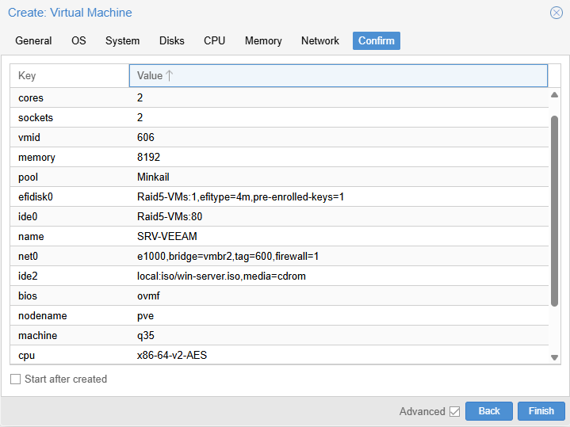
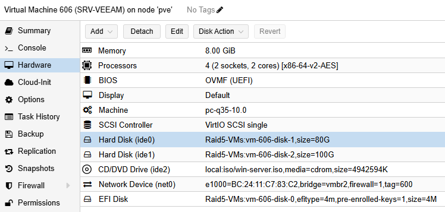
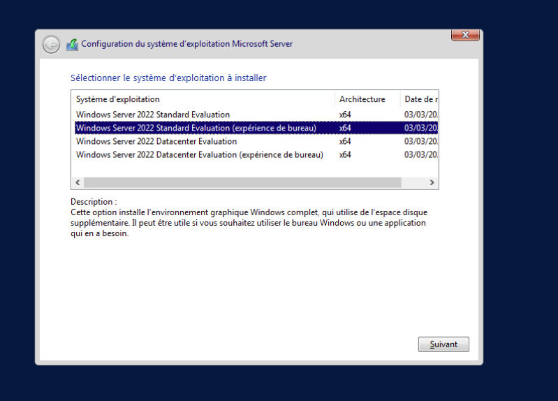
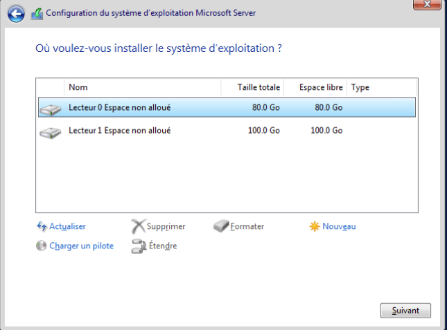
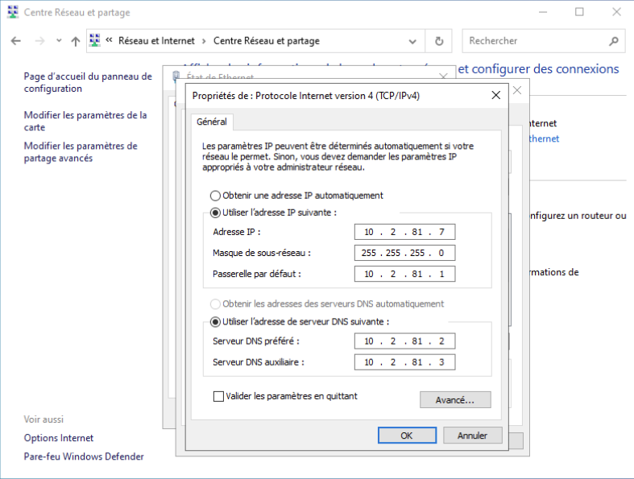
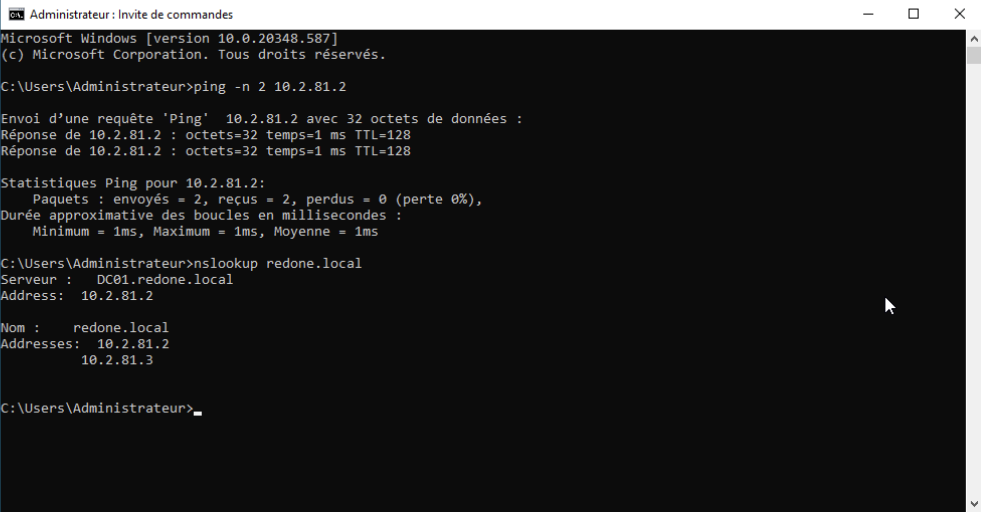
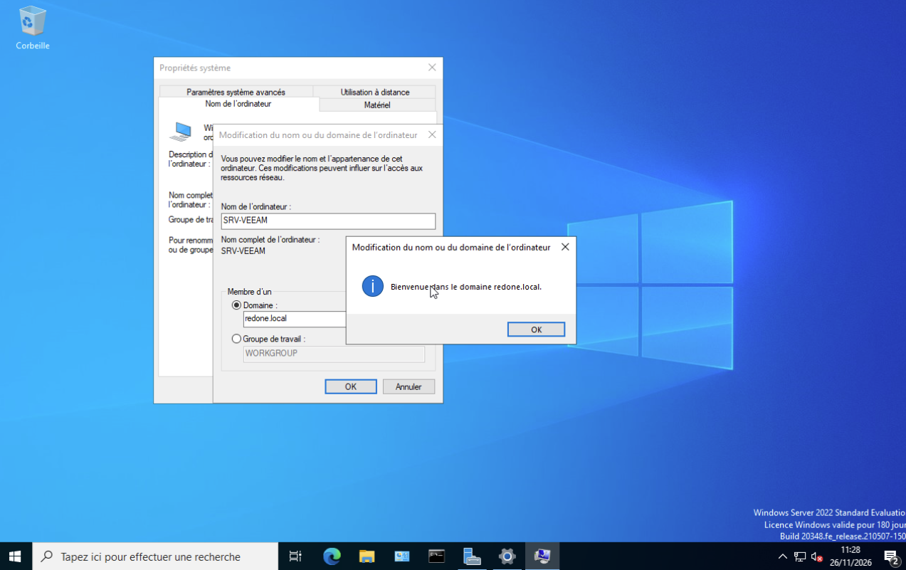
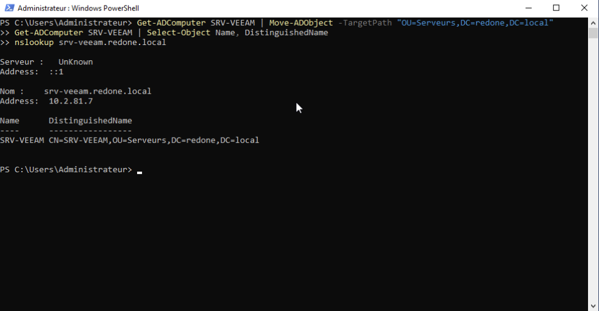
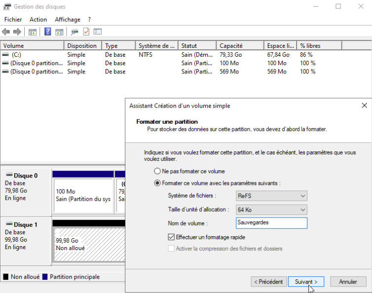
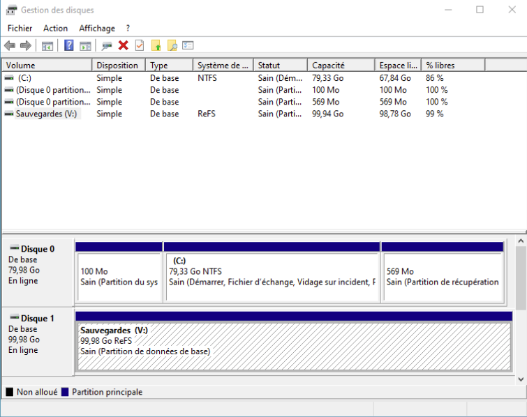

# Veeam Backup & Replication - sauvegarde des serveurs

| | |
| --- | --- |
| **Atelier** | AP 1, chantier 3 |
| **Objectif** | Sauvegarder automatiquement les machines de l'infrastructure et prouver qu'on sait les restaurer |
| **Prérequis** | [Active Directory et DNS](../../Infrastructure/Active-Directory/Active-Directory.md), [TrueNAS](../../Infrastructure/TrueNAS/TrueNAS.md) |
| **État** | **En cours** : serveur de sauvegarde prêt (étapes 1 à 4) |

## Plan

| # | Étape | État |
| --- | --- | --- |
| 1 | Créer la VM `SRV-VEEAM` | Réalisé |
| 2 | Installer Windows Server 2022 | Réalisé |
| 3 | Réseau, nom et domaine | Réalisé |
| 4 | Disque des sauvegardes `V:` en ReFS | Réalisé |
| 5 | Installer Veeam Backup & Replication 13 (Community Edition) | À faire |
| 6 | Déclarer le dépôt de sauvegarde | À faire |
| 7 | Sauvegarder DC01, SRV-GLPI et CLIENT01 | À faire |
| 8 | Tester les restaurations | À faire |

## Veeam en quelques mots

**Veeam Backup & Replication** est un logiciel de sauvegarde et de restauration. Un serveur central copie régulièrement les machines vers un stockage de sauvegarde et sait les restaurer après une panne, une erreur humaine ou un rançongiciel. L'édition **Community**, gratuite, protège jusqu'à 10 machines.

| Terme | Sens |
| --- | --- |
| Serveur de sauvegarde | Machine où Veeam est installé ; il pilote tout |
| Dépôt (repository) | Emplacement où sont stockées les sauvegardes |
| Job | Tâche de sauvegarde : quoi, quand, combien de versions garder |
| Point de restauration | Version sauvegardée à une date donnée |
| Complète / incrémentale | La complète copie tout ; l'incrémentale seulement ce qui a changé |
| Agent | Logiciel installé dans une machine pour la sauvegarder de l'intérieur |
| Règle 3-2-1 | 3 copies, sur 2 supports différents, dont 1 hors site |

## 1. Valeurs retenues

| Paramètre | Valeur |
| --- | --- |
| Nom de la VM (Proxmox) | `SRV-VEEAM`, VMID 606, pool `Minkail` |
| Système | Windows Server 2022 Standard Evaluation (expérience de bureau) |
| Processeur, mémoire | 2 sockets × 2 cœurs (4 vCPU), 8 Gio |
| Disque système | 80 Gio, `C:` |
| Disque des sauvegardes | 100 Gio, `V:` (`Sauvegardes`), ReFS 64 Ko |
| Réseau | pont `vmbr2`, **VLAN 600**, Intel E1000 |
| Nom | `srv-veeam.redone.local`, membre du domaine, OU `Serveurs` |
| Adresse IP | 10.2.81.7/24, passerelle 10.2.81.1 |
| DNS | 10.2.81.2 (`DC01`), puis 10.2.81.3 (`DC02`) |

## 2. Créer la machine virtuelle

Même configuration que `DC01`, éprouvée : démarrage UEFI (OVMF) avec disque EFI, disque IDE et carte Intel E1000, reconnus par Windows sans pilote supplémentaire. 8 Gio de mémoire : Veeam s'appuie sur une base PostgreSQL.



Un **second disque de 100 Gio** est ajouté pour les sauvegardes : elles ne doivent pas être sur le même disque que le système.



## 3. Installer Windows Server 2022

Édition **Standard Evaluation (expérience de bureau)**, comme `DC01`.



Windows est installé sur le **lecteur 0 (80 Go)** ; le lecteur 1 (100 Go) reste vierge pour les sauvegardes.



## 4. Réseau, nom et domaine

Adresse fixe, DNS des deux contrôleurs de domaine (`ncpa.cpl`).



`DC01` répond et le domaine `redone.local` est résolu par ses deux contrôleurs.



Renommage en `SRV-VEEAM` et jonction au domaine `redone.local` en une seule opération (`sysdm.cpl`), avec le compte `REDONE\Administrateur`.



Sur `DC01`, l'ordinateur est rangé dans l'OU **Serveurs**. En rejoignant le domaine, la machine s'est **enregistrée toute seule dans le DNS** : `srv-veeam.redone.local` → 10.2.81.7.

```
Get-ADComputer SRV-VEEAM | Move-ADObject -TargetPath "OU=Serveurs,DC=redone,DC=local"
Get-ADComputer SRV-VEEAM | Select-Object Name, DistinguishedName
nslookup srv-veeam.redone.local
```



## 5. Disque des sauvegardes

Dans la *Gestion des disques* (`diskmgmt.msc`), le disque 1 est initialisé en **GPT** puis formaté :

| Réglage | Valeur | Pourquoi |
| --- | --- | --- |
| Lettre | `V:` | V comme Veeam |
| Système de fichiers | **ReFS** | Format recommandé par Veeam pour un dépôt : avec le *Fast Clone*, les blocs déjà sauvegardés ne sont pas recopiés mais référencés, les sauvegardes complètes sont plus rapides et prennent moins de place |
| Unité d'allocation | **64 Ko** | Taille recommandée par Veeam pour ReFS |
| Nom | `Sauvegardes` | |





## Questions pour l'oral

- **Pourquoi un serveur de sauvegarde dédié ?** Si un serveur de production tombe, ses sauvegardes sont ailleurs et restent disponibles.
- **Pourquoi un disque séparé pour les sauvegardes ?** Une panne ou une réinstallation du système n'emporte pas les sauvegardes.
- **Pourquoi ReFS ?** Le Fast Clone accélère les sauvegardes complètes et économise de l'espace.
- **Qu'est-ce que la règle 3-2-1 ?** 3 copies des données, sur 2 supports différents, dont 1 hors site.
- **Pourquoi tester les restaurations ?** Une sauvegarde qui n'a jamais été restaurée n'est pas une preuve : c'est la restauration qui compte.
