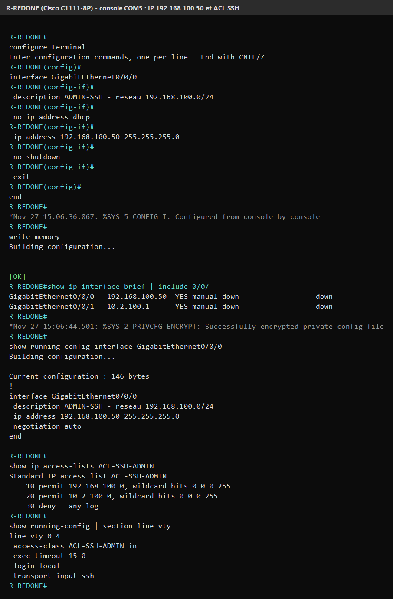
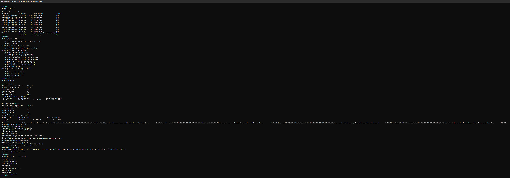
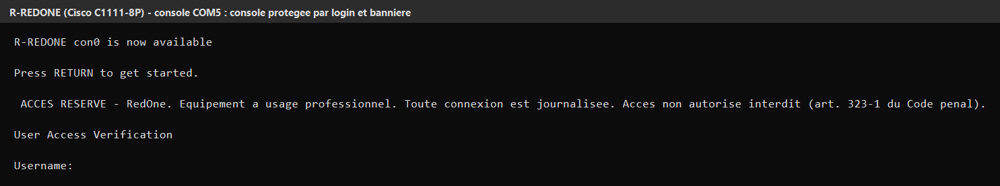
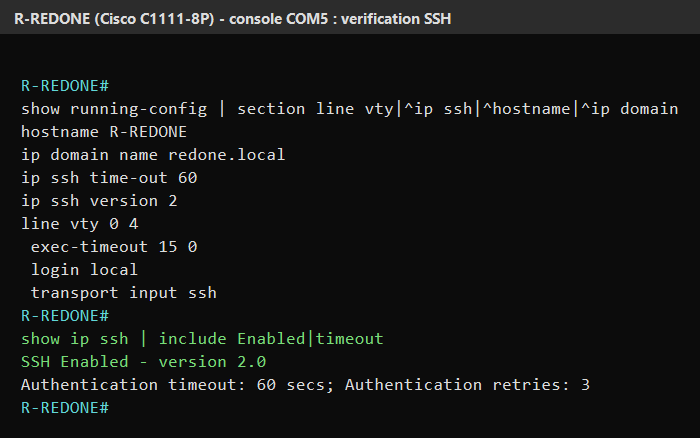

# AP 2 - Routeur physique Cisco C1111-8P (R-REDONE)

> État : **en cours**. Configuration complète appliquée (SSH durci, réseau visiteurs isolé avec NAT et DHCP) ; tests sur câble et supervision Zabbix à venir. Retour à l'[AP 2](../README.md).

## Objectif

Ajouter un routeur physique à l'infrastructure RedOne pour :

- router entre les VLAN (serveurs, utilisateurs, visiteurs, administration) ;
- offrir un **accès Internet aux visiteurs**, sans aucun accès au réseau interne ;
- n'être administré qu'en **SSH**, jamais en Telnet.

Cette page couvre la première étape : la prise en main du routeur et la mise en place de l'accès SSH.

## Matériel et valeurs

| Élément | Valeur |
|---|---|
| Modèle | Cisco ISR 1100, `C1111-8P` |
| Système | IOS-XE 16.12.04 |
| Ports routés (WAN) | `Gi0/0/0`, `Gi0/0/1` |
| Switch intégré | 8 ports, `Gi0/1/0` à `Gi0/1/7` |
| Nom d'hôte | `R-REDONE` |
| Domaine | `redone.local` |
| IP d'administration SSH et sortie Internet | `192.168.100.50/24` sur `Gi0/0/0` (NAT outside), passerelle `192.168.100.1` |
| Visiteurs, port routé | `10.2.83.1/24` sur `Gi0/0/1` |
| Visiteurs, prises du switch | VLAN 620, `10.2.84.1/24`, ports `Gi0/1/0` à `Gi0/1/3` |
| Compte d'administration | `admin-minka` (privilège 15) |
| Câble console | USB-série CH340, port `COM5`, 9600 bauds, 8N1 |

Le switch intégré permet de tout faire dans un seul boîtier : pas besoin de switch supplémentaire pour les prises visiteurs.

## Plan d'adressage prévu

| VLAN | Réseau | Rôle | Accès |
|---|---|---|---|
| 600 Serveurs (existant) | 10.2.81.0/24 | AD, DNS, GLPI, TrueNAS, Veeam | Inchangé |
| 610 Utilisateurs | 10.2.82.0/24 | Postes des employés | Serveurs et Internet |
| Visiteurs (port routé `Gi0/0/1`) | 10.2.83.0/24 | Prise invités | Internet seulement |
| 620 Visiteurs (prises du switch) | 10.2.84.0/24 | Prises invités `Gi0/1/0-3` | Internet seulement |
| 699 Administration | 10.2.100.0/24 | Gestion du routeur | Admins seulement |

Le DHCP du VLAN 600 reste assuré par le pfSense de la classe. Les visiteurs recevront leur adresse du routeur lui-même.

## Étape 1 - Accès console sans PuTTY

Le routeur neuf n'a ni adresse IP, ni compte, ni clé : la première configuration passe obligatoirement par le port console.

J'ai piloté le port console directement depuis PowerShell, avec la classe .NET `System.IO.Ports.SerialPort`, sans logiciel de terminal.

Problème rencontré : avec le pilote CH340 version 3.9.2024.9, Windows refusait d'ouvrir le port (« Un périphérique attaché au système ne fonctionne pas correctement »), puis plus aucun octet ne revenait du routeur. Ce comportement est connu avec certains adaptateurs USB-série. **Solution : installer le pilote CH340 version 3.4.2014.8.** Le port s'ouvre ensuite normalement.

Au premier démarrage, le routeur propose l'assistant de configuration initiale : réponse `no`, puis arrêt de l'autoinstall.


## Étape 2 - Configuration SSH

```
configure terminal
hostname R-REDONE
ip domain name redone.local
no ip domain lookup
crypto key generate rsa modulus 2048
ip ssh version 2
ip ssh time-out 60
ip ssh authentication-retries 3
line vty 0 4
 login local
 transport input ssh
 exec-timeout 15 0
line con 0
 logging synchronous
interface GigabitEthernet0/0/1
 description ADMIN - acces SSH (futur VLAN 699)
 ip address 10.2.100.1 255.255.255.0
 no shutdown
end
write memory
```

| Commande | Rôle |
|---|---|
| `hostname`, `ip domain name` | Nécessaires pour nommer la clé RSA |
| `no ip domain lookup` | Une faute de frappe n'est pas prise pour un nom à résoudre |
| `crypto key generate rsa modulus 2048` | Clé qui chiffre les sessions SSH |
| `ip ssh version 2` | SSHv1 est obsolète et vulnérable |
| `time-out 60`, `authentication-retries 3` | Limite les tentatives de connexion |
| `login local`, `transport input ssh` | Comptes locaux, Telnet interdit |
| `exec-timeout 15 0` | Déconnexion après 15 minutes d'inactivité |
| `write memory` | Configuration conservée au redémarrage |


## Étape 3 - Comptes chiffrés

```
username admin privilege 15 algorithm-type scrypt secret ********
enable algorithm-type scrypt secret ********
service password-encryption
```

Les mots de passe sont stockés en **type 9 (scrypt)**, le hachage le plus robuste d'IOS-XE. Ils ont été saisis par un script qui ne les affiche ni ne les enregistre. Aucun mot de passe n'est publié dans ce dépôt.


## Étape 4 - Adresse d'administration et filtrage SSH

Le routeur est joignable en SSH sur le réseau `192.168.100.0/24`, depuis un autre poste. L'accès est filtré par une ACL standard posée sur les lignes VTY : seuls ce réseau et le futur réseau d'administration peuvent ouvrir une session, les autres tentatives sont refusées et journalisées.

```
ip access-list standard ACL-SSH-ADMIN
 remark Postes autorises a administrer R-REDONE en SSH
 10 permit 192.168.100.0 0.0.0.255
 20 permit 10.2.100.0 0.0.0.255
 30 deny   any log
line vty 0 4
 access-class ACL-SSH-ADMIN in
interface GigabitEthernet0/0/0
 description ADMIN-SSH - reseau 192.168.100.0/24
 ip address 192.168.100.50 255.255.255.0
 no shutdown
```

J'ai d'abord essayé `ip address dhcp` sur `Gi0/0/0`, mais aucun serveur DHCP n'a répondu sur ce lien (bail `0.0.0.0`, état « Purging »). J'ai donc choisi une adresse fixe, plus simple à retenir pour se connecter en SSH.



## Étape 5 - Configuration complète : durcissement et réseau visiteurs

La configuration finale reprend celle d'un collègue, adaptée à mon infrastructure. Elle a été appliquée en deux parties :

- **partie A**, sans secret, envoyée en console ;
- **partie B**, avec les mots de passe, saisie par moi dans un script qui ne les affiche pas.

| Bloc | Contenu |
|---|---|
| Identité et heure | Fuseau CET/CEST, horodatage des journaux, NTP `192.168.100.1` |
| Mots de passe | `security passwords min-length 12`, compte `admin-minka` et `enable` en scrypt, `service password-encryption` |
| Services coupés | `no ip http server`, `no cdp run`, `no service pad`, `no ip source-route` |
| SSH | ACL `ADMIN-SSH` (192.168.100.0/24 seulement), `login block-for 120 attempts 3 within 60`, journalisation des connexions, `exec-timeout 5 0` |
| Console | `login local` : la console demande aussi un identifiant |
| Traçabilité | Bannière légale (art. 323-1 du Code pénal), `archive log config` avec `hidekeys`, journal de 64 ko |
| Visiteurs | Deux réseaux isolés : `Gi0/0/1` en 10.2.83.0/24 et VLAN 620 en 10.2.84.0/24 (prises `Gi0/1/0-3`, `portfast`, `bpduguard`) |
| DHCP visiteurs | Pools `VISITEURS` et `VISITEURS-SWITCH`, baux de 4 h, 19 premières adresses exclues |
| Filtrage visiteurs | ACL `VISITEURS-IN` : DHCP, ping de la passerelle, DNS de la salle, puis **tout réseau privé interdit** (10/8, 172.16/12, 192.168/16) et Internet autorisé |
| NAT | PAT des deux réseaux visiteurs derrière `Gi0/0/0`, avec `ip nat log translations syslog` (traçabilité des connexions, CPCE art. L34-1) |
| SNMP | Vue `LECTURE` préparée ; groupe et utilisateur SNMPv3 pour Zabbix à ajouter |

L'ancien compte `admin` et l'ancienne ACL `ACL-SSH-ADMIN` ont été supprimés, pour ne laisser aucun accès inutilisé.






## Vérifications



| Test | Résultat attendu | État |
|---|---|---|
| `show ip ssh` | `SSH Enabled - version 2.0` | OK |
| `show running-config \| section line` | `transport input ssh`, `login local`, `access-class ADMIN-SSH in` | OK |
| Mots de passe en type 9 | `secret 9 ...` | OK |
| `show ip access-lists ADMIN-SSH` | 192.168.100.0/24 autorisé, reste refusé et journalisé | OK |
| `show ip dhcp pool` | Pools `VISITEURS` et `VISITEURS-SWITCH` | OK |
| Console | Bannière puis `Username:` | OK |
| `ssh admin-minka@192.168.100.50` depuis un PC en 192.168.100.x | Bannière puis invite `R-REDONE#` | À faire (câble) |
| PC sur une prise `Gi0/1/0-3` | Adresse en 10.2.84.x, navigation Internet | À faire |
| Même PC vers `10.2.81.2` (DC01) | Bloqué par `VISITEURS-IN` | À faire |
| `show ip nat translations` | Traductions des visiteurs | À faire |
| Supervision Zabbix en SNMPv3 | Hôte R-REDONE disponible | À faire |

## Points à justifier à l'oral

- Pourquoi la première configuration passe forcément par la console.
- Différence entre SSH et Telnet, et pourquoi SSHv2 uniquement.
- Différence entre `enable password`, `enable secret` type 5 et type 9 (scrypt).
- Pourquoi une adresse d'administration dans un réseau séparé (VLAN 699).
- Pourquoi l'ACL visiteurs interdit toutes les plages privées et pas seulement mes réseaux.
- Rôle du NAT (PAT) et obligation de conserver les journaux de connexion (CPCE art. L34-1).
- Intérêt de `login block-for`, de la bannière légale et de `archive log config`.
