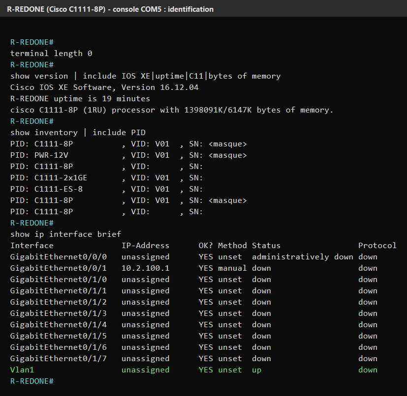
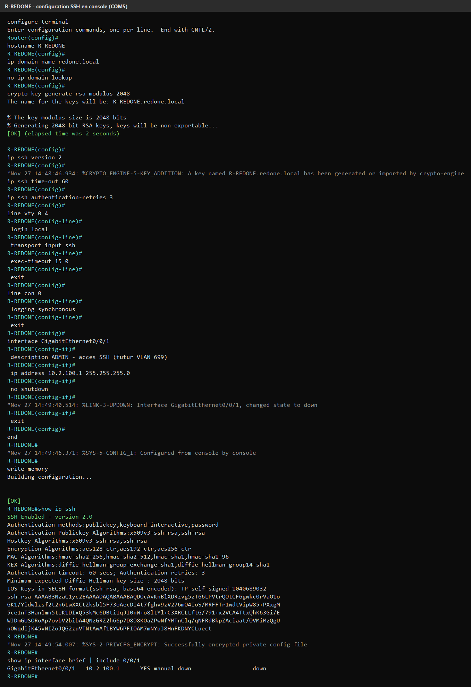
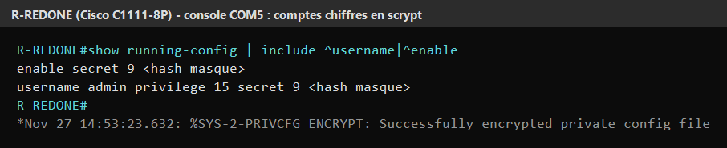

# AP 2 - Routeur physique Cisco C1111-8P (R-REDONE)

> État : **en cours**. Accès SSH configuré ; VLAN visiteurs, utilisateurs et administration à venir. Retour à l'[AP 2](../README.md).

## Objectif

Ajouter un routeur physique à l'infrastructure RedOne pour :

- router entre les VLAN (serveurs, utilisateurs, visiteurs, administration) ;
- offrir un **accès Internet aux visiteurs**, sans aucun accès au réseau interne ;
- n'être administré qu'en **SSH**, jamais en Telnet.

Cette page couvre la première étape : la prise en main du routeur et la mise en place de l'accès SSH.

## Matériel et valeurs

| Élément | Valeur |
|---|---|
| Modèle | Cisco ISR 1100, `C1111-8P` |
| Système | IOS-XE 16.12.04 |
| Ports routés (WAN) | `Gi0/0/0`, `Gi0/0/1` |
| Switch intégré | 8 ports, `Gi0/1/0` à `Gi0/1/7` |
| Nom d'hôte | `R-REDONE` |
| Domaine | `redone.local` |
| IP d'administration | `10.2.100.1/24` sur `Gi0/0/1` (réseau du futur VLAN 699) |
| Câble console | USB-série CH340, port `COM5`, 9600 bauds, 8N1 |

Le switch intégré permet de tout faire dans un seul boîtier : pas besoin de switch supplémentaire pour les prises visiteurs.

## Plan d'adressage prévu

| VLAN | Réseau | Rôle | Accès |
|---|---|---|---|
| 600 Serveurs (existant) | 10.2.81.0/24 | AD, DNS, GLPI, TrueNAS, Veeam | Inchangé |
| 610 Utilisateurs | 10.2.82.0/24 | Postes des employés | Serveurs et Internet |
| 620 Visiteurs | 10.2.83.0/24 | Prise invités | Internet seulement |
| 699 Administration | 10.2.100.0/24 | Gestion du routeur | Admins seulement |

Le DHCP du VLAN 600 reste assuré par le pfSense de la classe. Les visiteurs recevront leur adresse du routeur lui-même.

## Étape 1 - Accès console sans PuTTY

Le routeur neuf n'a ni adresse IP, ni compte, ni clé : la première configuration passe obligatoirement par le port console.

J'ai piloté le port console directement depuis PowerShell, avec la classe .NET `System.IO.Ports.SerialPort`, sans logiciel de terminal.

Problème rencontré : avec le pilote CH340 version 3.9.2024.9, Windows refusait d'ouvrir le port (« Un périphérique attaché au système ne fonctionne pas correctement »), puis plus aucun octet ne revenait du routeur. Ce comportement est connu avec certains adaptateurs USB-série. **Solution : installer le pilote CH340 version 3.4.2014.8.** Le port s'ouvre ensuite normalement.

Au premier démarrage, le routeur propose l'assistant de configuration initiale : réponse `no`, puis arrêt de l'autoinstall.



## Étape 2 - Configuration SSH

```
configure terminal
hostname R-REDONE
ip domain name redone.local
no ip domain lookup
crypto key generate rsa modulus 2048
ip ssh version 2
ip ssh time-out 60
ip ssh authentication-retries 3
line vty 0 4
 login local
 transport input ssh
 exec-timeout 15 0
line con 0
 logging synchronous
interface GigabitEthernet0/0/1
 description ADMIN - acces SSH (futur VLAN 699)
 ip address 10.2.100.1 255.255.255.0
 no shutdown
end
write memory
```

| Commande | Rôle |
|---|---|
| `hostname`, `ip domain name` | Nécessaires pour nommer la clé RSA |
| `no ip domain lookup` | Une faute de frappe n'est pas prise pour un nom à résoudre |
| `crypto key generate rsa modulus 2048` | Clé qui chiffre les sessions SSH |
| `ip ssh version 2` | SSHv1 est obsolète et vulnérable |
| `time-out 60`, `authentication-retries 3` | Limite les tentatives de connexion |
| `login local`, `transport input ssh` | Comptes locaux, Telnet interdit |
| `exec-timeout 15 0` | Déconnexion après 15 minutes d'inactivité |
| `write memory` | Configuration conservée au redémarrage |



## Étape 3 - Comptes chiffrés

```
username admin privilege 15 algorithm-type scrypt secret ********
enable algorithm-type scrypt secret ********
service password-encryption
```

Les mots de passe sont stockés en **type 9 (scrypt)**, le hachage le plus robuste d'IOS-XE. Ils ont été saisis par un script qui ne les affiche ni ne les enregistre. Aucun mot de passe n'est publié dans ce dépôt.



## Vérifications


| Test | Résultat attendu | État |
|---|---|---|
| `show ip ssh` | `SSH Enabled - version 2.0` | OK |
| `show running-config \| section line vty` | `transport input ssh`, `login local` | OK |
| Mots de passe en type 9 | `secret 9 ...` | OK |
| `ssh admin@10.2.100.1` depuis un PC en 10.2.100.10/24 | Invite `R-REDONE#` | À faire |

## Points à justifier à l'oral

- Pourquoi la première configuration passe forcément par la console.
- Différence entre SSH et Telnet, et pourquoi SSHv2 uniquement.
- Différence entre `enable password`, `enable secret` type 5 et type 9 (scrypt).
- Pourquoi une adresse d'administration dans un réseau séparé (VLAN 699).
