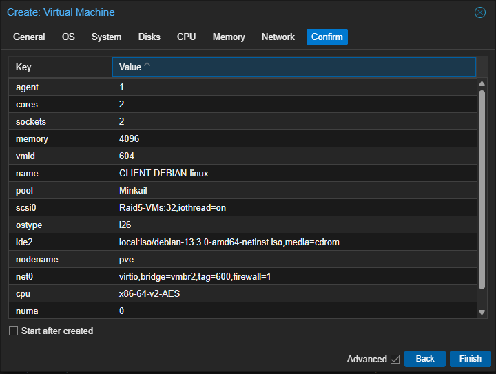
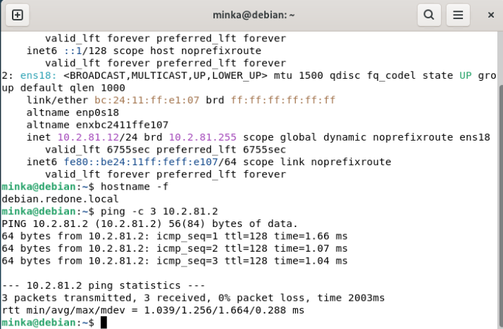
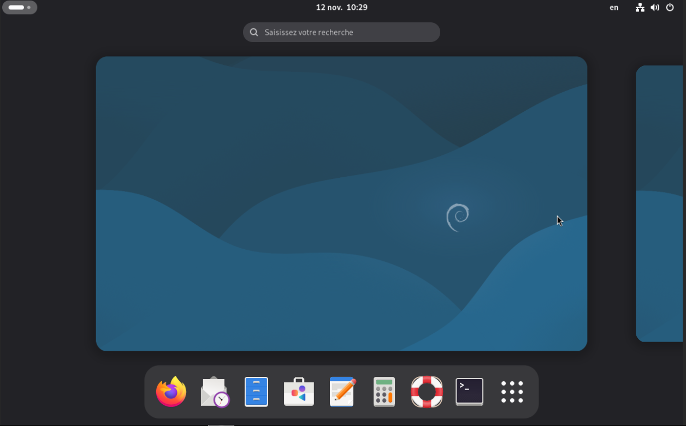
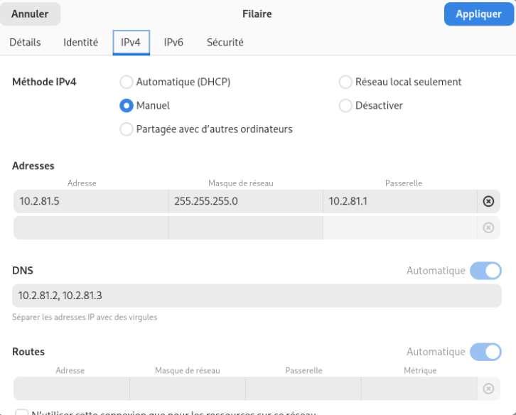
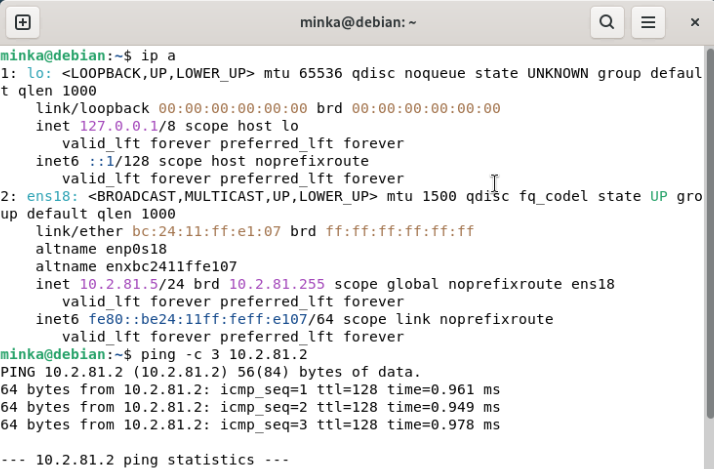
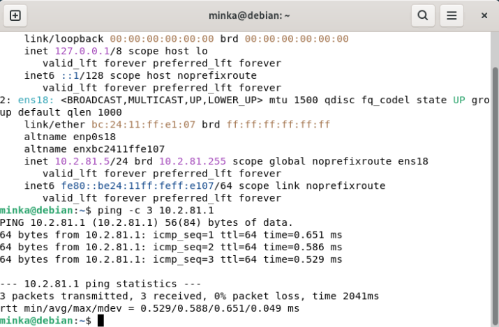

# Poste client Debian 13 - installation avec bureau et adresse fixe

| | |
| --- | --- |
| **Chantier** | Complément : poste Linux pour les TP |
| **Objectif** | Disposer d'un poste Debian 13 avec environnement de bureau dans le VLAN 600, joignable et configuré en adresse fixe |
| **Prérequis** | [Serveur DC01](../Serveur/Serveur.md) et [Active Directory et DNS](../Active-Directory/Active-Directory.md) : le DNS `10.2.81.2` répond |
| **Résultat** | Bureau GNOME opérationnel, adresse `10.2.81.5/24`, `DC01` et la passerelle joignables |

Cette machine est distincte du futur serveur GLPI de l'[AP 1](../../AP1/README.md) : c'est un poste de travail Linux qui sert de support aux TP.

## 1. Valeurs retenues

| Paramètre | Valeur |
| --- | --- |
| Nom de la VM (Proxmox) | `CLIENT-DEBIAN-linux`, VMID 604, pool `Minkail` |
| Système | Debian 13.3 (ISO `debian-13.3.0-amd64-netinst.iso`), bureau GNOME |
| Nom du système | `debian.redone.local` |
| Processeur | 2 sockets × 2 cœurs (4 vCPU), type `x86-64-v2-AES` |
| Mémoire | 4096 Mio |
| Disque | 32 Gio sur `Raid5-VMs`, bus SCSI (`iothread` activé) |
| Réseau | pont `vmbr2`, **VLAN 600**, modèle VirtIO, pare-feu Proxmox activé |
| Adresse IP | 10.2.81.5/24 (fixe) |
| Passerelle | 10.2.81.1 |
| DNS | 10.2.81.2 (`DC01`), puis 10.2.81.3 (`DC02`) |

## 2. Créer la machine virtuelle

L'écran de confirmation de Proxmox récapitule les choix.

| Paramètre | Valeur | Pourquoi |
| --- | --- | --- |
| `ostype` | `l26` | Profil Linux (noyau 2.6 et suivants) : Proxmox adapte les réglages par défaut |
| `ide2` | `debian-13.3.0-amd64-netinst.iso` | Image d'installation réseau, légère : les paquets sont téléchargés pendant l'installation |
| `scsi0` | `Raid5-VMs:32`, `iothread=on` | Disque de 32 Go sur le stockage RAID 5, avec un fil d'entrées-sorties dédié |
| `net0` | `virtio`, pont `vmbr2`, **`tag=600`** | Carte paravirtualisée, reconnue nativement par Linux, placée dans le VLAN 600 |
| `agent` | 1 | Agent invité QEMU activé côté Proxmox |

## 3. Installer Debian avec un bureau

Installation de Debian en français, avec un **environnement de bureau GNOME** : la machine est un poste de travail, pas un serveur. Le compte utilisateur créé pendant l'installation est `minka`.

À l'issue de l'installation, la carte `ens18` a reçu une adresse automatique, `10.2.81.12`, marquée `dynamic` avec une durée de bail. `DC01` répond déjà, ce qui confirme que la VM est bien dans le VLAN 600.

Une adresse attribuée automatiquement peut changer au renouvellement du bail : je la remplace par une adresse fixe (section 4), comme pour les autres machines du domaine.

Le bureau GNOME est opérationnel.

## 4. Passer en adresse fixe

Le terminal de la console Proxmox ne permet pas le copier-coller : la configuration se fait donc dans l'interface graphique.

*Paramètres > Réseau > Filaire* (roue dentée) *> IPv4* :

| Champ | Valeur |
| --- | --- |
| Méthode IPv4 | Manuel |
| Adresse | `10.2.81.5` |
| Masque de réseau | `255.255.255.0` |
| Passerelle | `10.2.81.1` |
| DNS | `10.2.81.2, 10.2.81.3` |

Après *Appliquer*, il faut désactiver puis réactiver la connexion *Filaire* pour que la nouvelle configuration soit prise en compte.

En méthode manuelle, l'interrupteur *Automatique* des DNS n'a plus d'effet : il n'y a plus de serveur pour fournir des DNS, ce sont ceux saisis dans le champ qui s'appliquent.

## 5. Vérifications

`ip a` montre désormais `inet 10.2.81.5/24` **sans** la mention `dynamic` : l'adresse est fixe. `DC01` répond.

La passerelle `10.2.81.1` répond également : la machine peut sortir du réseau local.

| Test | Résultat |
| --- | --- |
| `ip a` | `10.2.81.5/24` sur `ens18`, sans `dynamic` |
| `ping -c 3 10.2.81.2` | 3 réponses, environ 1 ms, 0 % de perte : `DC01` joignable |
| `ping -c 3 10.2.81.1` | 3 réponses, environ 0,6 ms, 0 % de perte : passerelle joignable |

## 6. Questions pour l'oral

- **Pourquoi une adresse fixe alors que la machine en avait reçu une automatiquement ?** Une adresse en bail peut changer ; une adresse fixe garantit que la machine est toujours joignable au même endroit et reste cohérente avec le plan d'adressage.
- **Pourquoi `10.2.81.5` ?** C'est l'adresse libre qui suit les serveurs (`.2` à `.4`). Elle est en dessous de l'adresse reçue automatiquement (`.12`), donc à l'écart des adresses distribuées, pour éviter un conflit.
- **Pourquoi la passerelle est-elle `10.2.81.1` et pas `DC01` ?** `DC01` est un contrôleur de domaine et un DNS, pas un routeur. Le pfSense en `10.2.81.1` est le seul équipement qui fait sortir le trafic du réseau.
- **Pourquoi le DNS est-il `DC01` puis `DC02` ?** Ce sont les serveurs qui connaissent la zone `redone.local` ; `DC02` prend le relais si `DC01` est arrêté.
- **Pourquoi une carte VirtIO plutôt qu'Intel E1000 comme sur le poste Windows ?** Linux intègre nativement les pilotes VirtIO, plus performants. Windows aurait besoin de pilotes supplémentaires.
- **Pourquoi le TTL vaut-il 128 vers `DC01` et 64 vers la passerelle ?** La valeur de départ dépend du système qui répond : 128 pour Windows (`DC01`), 64 pour les systèmes de type Unix comme pfSense.
- **Pourquoi l'interface `ens18` ?** Nom « prévisible » donné par Linux selon l'emplacement de la carte (slot PCI 18), au lieu de l'ancien `eth0`.
