# TrueNAS - serveur de fichiers

| | |
| --- | --- |
| **Chantier** | 7 sur 7 |
| **Objectif** | Mettre en place un serveur de fichiers TrueNAS avec un partage par service, dont les droits s'appuient sur les groupes `GG_<service>` de l'annuaire |
| **Prérequis** | [Active Directory](../Active-Directory/Active-Directory.md), [groupes et comptes](../Active-Directory/Groupes-Comptes.md) et zone DNS inversée en place |
| **Résultat** | Un partage par service, accessible aux seuls membres du groupe du service |
| **État** | **Réalisé** |

> Cette page pose le socle : trois services de démonstration, un partage par service. Dans l'AP 1, les 10 services sont regroupés sous un partage unique `Services`, monté en lecteur `S:` par GPO : voir [Partages des services et lecteur S:](../../AP1/Partages-Services/Partages-Services.md). Les partages individuels décrits ici n'existent donc plus.
| **Suite** | [AP 1 : partages des services et lecteur S:](../../AP1/Partages-Services/Partages-Services.md) |

## 1. Valeurs retenues

| Paramètre | Valeur |
| --- | --- |
| Nom de la VM (Proxmox) | `TrueNAS`, VMID 603 |
| Système | TrueNAS SCALE Community Edition 25.10.1 |
| Processeur, mémoire | 2 sockets × 2 cœurs (4 vCPU), 8 Gio |
| Disques | `scsi0` 64 Gio (données), `scsi1` 50 Gio (système), sur `Raid5-VMs` |
| Réseau | pont `vmbr2`, **VLAN 600**, modèle Intel E1000, pare-feu Proxmox activé |
| Nom d'hôte | `truenas`, domaine `redone.local` |
| Adresse IP | 10.2.81.4/24 |
| Passerelle | 10.2.81.1 |
| DNS | 10.2.81.2 (`DC01`) puis 10.2.81.3 (`DC02`) |

## 2. Créer la machine virtuelle

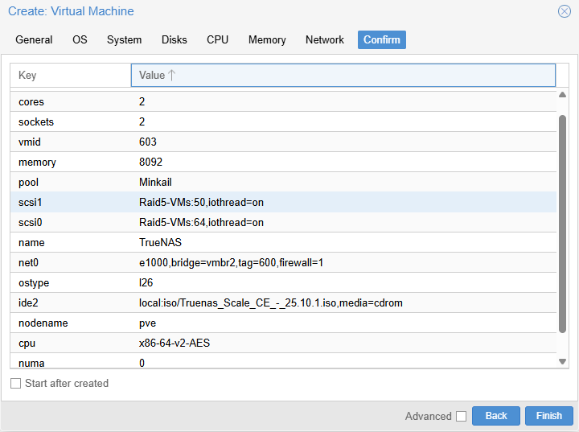

TrueNAS demande beaucoup plus de mémoire que Windows Server : 8 Gio, car le système de fichiers ZFS se sert de la RAM comme cache. Deux disques : un pour le système, un pour les données, afin que le pool de stockage reste séparé du système.

## 3. Installer TrueNAS

L'installateur écrit le système sur le disque de 50 Gio.

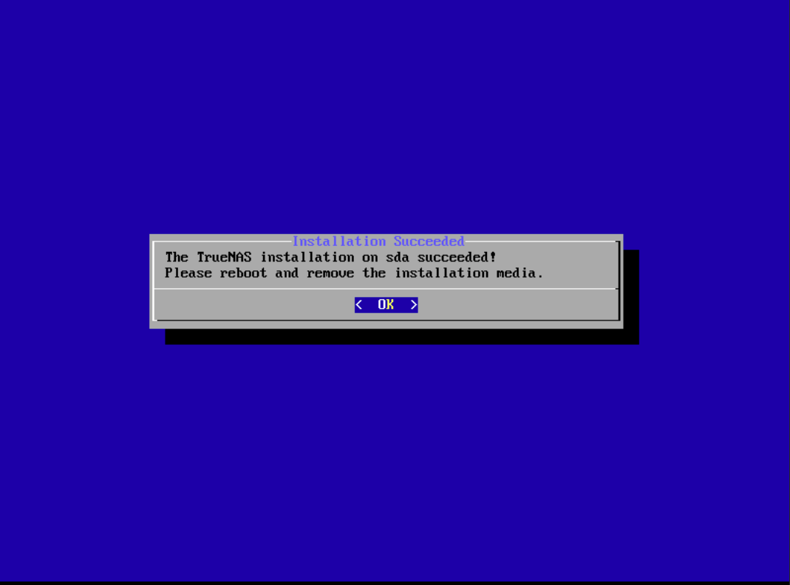

Après l'installation, l'ordre de démarrage de Proxmox place ce disque (`scsi1`) en premier, avant l'ISO : la VM démarre sur le système installé et non plus sur l'installateur.

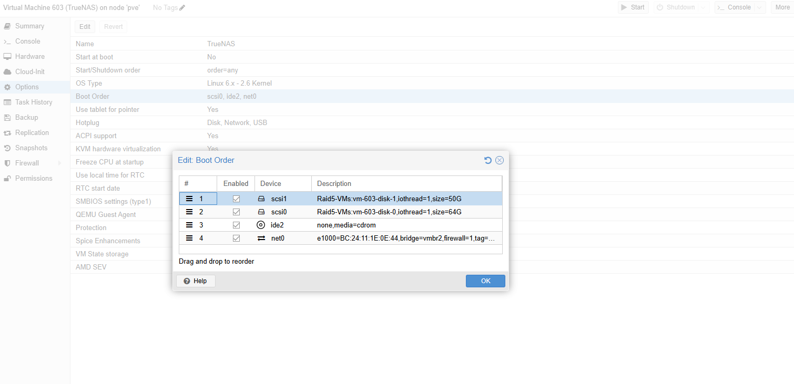

## 4. Configurer le réseau

Depuis la console de TrueNAS, *Configure network interfaces* : DHCP désactivé et adresse fixe `10.2.81.4/24` sur la carte `ens18`.

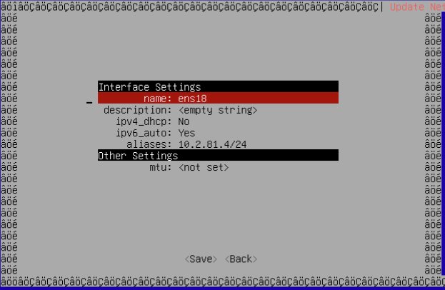

L'interface web est alors joignable depuis `CLIENT01` à l'adresse `http://10.2.81.4`.

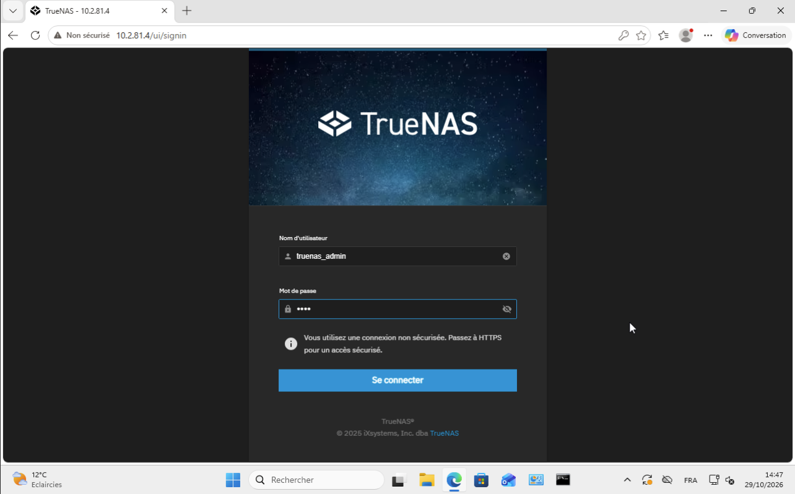

Dans *Système > Réseau*, je renseigne le nom d'hôte `truenas`, le domaine `redone.local`, les deux DNS des contrôleurs de domaine et la passerelle.

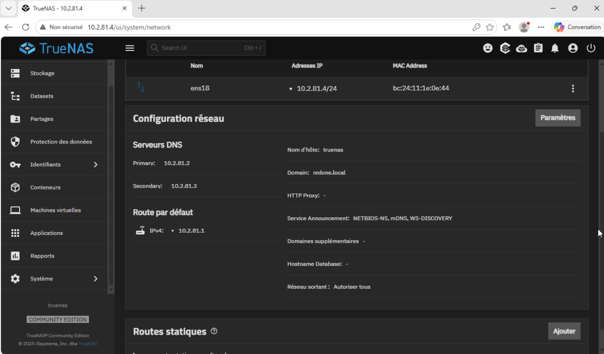

| Paramètre | Valeur | Pourquoi |
| --- | --- | --- |
| DNS primaire | 10.2.81.2 (`DC01`) | Seuls les contrôleurs connaissent `redone.local` : TrueNAS en a besoin pour joindre le domaine |
| DNS secondaire | 10.2.81.3 (`DC02`) | Le DNS reste disponible si `DC01` tombe |

Test depuis le shell de TrueNAS : `DC01` et le domaine répondent.

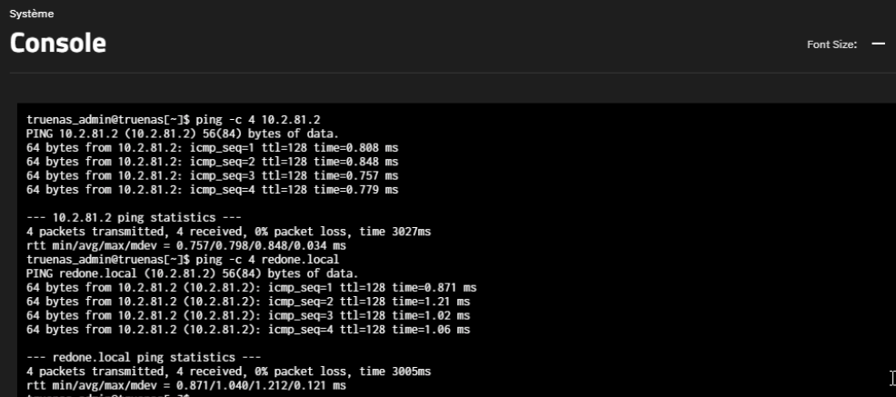

## 5. Créer le pool de stockage

Un **pool** regroupe des disques en un espace de stockage unique. J'utilise le disque de 64 Gio, avec une seule rangée de données en **stripe**.

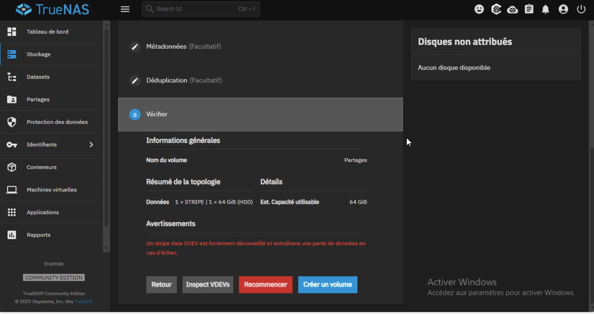

L'avertissement rouge est attendu : un stripe n'a **aucune redondance**, la perte du disque entraîne la perte des données. C'est acceptable pour un laboratoire avec un seul disque de données ; en production on utiliserait un miroir ou un RAID-Z. Le pool s'appelle `Partages`.

L'écran des disques confirme leur rôle : `sda` (64 Gio) porte le pool `Partages`, `sdb` (50 Gio) le système, dans le pool `boot-pool`.

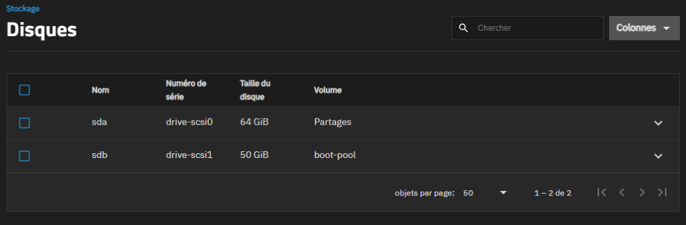

## 6. Joindre le domaine

*Identifiants > Services d'annuaire*, **Active Directory** : domaine `redone.local`, compte administrateur du domaine (authentification par nom d'utilisateur et mot de passe). Le statut passe à `HEALTHY`.

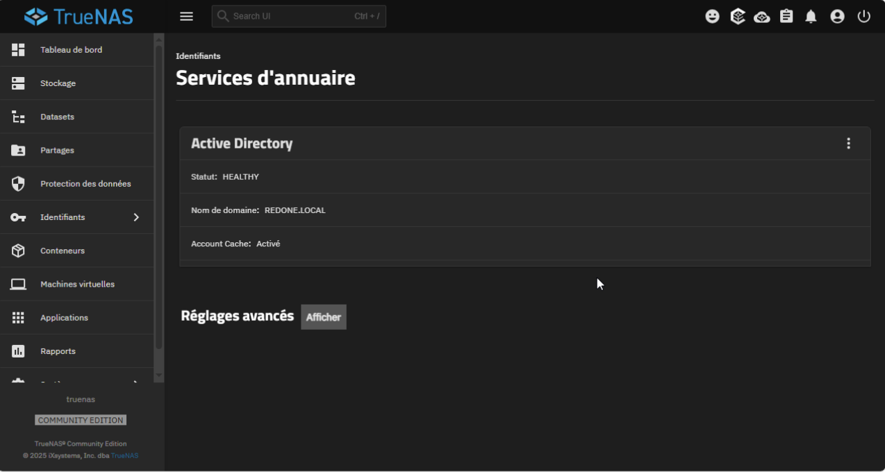

TrueNAS est maintenant membre du domaine : les comptes et les groupes de l'annuaire (`REDONE\GG_Accueil`, par exemple) peuvent recevoir des droits sur les partages.

## 7. Un dataset par service

Un **dataset** est un dossier géré par ZFS, avec ses propres droits, quotas et instantanés. Je crée un dataset par service dans le pool `Partages`, avec le préréglage SMB. Trois services suffisent pour la démonstration : `Accueil`, `Commercial` et `Direction-DSI` (les autres se créent de la même façon).

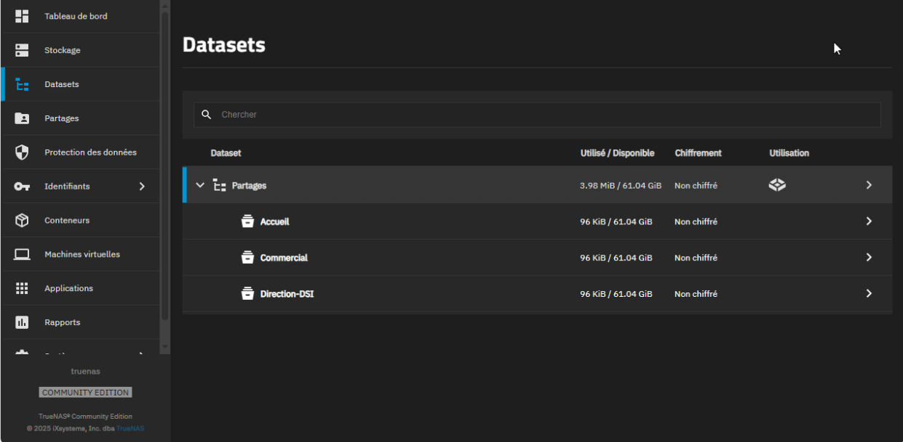

## 8. Droits par groupe

Pour chaque dataset, j'ouvre l'éditeur d'ACL et je commence par charger le préréglage **NFS4_RESTRICTED** : il ne donne aucun accès à « tout le monde ».

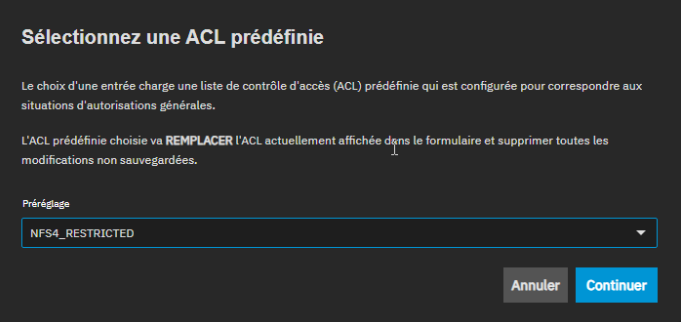

Puis je désigne le **groupe propriétaire** : le groupe du domaine du service, par exemple `REDONE\gg_commercial` pour le dataset `Commercial`. Le propriétaire est `root`.

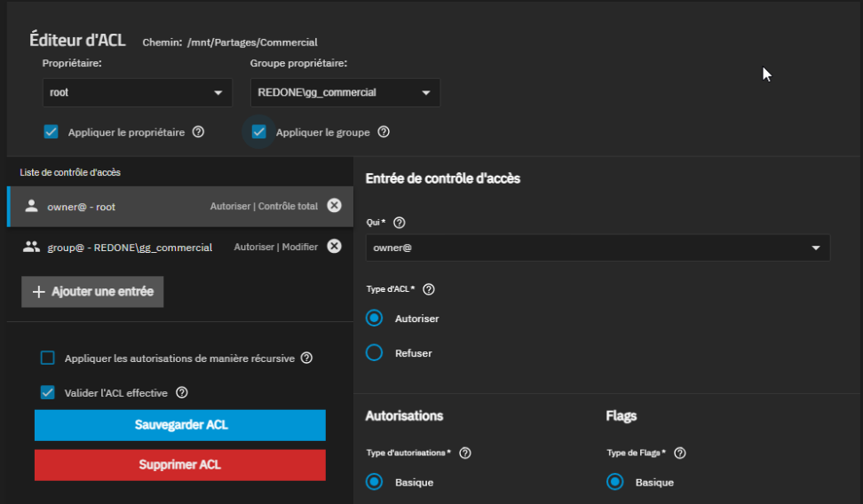

| Entrée | Droit | Effet |
| --- | --- | --- |
| `owner@` - `root` | Contrôle total | Administration du dataset |
| `group@` - `REDONE\gg_commercial` | Modifier | Les membres du groupe lisent et écrivent |

Personne d'autre n'a d'accès. Les droits sont donnés au **groupe**, jamais à un compte : le groupe de l'annuaire est celui créé au chantier 4.

## 9. Les partages SMB

Chaque dataset est publié par un partage SMB du même nom. Le service SMB est démarré (`RUNNING`).

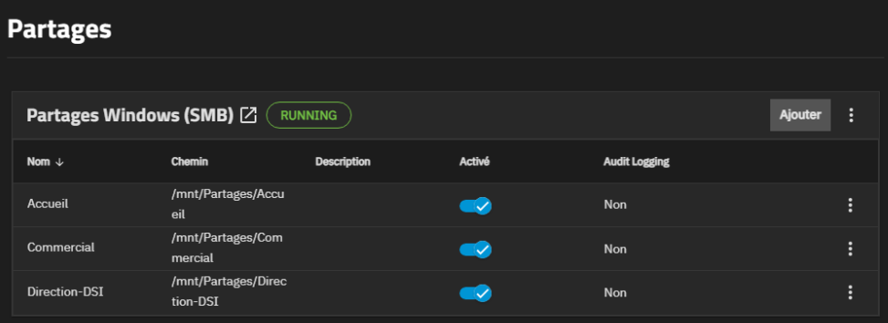

## 10. Tester depuis CLIENT01

Depuis `CLIENT01`, avec la session `REDONEdavid`, membre de `GG_Accueil` :

**Accès autorisé.** `\10.2.81.4\Accueil` s'ouvre.

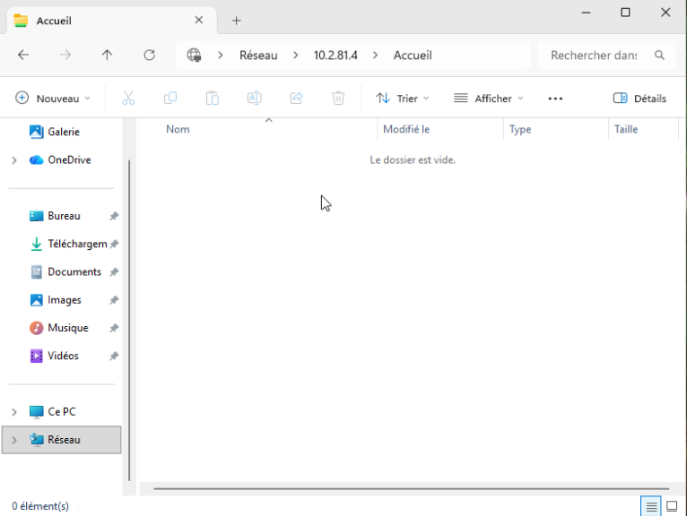

**Accès refusé.** `\10.2.81.4\Commercial` est refusé : Windows indique que l'utilisateur n'a pas l'autorisation d'accéder au partage, car `adavid` n'est pas membre de `GG_Commercial`.

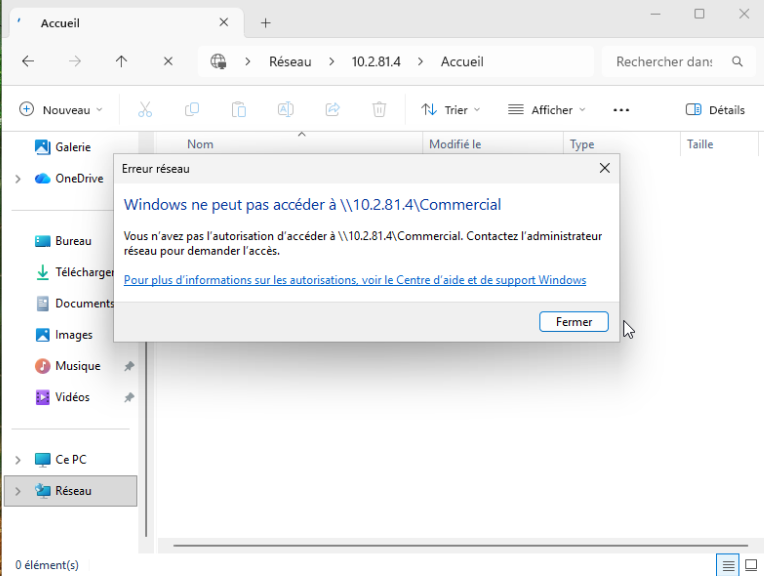

Le même utilisateur, sur le même serveur, accède à un partage et pas à l'autre : ce sont bien les groupes de l'annuaire qui décident, et non le poste.

## 11. Questions pour l'oral

- **Qu'est-ce qu'un pool ZFS ?** Un regroupement de disques en un espace de stockage unique, sur lequel on crée des datasets.
- **Pourquoi un stripe est-il déconseillé ?** Il n'a aucune redondance : si le disque tombe, tout est perdu. Un miroir copie les données sur deux disques.
- **Pourquoi 8 Gio de mémoire ?** ZFS utilise la RAM comme cache de lecture ; avec trop peu de mémoire, les performances s'effondrent.
- **Pourquoi le DNS de TrueNAS est-il celui des contrôleurs ?** La jonction au domaine repose sur le DNS : seuls les contrôleurs connaissent `redone.local`.
- **Pourquoi donner les droits aux groupes ?** Un changement de service se règle dans l'annuaire, sans retoucher les permissions de chaque partage.
- **Pourquoi un dataset par service ?** Chaque service a ses droits, ses quotas et ses instantanés, indépendamment des autres.
- **Qu'est-ce qu'une ACL ?** Une liste de contrôle d'accès : elle précise qui (un utilisateur ou un groupe) a quel droit (lecture, modification, contrôle total) sur un dossier.
- **Pourquoi `NFS4_RESTRICTED` ?** Ce préréglage ne donne aucun accès à « tout le monde » : seuls le propriétaire et le groupe désigné entrent.
- **Comment prouver que ça marche ?** Le même utilisateur accède à son partage et se voit refuser celui d'un autre service.
- **Quelle différence entre un snapshot et une sauvegarde ?** Le snapshot est stocké sur le même pool : si le pool disparaît, il disparaît avec lui.

Suite : [AP 1 : partages des services et lecteur S:](../../AP1/Partages-Services/Partages-Services.md).
