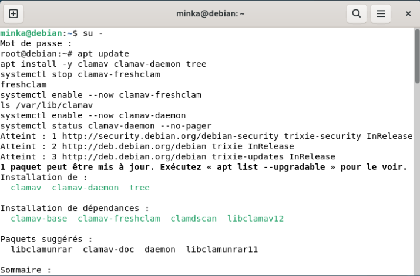
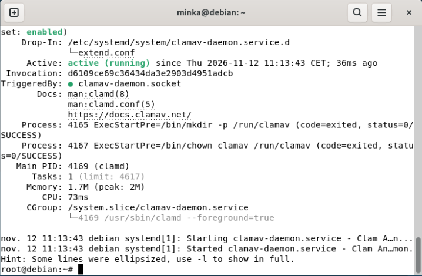
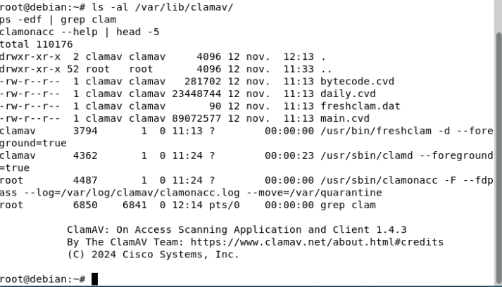
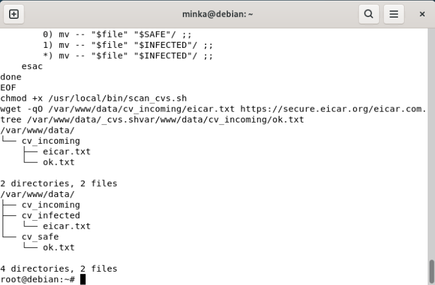
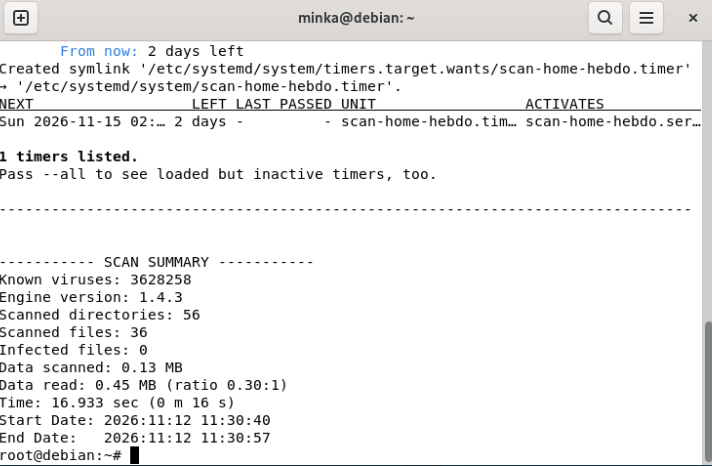
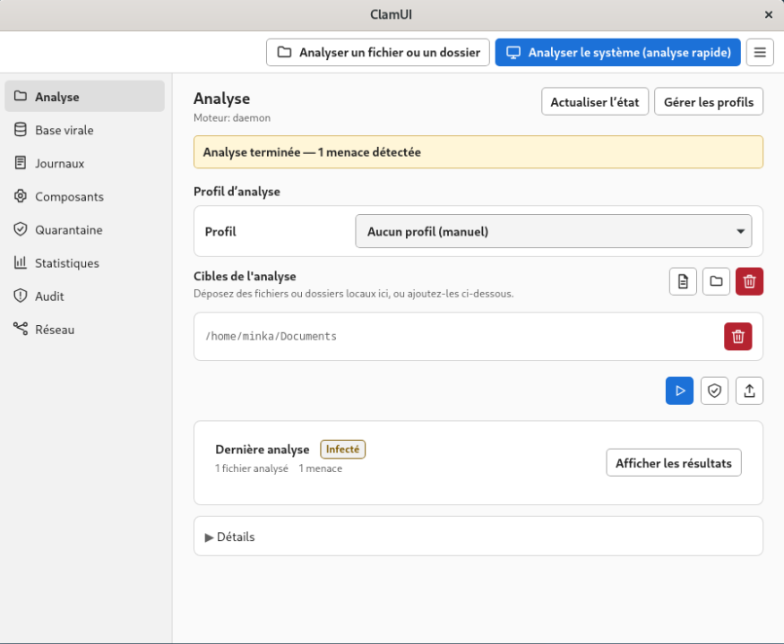

# TP - Antivirus ClamAV sur Debian 13

| | |
| --- | --- |
| **Énoncé** | [IT-Connect : Guide ClamAV](https://www.it-connect.fr/guide-clamav-installer-et-configurer-un-antivirus-sur-linux/) |
| **Machine** | [Poste Debian 13](../../Infrastructure/Client-Debian/Client-Debian.md), VM 604, 10.2.81.5 |
| **Réalisé le** | 12/11/2026 |

Les étapes suivent le tutoriel dans l'ordre. Chaque test utilise le fichier **EICAR** : un faux virus inoffensif, reconnu par tous les antivirus. Toutes les commandes sont lancées en root (`su -`), sauf mention contraire.

| # | Étape | Résultat |
| --- | --- | --- |
| 1 | Installation et signatures | ClamAV 1.4.3, 3 628 258 signatures |
| 2 | Démon `clamd` | Actif, signatures en mémoire |
| 3 | Test EICAR | Détecté et supprimé |
| 4 | Tri automatique des CV + cron | Fichier sain et fichier infecté triés |
| 5 | Protection en temps réel | Fichier bloqué et mis en quarantaine dès son téléchargement |
| 6 | Scan hebdomadaire | Programmé le dimanche à 2 h |
| 7 | Interface ClamUI (complément) | Menace détectée depuis l'interface |

## 1. Installation et signatures

```
apt update
apt install -y clamav clamav-daemon tree
systemctl stop clamav-freshclam
freshclam
systemctl enable --now clamav-freshclam
```

`freshclam` télécharge les bases de signatures dans `/var/lib/clamav`, puis le service `clamav-freshclam` les tient à jour automatiquement.



## 2. Démon clamd

```
systemctl enable --now clamav-daemon
systemctl status clamav-daemon
```

`clamd` garde les signatures en mémoire : les analyses sont immédiates, et c'est lui qu'utilisent le scan en temps réel et ClamUI.



Vérifications du tutoriel :

```
ls -al /var/lib/clamav/
ps -edf | grep clam
clamonacc --help | head -5
```

Les bases `main.cvd`, `daily.cvd` et `bytecode.cvd` sont présentes. `freshclam` et `clamd` tournent sous le compte `clamav`, sans privilèges. Le binaire `clamonacc` est bien installé.



## 3. Test EICAR

```
wget -O eicar.txt https://secure.eicar.org/eicar.com.txt
clamscan --infected --remove --recursive eicar.txt
```

`Infected files: 1` : le fichier est détecté puis supprimé.


## 4. Tri automatique des CV

Un site web dépose des CV dans `cv_incoming`. Le script les analyse et les range dans `cv_safe` (sain) ou `cv_infected` (infecté).

`/usr/local/bin/scan_cvs.sh` :

```bash
#!/bin/bash
INCOMING="/var/www/data/cv_incoming"
SAFE="/var/www/data/cv_safe"
INFECTED="/var/www/data/cv_infected"
LOG="/var/log/clamav/scan_cvs.log"

mkdir -p "$SAFE" "$INFECTED"

for file in "$INCOMING"/*; do
    [ -e "$file" ] || continue
    result=$(clamscan --stdout "$file" 2>&1)
    ret=$?
    echo "$(date '+%F %T') - $result" >> "$LOG"
    case "$ret" in
        0) mv -- "$file" "$SAFE"/ ;;      # sain
        1) mv -- "$file" "$INFECTED"/ ;;  # virus
        *) mv -- "$file" "$INFECTED"/ ;;  # erreur : par prudence
    esac
done
```

Test avec un fichier EICAR et un fichier sain : `eicar.txt` part dans `cv_infected`, `ok.txt` dans `cv_safe`.



Chaque analyse est tracée dans `/var/log/clamav/scan_cvs.log`.


Lancement automatique toutes les 15 minutes (`crontab -e`) :

```
*/15 * * * * flock -n /run/scan_cvs.lock /usr/local/bin/scan_cvs.sh
```

`flock -n` empêche deux scans de tourner en même temps.

## 5. Protection en temps réel

`/etc/systemd/system/clamonacc.service` :

```ini
[Unit]
Description=ClamAV On-Access Scanner
Requires=clamav-daemon.service
After=clamav-daemon.service syslog.target network.target

[Service]
Type=simple
User=root
ExecStart=/usr/sbin/clamonacc -F --fdpass --log=/var/log/clamav/clamonacc.log --move=/var/quarantine
Restart=on-failure

[Install]
WantedBy=multi-user.target
```

Ajout dans `/etc/clamav/clamd.conf` :

```
OnAccessPrevention yes
OnAccessIncludePath /home/minka/Téléchargements
OnAccessExcludeUname clamav
OnAccessExcludeRootUID yes
OnAccessExcludePath /proc
OnAccessExcludePath /dev
OnAccessExcludePath /sys
```

Le dossier Téléchargements est surveillé en permanence. Tout fichier infecté est déplacé dans `/var/quarantine` (droits `700`, accessible à root seulement).


**Test**, fait en tant que `minka` : les accès root sont exclus (`OnAccessExcludeRootUID yes`). À gauche, `minka` télécharge le fichier EICAR. À droite, le journal montre la détection et le déplacement en quarantaine. Téléchargements est vide.


## 6. Scan hebdomadaire

`/etc/systemd/system/scan-home-hebdo.service` :

```ini
[Unit]
Description=Scan ClamAV hebdomadaire de /home
Requires=clamav-daemon.service
After=clamav-daemon.service

[Service]
Type=oneshot
Nice=19
IOSchedulingClass=idle
ExecStart=/usr/bin/clamscan --recursive --infected --move=/var/quarantine --log=/var/log/clamav/scan-home-hebdo.log --exclude-dir="^/home/[^/]+/\.cache" /home
SuccessExitStatus=1
```

`/etc/systemd/system/scan-home-hebdo.timer` :

```ini
[Unit]
Description=Scan ClamAV de /home chaque semaine

[Timer]
OnCalendar=Sun *-*-* 02:00:00
Persistent=true

[Install]
WantedBy=timers.target
```

```
systemctl daemon-reload
systemctl enable --now scan-home-hebdo.timer
systemctl list-timers scan-home-hebdo.timer
systemctl start scan-home-hebdo.service
```

Le scan tourne chaque dimanche à 2 h, en priorité basse (`Nice=19`) pour ne pas gêner l'utilisateur. `Persistent=true` le rattrape au démarrage si la machine était éteinte. Le lancement manuel analyse `/home` sans infection.



## 7. Complément : interface ClamUI

[ClamUI](https://clamui.com/) est une interface graphique pour ClamAV. Elle n'est pas demandée par le tutoriel. Installation en tant que `minka` (paquet `flatpak` installé en root au préalable) :

```
flatpak remote-add --user --if-not-exists flathub https://dl.flathub.org/repo/flathub.flatpakrepo
flatpak install --user -y ./clamui-x86_64.flatpak
flatpak run io.github.linx_systems.ClamUI
```

ClamUI utilise le démon `clamd` configuré plus haut (« Moteur : daemon »).


**Test** : un fichier EICAR créé dans `~/Documents/test-virus`, hors du dossier surveillé en temps réel, puis analyse du dossier `/home/minka/Documents` depuis l'interface. Résultat : 1 menace détectée, statut « Infecté ».

```
echo 'X5O!P%@AP[4\PZX54(P^)7CC)7}$EICAR-STANDARD-ANTIVIRUS-TEST-FILE!$H+H*' > ~/Documents/test-virus/eicar.txt
```



## 8. Questions pour l'oral

- **`clamscan` ou `clamd` ?** `clamscan` recharge les signatures à chaque lancement, ce qui prend une quinzaine de secondes. `clamd` les garde en mémoire.
- **Pourquoi une quarantaine plutôt qu'une suppression ?** En cas de faux positif, le fichier peut être récupéré.
- **Pourquoi le test en temps réel est-il fait par `minka` ?** Les accès root sont exclus de la surveillance.
- **Limites de ClamAV ?** Il fonctionne par signatures : il détecte mal les menaces très récentes (0-day) ou obfusquées. Ce n'est pas un EDR.
