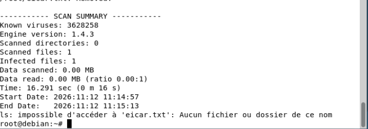
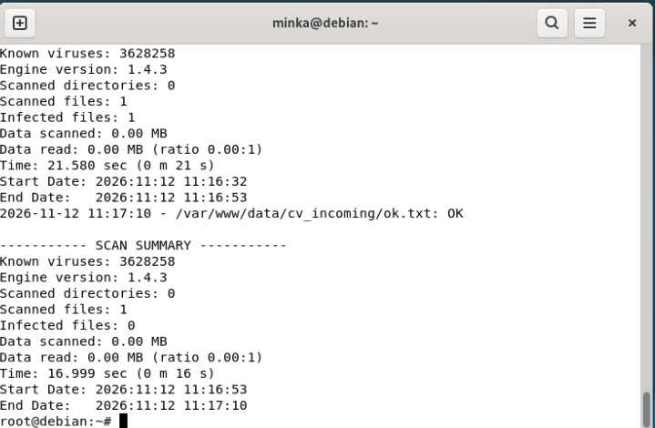
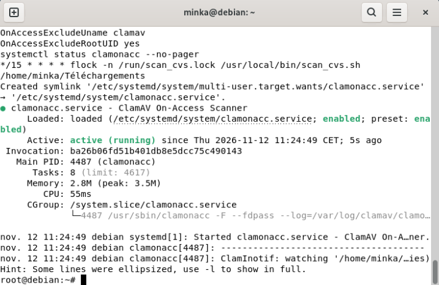
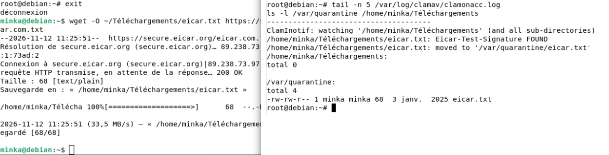
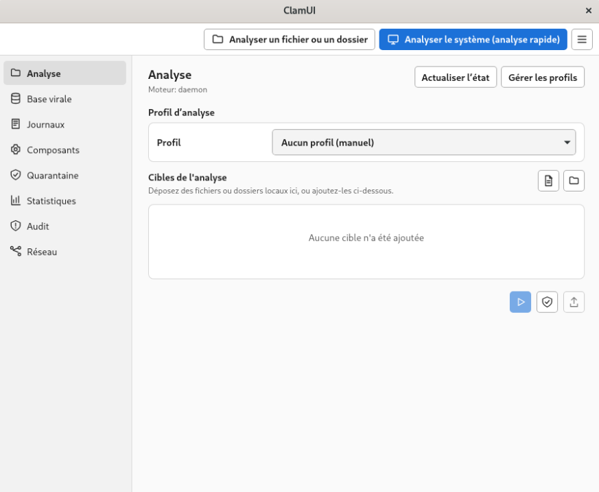
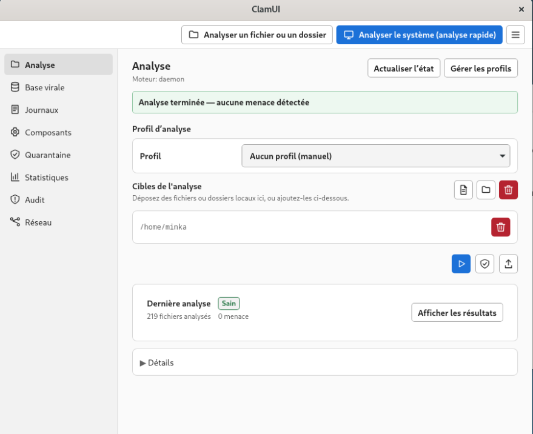

# TP - Antivirus ClamAV sur Debian 13

| | |
| --- | --- |
| **Énoncé** | [IT-Connect : Guide ClamAV, installer et configurer un antivirus sur Linux](https://www.it-connect.fr/guide-clamav-installer-et-configurer-un-antivirus-sur-linux/) |
| **Machine** | [Poste Debian 13](../../Infrastructure/Client-Debian/Client-Debian.md) `CLIENT-DEBIAN-linux` (VMID 604), 10.2.81.5, bureau GNOME |
| **Réalisé le** | 12/11/2026 |
| **Résultat** | ClamAV installé et à jour, scan manuel, tri automatique de fichiers déposés, protection en temps réel, scan hebdomadaire planifié, interface graphique ClamUI |

ClamAV est un antivirus libre fondé sur des signatures. Ce TP le met en place sur un poste Debian en suivant les sections du tutoriel dans l'ordre, puis ajoute en complément l'interface graphique ClamUI.

## 1. Composants mis en place

| Composant | Rôle |
| --- | --- |
| `clamscan` | Scanner en ligne de commande : charge les signatures à chaque lancement |
| `freshclam` (service `clamav-freshclam`) | Télécharge et maintient à jour les bases de signatures dans `/var/lib/clamav` |
| `clamd` (service `clamav-daemon`) | Démon qui garde les signatures en mémoire et répond aux demandes de scan |
| `clamonacc` (service `clamonacc`) | Scan à l'accès : surveille un dossier et transmet chaque fichier à `clamd` |
| `scan_cvs.sh` + `cron` | Tri automatique de fichiers déposés, toutes les 15 minutes |
| `scan-home-hebdo.timer` | Scan complet de `/home` chaque dimanche à 2 h |
| ClamUI | Interface graphique (complément, hors tutoriel) |

## 2. Installation et mise à jour des signatures

Toutes les commandes sont lancées en root (`su -`) : le compte `minka` n'est pas membre du groupe `sudo`.

```
apt update
apt install -y clamav clamav-daemon tree
systemctl stop clamav-freshclam
freshclam
systemctl enable --now clamav-freshclam
```

Le service `clamav-freshclam` est arrêté le temps de la première mise à jour manuelle, pour éviter que deux mises à jour ne s'exécutent en même temps. Les dépendances `clamav-base`, `clamav-freshclam`, `clamdscan` et `libclamav12` sont installées automatiquement.


## 3. Démon clamd

```
systemctl enable --now clamav-daemon
systemctl status clamav-daemon --no-pager
```

Le démon est `active (running)` et activé au démarrage. Il communique par une socket locale, plus sûre qu'un port TCP puisqu'elle n'est pas joignable depuis le réseau.


## 4. Premier test avec le fichier EICAR

Le fichier EICAR est un faux virus standardisé, inoffensif, que tous les antivirus détectent. Il sert à tester une protection sans risque.

```
wget -O eicar.txt https://secure.eicar.org/eicar.com.txt
clamscan --infected --remove --recursive eicar.txt
```

Résultat : `Infected files: 1`, le fichier est supprimé (`ls` ne le trouve plus). Le résumé montre **3 628 258 signatures** chargées et le **moteur 1.4.3**.



## 5. Tri automatique de fichiers déposés

Scénario du tutoriel : un site web dépose des CV dans `cv_incoming`. Un script les analyse et les range dans `cv_safe` ou `cv_infected`.

Script `/usr/local/bin/scan_cvs.sh` :

```bash
#!/bin/bash
INCOMING="/var/www/data/cv_incoming"
SAFE="/var/www/data/cv_safe"
INFECTED="/var/www/data/cv_infected"
LOG="/var/log/clamav/scan_cvs.log"

mkdir -p "$SAFE" "$INFECTED"

for file in "$INCOMING"/*; do
    [ -e "$file" ] || continue
    result=$(clamscan --stdout "$file" 2>&1)
    ret=$?
    echo "$(date '+%F %T') - $result" >> "$LOG"
    case "$ret" in
        0) mv -- "$file" "$SAFE"/ ;;      # sain
        1) mv -- "$file" "$INFECTED"/ ;;  # virus trouvé
        *) mv -- "$file" "$INFECTED"/ ;;  # erreur : quarantaine par prudence
    esac
done
```

Le tri repose sur le **code retour** de `clamscan` : 0 = sain, 1 = infecté, 2 = erreur. En cas d'erreur, le fichier est traité comme suspect.

Test avec un fichier EICAR et un fichier sain : `eicar.txt` part dans `cv_infected`, `ok.txt` dans `cv_safe`, `cv_incoming` est vidé.


Chaque analyse est tracée dans `/var/log/clamav/scan_cvs.log` : `ok.txt: OK` et `Infected files: 1` pour l'EICAR.



Planification toutes les 15 minutes (`crontab -e` en root) :

```
*/15 * * * * flock -n /run/scan_cvs.lock /usr/local/bin/scan_cvs.sh
```

`flock -n` empêche deux exécutions de se chevaucher si un scan dure plus de 15 minutes, comme le recommande le tutoriel.

## 6. Protection en temps réel (clamonacc)

Service `/etc/systemd/system/clamonacc.service` :

```ini
[Unit]
Description=ClamAV On-Access Scanner
Requires=clamav-daemon.service
After=clamav-daemon.service syslog.target network.target

[Service]
Type=simple
User=root
ExecStart=/usr/sbin/clamonacc -F --fdpass --log=/var/log/clamav/clamonacc.log --move=/var/quarantine
Restart=on-failure

[Install]
WantedBy=multi-user.target
```

Lignes ajoutées à `/etc/clamav/clamd.conf` :

```
OnAccessPrevention yes
OnAccessIncludePath /home/minka/Téléchargements
OnAccessExcludeUname clamav
OnAccessExcludeRootUID yes
OnAccessExcludePath /proc
OnAccessExcludePath /dev
OnAccessExcludePath /sys
```

| Paramètre | Rôle |
| --- | --- |
| `OnAccessPrevention yes` | Bloque l'accès au fichier tant qu'il n'est pas analysé |
| `OnAccessIncludePath` | Dossier surveillé, avec ses sous-dossiers |
| `OnAccessExcludeUname clamav` | Évite que ClamAV s'analyse lui-même en boucle |
| `OnAccessExcludeRootUID yes` | Ignore les accès faits par root |
| `OnAccessExcludePath` | Exclut les pseudo-systèmes de fichiers `/proc`, `/dev`, `/sys` |
| `--fdpass` | `clamd` reçoit le descripteur du fichier : il peut le lire même dans un dossier personnel |
| `--move=/var/quarantine` | Déplace le fichier infecté dans une quarantaine en droits `700` |

Le service est actif et surveille `/home/minka/Téléchargements`. La capture montre aussi la ligne de cron de la section 5.



**Test.** Le téléchargement est fait par **`minka`** et non par root : avec `OnAccessExcludeRootUID yes`, un fichier écrit par root ne serait pas analysé. À gauche, `minka` télécharge le fichier EICAR ; à droite, le journal montre la détection immédiate et le déplacement en quarantaine. Le dossier Téléchargements est vide (`total 0`), le fichier est dans `/var/quarantine`.



## 7. Scan hebdomadaire de /home (timer systemd)

Service `/etc/systemd/system/scan-home-hebdo.service` :

```ini
[Unit]
Description=Scan ClamAV hebdomadaire de /home
Requires=clamav-daemon.service
After=clamav-daemon.service

[Service]
Type=oneshot
Nice=19
IOSchedulingClass=idle
ExecStart=/usr/bin/clamscan --recursive --infected --move=/var/quarantine --log=/var/log/clamav/scan-home-hebdo.log --exclude-dir="^/home/[^/]+/\.cache" /home
SuccessExitStatus=1
```

Timer `/etc/systemd/system/scan-home-hebdo.timer` :

```ini
[Unit]
Description=Scan ClamAV de /home chaque semaine

[Timer]
OnCalendar=Sun *-*-* 02:00:00
Persistent=true

[Install]
WantedBy=timers.target
```

| Paramètre | Rôle |
| --- | --- |
| `Nice=19`, `IOSchedulingClass=idle` | Priorité la plus basse sur le processeur et le disque : le scan ne gêne pas l'utilisateur |
| `--exclude-dir` | Exclut les caches des utilisateurs, inutiles à analyser |
| `SuccessExitStatus=1` | Un virus trouvé (code 1) n'est pas un échec du service |
| `OnCalendar` | Tous les dimanches à 2 h |
| `Persistent=true` | Rattrape le scan au démarrage suivant si la machine était éteinte |

Le timer est programmé pour le dimanche 15/11/2026 à 2 h. Un lancement manuel (`systemctl start scan-home-hebdo.service`) analyse 56 dossiers et 36 fichiers, sans infection : l'EICAR est déjà en quarantaine.


## 8. Complément : interface graphique ClamUI

[ClamUI](https://clamui.com/) est une interface graphique pour ClamAV. Elle n'embarque ni moteur ni signatures : elle pilote le ClamAV déjà installé. Elle n'est pas demandée par le tutoriel, qui la cite seulement en ressource.

Installation par le paquet Flatpak publié sur [GitHub](https://github.com/linx-systems/clamui) (Flathub ne propose qu'une version plus ancienne), en tant que `minka` :

```
flatpak remote-add --user --if-not-exists flathub https://dl.flathub.org/repo/flathub.flatpakrepo
flatpak install --user -y ./clamui-x86_64.flatpak
flatpak run io.github.linx_systems.ClamUI
```

Le paquet `flatpak` est installé au préalable en root. Le dépôt Flathub fournit seulement le runtime nécessaire à l'application.

L'interface utilise le démon `clamd` configuré plus haut (« Moteur : daemon ») et donne accès à l'analyse, la base virale, les journaux, la quarantaine, les statistiques et un audit de sécurité.



Analyse de `/home/minka` depuis l'interface : 219 fichiers analysés, aucune menace.



## 9. Écarts avec le tutoriel

| Tutoriel | Ici | Raison |
| --- | --- | --- |
| Commandes avec `sudo` | Commandes en root (`su -`) | `minka` n'est pas dans le groupe `sudo` |
| Dossier surveillé `/home/flo/Téléchargements` | `/home/minka/Téléchargements` | Compte utilisateur de la machine |
| Fichier EICAR créé avec `echo` | Téléchargé avec `wget` depuis eicar.org | Même fichier, sans risque d'erreur de saisie |
| Dossier `cv_incoming` supposé existant | Créé avec `mkdir -p` | Le script ne crée que `cv_safe` et `cv_infected` |
| Cron sans protection | `flock -n` ajouté | Applique le conseil du tutoriel sur les exécutions qui se chevauchent |

## 10. Limites et questions pour l'oral

- **Quelle différence entre `clamscan` et `clamd` ?** `clamscan` recharge les signatures à chaque lancement (une quinzaine de secondes ici). `clamd` les garde en mémoire, ce qui permet le scan en temps réel et les analyses rapides.
- **Pourquoi le test en temps réel est-il fait par `minka` et pas par root ?** `OnAccessExcludeRootUID yes` exclut les accès root : un fichier écrit par root ne serait pas analysé.
- **Pourquoi une quarantaine plutôt qu'une suppression ?** En cas de faux positif, le fichier peut être récupéré. La quarantaine est en droits `700` : seul root y accède.
- **Pourquoi cron pour les CV et un timer systemd pour `/home` ?** Le tutoriel montre les deux méthodes. Le timer apporte en plus le rattrapage (`Persistent=true`), la priorité basse et les journaux de systemd.
- **Quelles sont les limites de ClamAV ?** Il repose sur des signatures : il détecte mal les menaces très récentes (0-day) ou fortement obfusquées. Ce n'est pas un EDR, et les scans consomment du processeur sur de gros volumes.
